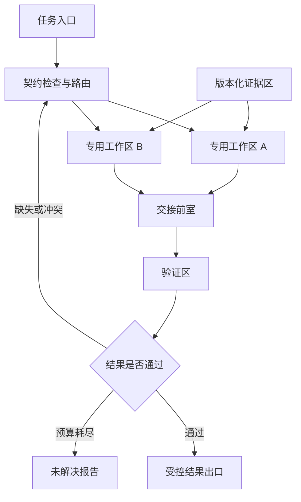

# 用建筑学弥合 AI 差异：异构智能体协作空间设计提案

观点与方向：吴孟城（Windy Wu）；方案整理：AI 辅助  
日期：2026-11-03  
状态：设计提案，尚未实现或验证；属于本 fork 的研究讨论，不代表上游作者立场。

## 1. 从社论到正面方案

[前一篇社论](ai_village_editorial_zh.md)质疑的是：将智能体聚在一起，再用人类社会故事替代机制解释。由此继续推导，建筑学能够提供另一种思考方式：**通过设计环境中的边界、邻接、通行和公共设施，使不同系统能够协作。**

本提案借用的是建筑设计中的组织问题，并把每项类比转为可测的软件约束。它不是某个建筑学理论已被证明适用于 AI 的文献结论，也不把数字房间当成具有物理效果的真实建筑。

“弥合差异”指降低接口错配、信息损失和交接失败，使能力能够互补；不要求模型输出同一种观点，更不宣称消除了感知差距。不同模型仍可保留不同判断，系统必须能表达“不兼容”“有争议”和“证据不足”。

## 2. 先测量差异，再画平面图

角色名称不能代替能力评估。每个接入者需有版本化能力记录，区分自报能力与通过固定任务测得的能力。

| 差异轴 | 入场记录 | 设计响应 | 无法弥合时 |
| --- | --- | --- | --- |
| 模态 | 可接受的文本、图像、音频与张量格式及测试记录 | 配置显式转换前室 | 无适用转换器则拒绝路由 |
| 语义 | 单位、坐标系、术语、输出结构 | 共享契约与版本化转换 | 未知单位或定义则请求澄清 |
| 上下文和记忆 | 接收预算、持久化范围、来源回溯能力 | 摘要加原文索引、按需读取 | 关键证据装不下则拆分任务 |
| 时序 | 响应时间分布、超时、有效期 | 异步交接、队列限额 | 迟到结果标记过期 |
| 工具与权限 | 已授予操作、环境及身份来源 | 专用工作区与出口检查 | 能力不足不得靠角色提示补齐 |
| 可靠性 | 按任务分类的错误率、校验覆盖 | 独立验证与争议保留 | 无法验证则输出未解决 |
| 物理接口 | 关节布局、量纲、时间基准、设备边界 | 单独的运动数据适配层 | 无真实接口验证则限于离线研究 |

记录必须绑定模型版本、配置和测试环境。模型更新使既有测量需要复核；“最强模型”不是永久通行证。权限来自可信主机策略，不接受模型自报的权限字段作为授权。

## 3. 将建筑元素转成系统机制

| 建筑设计概念 | 本提案的软件机制 | 要弥合的差异 | 验证办法与代价 |
| --- | --- | --- | --- |
| 功能分区 | 感知、规划、转换、验证分别运行 | 工具和专业能力不同 | 比较错误传播；分区增加交接成本 |
| 邻接关系与动线 | 任务依赖图决定消息接收者 | 信息需求不同 | 测无关信息量和路径长度；防止路由绕远 |
| 门与门禁 | 契约校验、身份校验、最小权限 | 权限和输入要求不同 | 注入越权请求；检查门禁实际执行位置 |
| 前室 | 转换后等待接收方确认 | 模态、单位与格式不同 | 测语义损失；转换失败不得放行 |
| 公共阅览区 | 版本化、可追溯的证据存储 | 记忆长度和信息可见性不同 | 测检索成功率；记录访问权限与快照 |
| 声学分隔 | 私有推理工作区、定向摘要 | 上下文容量和注意力分配不同 | 测通信量；防止隔离造成证据缺失 |
| 无障碍通道 | 同一证据的适用表示与回溯入口 | 接收模态不同 | 检查任务相关信息保留程度 |
| 检修通道 | 审计记录、回放、人工纠错 | 可解释与可维护性需求不同 | 检查可重建性；审计不得泄露私有数据 |

例如，为只能接收文本的模型提供图像描述，只解决了部分可访问性问题。细节、空间关系和描述者的错误可能损失或传递；关键视觉判断仍需回到原图或有相应能力的验证者。转换器不能把不存在的感知能力“补成已验证”。

房间名本身不提供隔离。未来实现需由宿主的进程、存储和权限机制执行这些边界；提示词中的“不要进入”不能充当门禁。

## 4. 最小空间布局

下图是逻辑拓扑，不表示实际物理建筑或已经部署的服务。

工作区只能提交候选产物。证据区写入经来源登记处理，已有版本不可被摘要覆盖。前室检查结构、语义标签和转换记录；验证区检查任务判据。验证者可以使用同一原始材料，但必须记录依赖关系，不能因换了一个模型名字便声称证据独立。

路由回路必须有最大交接次数、总体截止时间和预算上限，避免无限返工。示例限额属于实验参数，不是部署推荐值。

## 5. 交接契约与失败语义

伴随文件 [ai_collaboration_handoff_example.json](ai_collaboration_handoff_example.json) 是一个可解析的静态示例，不是已实现的 API、JSON Schema 或执行日志。示例描述将厘米转换为米的交接；数值正确仅证明该算术例子，不证明模型之间达成理解。

未来交接记录至少包含：

- 身份与绑定：协议版本、任务 ID、消息 ID、发送者、接收者、任务修订号。
- 数据语义：产物版本或摘要、结构、单位、坐标系、模型及配置版本。
- 证据：来源引用、证据快照、转换前后引用、转换器版本、保留信息与丢失信息。
- 控制：主机设置的有效期、允许操作、剩余预算、最大跳数。
- 接收回执：接受、拒绝或需要澄清，以及接收方理解的关键约束和独立校验结果。

建议状态为 CREATED → VALIDATED → DELIVERED → ACKNOWLEDGED → VERIFIED → RELEASED。任何状态都可在策略允许时进入 REJECTED、EXPIRED 或 CANCELLED；已释放结果发生撤回时，必须另发失效通知并要求消费者处理，不能假称历史输出已被收回。

ACKNOWLEDGED 仅表示接收方认可交接契约，不等于其解答正确。VERIFIED 由任务专用检查决定；RELEASED 由可信出口决定，二者不能由智能体自填标签代替。

同一任务修订中的重复消息按消息 ID 与内容摘要去重。相同 ID 配不同内容必须报错；旧任务修订、过期证据和撤回后的结果不能在出口重新获得有效性。缓存亦应绑定这些版本。

格式正确不能防止提示注入；来源材料始终按数据处理，不获得修改系统策略的权限。共享区不是所有任务无条件可读的公共群聊。

## 6. 一个具体场景：视觉 AI 与运动规划 AI

假设 A 能解析场景图像，B 擅长在指定运动格式下产生候选计划，C 执行确定性的格式和约束检查。

1. 入口先明确任务是离线运动研究，声明所需坐标系、单位和输入证据。
2. A 提交场景标记及来源；不确定尺度或遮挡必须显式保留。
3. 前室只在尺度依据与坐标变换明确时转换。像素位置不能自行冒充米制位置。
4. B 接收转换结果后复述约束，并提交结构化候选产物；缺少尺度即请求澄清。
5. C 校验单位、坐标、格式和任务约束。通过仅表示已检查项目通过，不表示真实机器人动作安全。
6. 出口生成离线报告；涉及物理执行的授权属于另一个经验证的系统。

用建筑语言表达：A 和 B 不必搬进同一间“脑房”，但它们之间的门、通道和交付窗口必须适配。能力差异因环境设计而变得可管理，尚未解决的能力缺口则保持可见。

## 7. 与 MotionBricks 的连接点

| 已有材料 | 本提案可复用的原则 | 本次修改范围 |
| --- | --- | --- |
| [TPU 接入提案](tpu_integration_protocol.md) | 后端能力声明、显式数据契约、单位与坐标边界 | 参考设计；不新增 TPU 支持 |
| [乘员主导倒数](crew_countdown.md) | 新鲜度、任务阶段、明确撤回、人工命令边界 | 不接入倒数或改变状态机 |
| [AI village 社论](ai_village_editorial_zh.md) | 行为与机制分开，限制社会外推 | 补充正面的可检验设计 |

智能体群体的多数意见不产生乘员授权。任何未来适配器均不得替人生成 resume、confirm 或刷新人类同意时间戳。空间拓扑只组织信息与产物，不改变谁有决定权。

本提案尚未接入 MotionBricks 推理、运动播放或真实设备。下一阶段应先实现无外部副作用的 CPU 交接仿真，验证路由、拒绝和回执，再考虑真实模型接口。

## 8. 怎样检验“建筑学”是否真的有用

先固定任务、模型版本、权限、总计算预算和截止时间，再比较：

| 条件 | 设计 | 目的 |
| --- | --- | --- |
| A：单智能体 | 单模型、完整任务、相同预算上限 | 检验多智能体的必要性 |
| B：共享群聊 | 相同智能体、全员广播 | 作为信息拓扑基线 |
| C：分区与契约 | 定向路由、前室、证据区、验证区 | 检验完整设计 |
| D：命名对照 | 与 C 完全相同，仅用中性模块名替代建筑词汇 | 排除“建筑”标签造成的叙事效果 |

C 与 B 使用相同模型集合和公共任务规则。必要的契约提示、路由处理、转换及验证成本都计入 C，不能当作免费资源。A 使用预先指定的模型，不在看到结果后挑选最弱基线。

对 C 逐项移除前室、来源追踪或定向路由，做消融比较；结构检查、权限和禁止物理执行的底线在所有条件保持一致。

建议首轮离线任务覆盖单位错配、坐标缺失、上下文不足、证据冲突、迟到消息与重复消息六类。每类先固定 10 个独立任务，每个条件重复 3 次，作为探索性规模，不声称统计功效充分。重复运行不是新的独立任务；比较以任务为配对单位，记录随机种子及不可控的服务端随机性。

主要指标是“在截止时间内通过预先指定判据的任务比例”，其次报告：

- 语义错配漏检率与正确交接误拒率。
- 未支持断言被下游采纳的比例，以及来源追踪完整率。
- 每个成功任务的总资源消耗、通信量和端到端延迟。
- 冲突保留、澄清成功与预算耗尽比例。
- 非法权限请求在出口被放行的次数。

运行前固定判据和成本容忍范围；对任务配对差异报告区间，不只展示成功故事。不确定性区间跨越无改善时，结论应为证据不足。若收益只来自额外计算、单个优质模型或更强验证器，就不能归因于空间拓扑。

对于刻意构造的权限用例，任何非法放行都阻止进入下一阶段；有限用例全部通过仍不构成普遍安全证明。

## 9. 感知理论的适用边界

沿用仓库中已明确的理解核验思路：先确认任务对象，再准确复述交接契约，随后在新单位、缺失坐标或过期证据情境中应用规则。复述正确仍需用客观测试验证实际应用。

要求至少三位人类理解结论的环节，应另做真实人工评阅，不能由三个 AI 代替。人体与机器人的感知、力量和温度差距也不会因新增“房间”消失，需要各自的实验。本提案不补写尚未明确的层级定义。

## 10. 当前证据与下一步

本 PR 只增加设计文档与静态 JSON 示例。已检查 JSON 语法、示例单位换算和仓库内引用目标；没有运行真实多模型实验，没有证明成功率、成本或安全性改善。

实现顺序建议：先做交接状态和版本校验；再加入可审计的单位转换与确定性验证；随后对同一组真实模型运行上述对照实验。只有取得结果后，才能决定哪些分区值得保留、合并或拆除。

核心假说是：**AI 之间的差异可以通过适配其能力的协作环境得到缓解，而无需先假定它们构成一个人类式社会。** 能否成立，交给交接成功率、错误传播和真实成本来回答。
