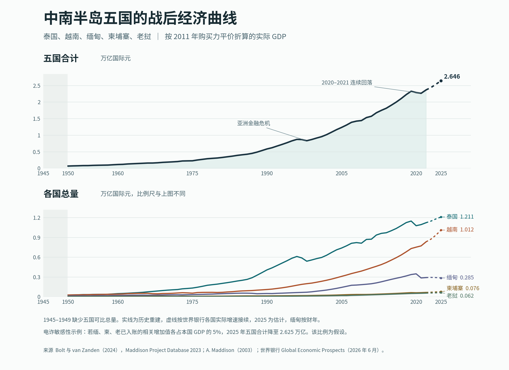

# 电已经用了，人能不能走？中南半岛五国的 GDP 与胁迫下的同意

> 电已经用了，房子已经建了，烟花也打了，人不当人了

——吴孟城，2026 年 11 月 22 日讨论原话。

## 战后曲线

这里按今天的泰国、越南、缅甸、柬埔寨、老挝五国统计，未含西马。1950 年五国实际 GDP 合计约 697 亿国际元，到 2025 年估计为 2.646 万亿，约为起点的 38 倍。1950 年泰、越两国体量相近，1990 年泰国约为越南的 3.7 倍。1996 至 1998 年间，亚洲金融危机使五国合计自高点回落约 4.6%。2010 至 2025 年，越南贡献了区域净增量的约 54%。总量会掩盖局部冲击：2021 年缅甸经济下跌约 18%，五国合计只跌约 1%。红色高棉时期连人口都难以可靠重建，图上的线条不宜用来推断柬埔寨人的生活状况。[缅甸经济监测](https://www.worldbank.org/en/country/myanmar/publication/myanmar-economic-monitor-july-2021-progress-threatened-resilience-tested) · [柬埔寨特别法庭人口资料](https://www.eccc.gov.kh/sites/default/files/documents/courtdoc/E3_2413_EN.PDF)

[逐年数据（CSV）](annual.csv)中，五个国家列与 total 均以十亿个 2011 年不变价国际元为单位。index 以 1950 年五国总量为 100，3share 是缅、柬、老合计占五国总量的比重（0 至 1）。1945–1949 年缺少同口径总量，保留空值。1950–2022 年按 Maddison 的各国实际人均 GDP 乘以年中人口，再加总。2023–2025 年将各国上一年总量分别乘以“一加该国实际增速”。2025 年使用世行 2026 年 6 月版估计，缅甸按财年。接续值是本文计算结果。[Bolt 与 van Zanden，Maddison Project Database 2023](https://doi.org/10.34894/INZBF2) · [Maddison 历史统计](https://doi.org/10.1787/9789264104143-en) · [世界银行增速表](https://thedocs.worldbank.org/en/doc/2b672b3b0415d6b66c45b66579db4ef5-0050012026/related/GEP-Jun-2026-Regional-Highlights-EAP.pdf)

## 电诈能扣掉多少

被骗走的一笔本金是受害人的财产损失。园区使用的电力、房屋租赁及中介服务，则可能在当地形成已经入账的增加值。要编一条扣除电诈关联活动的曲线，需要逐国识别已经计入 GDP 且可归因于园区的本地增加值，并避免重复扣除中间投入。美国和平研究所估算柬埔寨电诈年所得超过 125 亿美元；这个按当期美元计的犯罪所得，不能直接从按购买力平价计的实际 GDP 中扣除。[Eurostat 非法经济活动核算手册](https://unstats.un.org/unsd/nationalaccount/docs/KS-05-17-202-EN-N.pdf) · [美国和平研究所报告，第 8–9 页](https://www.usip.org/sites/default/files/2024-05/ssg_transnational-crime-southeast-asia.pdf)

只为检验数量级，设缅、柬、老各有本国 GDP 的 5% 属于已入账的电诈关联增加值。三国合占五国总量约 16.0%，故 2025 年合计下调约 0.80%，由 2.646 万亿降至 2.625 万亿国际元。**5% 是假设，实际比例未知。** 图中主线保留基准总量。这个算式衡量直接扣除的影响；如果没有园区，当地人本来会在哪里工作、土地会怎样利用，则是另一个问题。

## 高压下仍然能选什么

“被拿枪指着头”在讨论中是比喻。各案例的压力与当事人还能做的事各有不同。

| 人物 | 当时的选择和代价 |
| --- | --- |
| 天文学家哥白尼 | 担忧学说招致嘲笑，仍于 1543 年出版《天体运行论》，让读者能够检查计算。他生前出版此书时并未面对持枪威胁。[斯坦福哲学百科](https://plato.stanford.edu/entries/copernicus/) |
| 物理学家威廉·韦伯 | 1837 年与另外六位教授签名抗议汉诺威国王废除宪法，遭到解职。直到 1849 年他才回到哥廷根任教。[哥廷根大学](https://www.uni-goettingen.de/en/74927.html) |
| 植物遗传学家尼古拉·瓦维洛夫 | 面对政治打压仍批评李森科的遗传理论。1940 年被捕，死刑获减刑后，1943 年死于狱中。[档案研究](https://doi.org/10.1111/1600-0498.12059) |
| 儿科医生雅努什·科尔恰克 | 1942 年德方将华沙孤儿院的孩子押往特雷布林卡。科尔恰克、副手维尔琴斯卡和其他职员一直陪着孩子们。[美国大屠杀纪念馆](https://encyclopedia.ushmm.org/content/en/article/janusz-korczak-1) |
| 物理学家安德烈·萨哈罗夫 | 公开反对苏联出兵阿富汗后，1980 年未经审判被流放。流放期间，他又为妻子获准出国就医而绝食。[哈佛大学萨哈罗夫档案](https://hollisarchives.lib.harvard.edu/catalog/hou01977) |

这些选择值得记住。一个遭胁迫的人为了活下来而服从，同样有资格获救。检验政府的保护是否抵达园区里的人，一个具体问题就够了：他今天说要走，能不能平安走出去？

## 报酬、保护承诺与拒绝权

讨论也借 CIA 和克格勃提出一条对情报机构的要求：线人可以提出合作条件，机构可以拒绝；接受条件并取得协助之后，就负有守约责任。这是作者的伦理主张。两家机构在某次行动中是否守约，需要该案证据。

如果会上承诺“你可以拒绝”，考验就在他真的拒绝、计划因此落空的那天。他是否还能回家？原先承诺的保护还算不算数？事后泄露身份，风险也落到了从未答应参与的家人身上。事后赔偿仍有意义，却补不出事前的同意。

> 这不是钱多少可以解决的问题，正如诈骗的gdp核算剔除不了一样

——吴孟城，讨论原话。

回到那只电表：用掉几度电可以计量。一个被扣下护照的人原本打算怎样过这几年，电表给不出答案。
