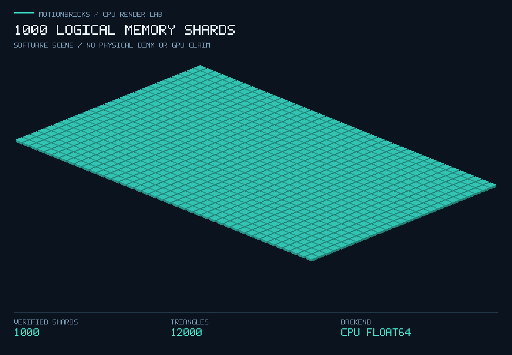

# 1000 根 DDR4 设想：Skylake-X 装机规划与 CPU 伪 GPU 渲染

创意与需求：吴孟城（Windy Wu）。实现：AI 辅助。记录日期：2026-11-08。

本实验承接 [PR #48](https://github.com/wu709621493/motionbricks/pull/48) 的离线电压、电流与温度检查，落实“用 matrices 调用 1000 根 DDR4、在 CPU 和内存中模拟伪 GPU 运行态，再做 rendering”的设想。可执行成果是 **1000 个逻辑内存分片的真实 CPU 运算与软件光栅化**。采购、物理装机和目标主板测试尚未完成。



## 平台与采购状态

本次沿用讨论中的 ASUS ROG Rampage VI Extreme Encore + Intel Core i9-7980XE。这里的 Skylake 是 **Skylake-X / LGA2066**；不能把所有名为 Skylake 的处理器当作同一种插槽。这个选择作为高端旧平台实验对象，不宣称它在当前全球市场上仍是“最新、最贵”的兼容主板。

| 项目 | 核验值与约束 |
| --- | --- |
| 主板 | ASUS ROG Rampage VI Extreme Encore，X299，LGA2066 |
| CPU | Intel Core i9-7980XE，18 核 / 36 线程，165 W TDP |
| CPU 支持 | ASUS CPU 清单列出该 CPU，支持 BIOS 自 0401 起 |
| 内存拓扑 | 8 个 DIMM 插槽，4 个内存通道 |
| 内存种类 | 非 ECC、非缓冲 DDR4；不能用便宜的服务器 RDIMM 直接替代 |
| CPU 官方容量上限 | 128 GB；不能直接套用主板面向其他 CPU 的 256 GB 标称上限 |
| CPU 官方内存规格 | DDR4-2666；XMP / 超频不能视作默认稳定工况 |
| 首阶段方案 | 同一套经 QVL 核验的 4 × 16 GiB，再评估 8 × 16 GiB |
| 当前采购状态 | 浏览器购物车中 1 块主板，尚未付款、未下单、未装机 |

2026-11-08 的 Newegg 浏览器页面显示商品小计 $948.04，卖家 InfiniteEnergyPmax Co., Limited；商品页曾显示运费 $29.99，最终运费、税费及送达条件仍需地址后结算。报价只是当时观察，不是发票或有效期承诺。没有选购 125 块主板或 1000 根实物内存。软件渲染不依赖 Shop / Shopify。

### 为什么一块主板装不下 1000 根

按每根 16 GiB、每台 8 根计算：

- 总原始容量：1000 × 16 GiB = 16000 GiB = **15.625 TiB**。
- 插槽与容量下限：ceil(1000 / 8) = **125 台节点**。
- 125 台各有自己的 CPU、内存控制器、电源域和操作系统；它们不是一台拥有透明共享内存的普通桌面电脑。

125 台只是槽位和容量的算术下限，不是完整采购方案。当前代码没有跨节点网络、RDMA、分布式一致性或远程调度后端。实际扩展应把矩阵按块分配给节点，尽量使运算靠近本地数据，批量交换边界或结果，避免逐元素网络访问。PR #48 的电气检查需要按真实电源域分别采样，不能把 1000 根内存的电压平均成一个“健康”值。

## 可执行程序

代码入口：[memory_lab.py](../motionbricks/memory_lab.py)、[worker](../motionbricks/memory_lab_worker.py)、[renderer](../motionbricks/memory_lab_render.py)。Python 3.12 / 3.13，POSIX；隔离依赖只有 NumPy，不安装主工程的 CUDA / TensorRT 依赖。

```bash
python3 -m venv .venv-memory-lab
. .venv-memory-lab/bin/activate
python -m pip install -r tools/memory_lab/requirements.txt

# 规划模式只使用 Python 标准库，不分配实验内存。
python -S -m motionbricks.memory_lab plan --dimms 1000 --dimm-gib 16

# 首次小规模运行。PNG 必须使用尚不存在的路径。
mkdir -p /tmp/motionbricks-memory-lab
python -m motionbricks.memory_lab run \
  --logical-shards 1000 --memory-mib 64 --matrix-size 32 \
  --tile 16 --threads 1 --timeout-s 60 \
  --render /tmp/motionbricks-memory-lab/first.png \
  > /tmp/motionbricks-memory-lab/first.json

python -m unittest discover -s tests/memory_lab -v
```

执行过程如下：

1. 检查参数、可用内存与可见的 cgroup 限制；导入 NumPy 和分配大数组前，在父进程及子进程各检查一次。估计工作内存不超过当前可用内存的一半，并至少留出 512 MiB；估计包含矩阵工作区、渲染缓冲及解释器 / BLAS 余量。它是准入估计，不是内核强制的 RSS 上限。
2. 创建一个连续 uint64 内存池，均匀分成 1000 个互不重叠的逻辑分片。每个 64 位字写入与地址有关的模式及其反码，每轮完整读回核验，能够在测试中检出比特翻转与分片交换。
3. 每片存放 float64 的 A、B、C 矩阵。运行分块 `C = A @ B`；CPU 逐块排队，复制 A/B 子块作为功能性的 shared memory，以累加块模拟寄存器状态，记录加载、计算和屏障顺序。使用独立的 Python 整数点积作为结果判据，每次 launch 都校验。
4. 保留整个池，依次跑不同尺寸矩阵乘法，改变工作集。然后可选生成三维场景，最后再核验池内 A/B/C 和所有未使用尾部数据，确保整个已分配池仍正确。
5. 监督进程设置 BLAS 线程数与总时限，超时或取消时终止并回收子进程组。失败退出非零，返回错误状态；不会把超时或子进程异常写成通过。

这是一条 CPU 队列的功能模型，不执行 CUDA/PTX，不模拟 warp 时序、真实 GPU 寄存器分配或 GPU 带宽。操作系统决定页面与物理内存的映射；逻辑分片编号不能选择真实 DIMM。NumPy / BLAS 可使用 CPU SIMD 和多线程，实际性能依赖运行主机。

## Rendering 如何调用伪 GPU 态

每个已校验分片对应一个立体模块。模块高度与青色深浅由该分片 C 矩阵的平均绝对值决定，不是温度、实物容量或 GPU 利用率。

- 每模块 8 个顶点，按 4 个顶点一批，经同一个 `CpuBlockRuntime.launch` 计算 4 × 4 相机变换；再用独立标量点积校验坐标。
- 每模块 12 个三角形，共 12000 个。CPU 在 16 × 16 像素块中计算重心坐标、深度插值、遮挡和面着色。
- float64 Z-buffer 选择最近表面；等深度用固定三角形编号裁决。单元测试验证近面遮挡、乱序提交一致性、裁剪、退化三角形和解析深度值。
- PNG 使用标准库编码，附图像 SHA-256、可见对象数、顶点数、覆盖像素数和执行时间；不调用真实 GPU。PNG 输出采用独占创建，防止悄悄覆盖上一轮结果。

场景是可复现的软件渲染，不是主板照片。商店插件不是渲染后端，也不需要为了这项实验开设商店。

## 本次实际运行

[原始 JSON](results/memory_lab/host_run.json) 和 [PNG](results/memory_lab/1000_shards.png) 随代码入仓。原始报告中的绝对输出路径保留了运行时环境；仓库内请使用以上相对链接。

```bash
python -m motionbricks.memory_lab run \
  --logical-shards 1000 --memory-mib 256 --matrix-size 32 \
  --tile 16 --rounds 2 --threads 2 \
  --cache-sizes 16 64 256 1024 2048 --timeout-s 90 \
  --render docs/results/memory_lab/1000_shards.png \
  > docs/results/memory_lab/host_run.json
```

复现时更换输出文件名；不要覆盖已入仓的证据。

| 测量项 | 本次结果 |
| --- | --- |
| 实际主机 | Linux x86_64，OS 报告 AMD EPYC 9V74；不是目标 Skylake-X 主机 |
| 软件 | Python 3.12.14，NumPy 2.3.5 |
| 内存池 | 256 MiB，1000 个逻辑分片全部验证 |
| 地址模式检查 | 2 轮；共检查 67108864 个 64 位字 |
| 末次保留数据检查 | 33554432 个 64 位字，0 个不匹配 |
| 分片矩阵乘法 | 2000 次 32 × 32 launch，所有输出逐元素校验 |
| 渲染 | 1440 × 1000；1000 / 1000 个对象可见 |
| 顶点 / 三角形 | 8000 个已校验顶点；12000 个三角形 |
| 渲染变换调用 | 2000 次额外 kernel launch |
| 渲染覆盖像素 | 357495 |
| 渲染耗时 | 约 1.591 秒，含坐标校验及 PNG 写入 |
| Worker 总耗时 | 约 3.008 秒，不含父进程启动与 NumPy 导入 |
| Worker 峰值 RSS | 401293312 字节，约 382.7 MiB |

矩阵工作集按 `3 × N² × 8` 字节计算：

| N | 三矩阵工作集 | matmul 中位耗时，3 次 |
| --- | --- | --- |
| 16 | 6 KiB | 约 1.90 μs |
| 64 | 96 KiB | 约 10.28 μs |
| 256 | 1.5 MiB | 约 0.682 ms |
| 1024 | 24 MiB | 约 23.26 ms |
| 2048 | 96 MiB | 约 183.28 ms |

这些是一次云端运行的观测，微秒级计时容易受噪声影响，不能移植为 Skylake 或 GPU 性能预测。没有采集硬件 cache hit/miss 计数；当前环境也没有暴露 CPU cache 描述。程序确实访问全部已分配池，并测试多种工作集，但不能证明“所有物理 RAM 和所有 cache 都已用满”。把系统内存占满会改变实验为换页或 OOM，不能提高这项计算验证的可信度。

## PR #48 衔接与实机步骤

`run --power-trace <trace.json>` 可先调用 PR #48 的 `review_trace`。超限的离线记录阻止 worker 启动；通过仅代表记录在其声明范围内，不代表当前硬件被实时监控或授权加压。PR #48 的默认演示数据是合成数据，不能直接当作这套 DDR4 的测量阈值。每个实机电源域应使用自身验证过的 DDR4 参数及采样记录。

实体装机待硬件到位后进行，repo 只记录流程：

1. 核对主板型号、CPU 支持清单、实际 BIOS、内存 QVL、套装型号和容量；按主板手册确定 4 DIMM / 8 DIMM 的插槽顺序。
2. 断电装配 LGA2066 CPU、匹配散热器、内存和电源；使用符合主板尺寸的机箱与可靠散热。i9-7980XE 没有处理器集成显卡，显示输出另需独立显示设备方案；本 CPU 渲染程序本身不需要 GPU。
3. 首次使用固件默认内存频率，核对识别容量、通道和温度；记录 BIOS 与内存料号。超频与改固件不属于本次实现。
4. 先跑 64 MiB 软件验证，再根据空闲内存逐步扩大到 1 GiB、8 GiB 等规模；始终留出系统余量。需要独立物理内存诊断时另行安排启动环境，不能把本程序当作完整 DRAM 故障诊断。
5. 记录目标主机真实报告并与本次云端基线比较。1000 小时寿命、电压安全与热稳定需要专门实验，当前报告没有这些结论。

## 验证与限制

本地 Python 3.12.14 / 3.13.5（均使用 NumPy 2.3.5）各通过新增 25 项测试；另通过 PR #48 的 29 项电气模型测试和 31 项 preflight 回归测试。

新增 25 项测试覆盖物理规划、参数范围、内存准入、父级 cgroup 限额、地址模式、独立矩阵判据、错误状态保持、别名拒绝、超时回收、PR #48 失败拦截、PNG 编码、解析光栅化、深度与渲染集成。现有 CPU preflight 工作流加入本套测试和 1000 分片渲染 smoke run，覆盖 Ubuntu x86_64 / ARM64、macOS ARM64、Python 3.12 / 3.13；以实际 CI 结果为准。

可用内存是瞬时读数，其他进程可能竞争资源。隐藏的容器上层配额和非标准 cgroup v1 挂载可能无法被识别。程序没有内核强制 RSS 上限；需要严格隔离时应在配置了内存上限的外部容器或服务中运行。输出文件可能在被外部强制终止时留下不完整数据，只有最终 `status: PASSED` 的 JSON 才算本次执行通过。

## 一手资料

- [ASUS CPU 支持清单](https://rog.asus.com/motherboards/rog-rampage/rog-rampage-vi-extreme-encore-model/helpdesk_cpu/)
- [ASUS 主板技术规格](https://rog.asus.com/us/motherboards/rog-rampage/rog-rampage-vi-extreme-encore-model/spec/)
- [Intel i9-7980XE 官方规格](https://www.intel.com/content/www/us/en/products/sku/126699/intel-core-i97980xe-extreme-edition-processor-24-75m-cache-up-to-4-20-ghz/specifications.html)
- [ASUS 主板手册与文档入口](https://rog.asus.com/motherboards/rog-rampage/rog-rampage-vi-extreme-encore-model/helpdesk_manual/)
- [NumPy 线性代数与 BLAS 说明](https://numpy.org/doc/stable/reference/routines.linalg.html)
- [CUDA 编程模型：线程块、共享内存等概念来源](https://docs.nvidia.com/cuda/cuda-programming-guide/01-introduction/programming-model.html)
- [Linux cgroup v2 内存控制器](https://www.kernel.org/doc/html/latest/admin-guide/cgroup-v2.html)
- [当时核对的 Newegg 商品页](https://www.newegg.com/asus-rog-rampage-vi-extreme-encore-extended-atx-intel-motherboard-intel-x299-lga-2066/p/N82E16813119326)
