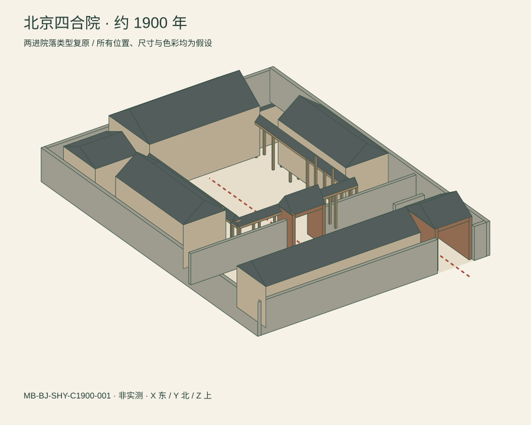

# 北京四合院：约 1900 年数字档案

档案号 **MB-BJ-SHY-C1900-001**，版本 1.0.0，整理日期 2026-11-07。构想：吴孟城（Windy Wu）；AI 辅助史料整理、建模和程序实现。

本档案以**两进四合院的类型复原**保存空间关系、构件名称、资料出处及未确定事项。尚无真实宅址或完整实测资料。`1900` 是约略的时代锚点，不能解释为某一天、某一住户宅院的精确快照。所有位置、尺寸、高度和色彩都是显式建模假设。



## 打开和使用

下载本目录后，用浏览器打开 [index.html](index.html)。模型、资料卡和 JSON 数据均内嵌，不请求 CDN、不需安装依赖，离线可用；点击来源链接时才需联网。GitHub 文件预览通常显示 HTML 源码，不会运行交互页。

- 立体视图可旋转、隐藏屋顶、选择构件、显示导览线。
- 北向平面图支持点选和键盘 Enter／空格；构件下拉框提供等价入口。
- 史料页分开展示拍摄日期、出版日期、来源用途与限制。
- 无 JavaScript 时可看 [平面 SVG](plan.svg)、[立体 SVG](axonometric.svg)、[JSON 档案](catalog.json)及本说明。

## 归档内容

| 文件 | 用途及边界 |
| --- | --- |
| `catalog.json` | 20 个构件、4 条来源、坐标系、档案身份、未知项及几何证据状态；由主数据生成 |
| `plan.svg` | 北向体量平面图和模型比例尺；不是建筑施工平面图，未细分房间或门窗 |
| `axonometric.svg` | 固定初始视角的立体体量图，可直接在仓库中查看 |
| `courtyard.obj` | 米制三维体量，X 东、Y 北、Z 上；几何对象名称对应构件 ID，无贴图、家具或动画 |
| `courtyard.scene.json` | 对接 MotionBricks scene v1 的 Unitree G1 外部空间；屋顶用长方体包络表达 |
| `index.html` | 单文件交互浏览器；使用与 OBJ 相同的顶点和面数据 |
| `manifest.json` | 7 个导出文件中除清单自身外的 6 个文件的 SHA-256；不涵盖本说明或远端来源原件 |

权威编辑源是 [`data/heritage/beijing_siheyuan_1900.json`](../../../data/heritage/beijing_siheyuan_1900.json)。导出目录中的 `catalog.json` 是只读副本；请修改主数据并重建，避免两份版本分叉。

## 空间解释与证据分层

本例选取北侧正房、东西厢房、南侧倒座、耳房、东南街门、影壁、卡子墙、垂花门和示意游廊。前院与内院通过垂花门联系。两进是本次选型，不能代表全部北京住宅；一进、多进及跨院等类型不在本模型内。[BJ2019][ICH-STUDY][BJ2020]

| 层次 | 本档案如何使用 |
| --- | --- |
| 同期材料目录 `primary` | LOC 照片的馆藏元数据支持其自己的拍摄与出版记录，不支持本模型的尺度 |
| 类型依据 `typological` | 后世建筑研究与保护资料支持构件名称和关系；没有据此声称某栋房子在 1900 年实际存在 |
| 建模假设 `hypothesis` | 全部几何参数、具体地块、院墙布置、展示颜色；每个构件的 `geometry_evidence` 独立保存 |

房间用途只作可能性介绍。未给住户命名，也未把代际、性别和社会身份固定分配到房间。原始资料不足时，用 `null` 或未知项表达缺口，不用“1900 年标准户型”补全。照片所示为富裕家庭，不能代表全城居民。[LOC1900]

## 史料登记与日期辨析

| ID | 来源与定位 | 可支持的内容 | 限制 |
| --- | --- | --- | --- |
| LOC1900 | [美国国会图书馆 LCCN 2006681326](https://www.loc.gov/item/2006681326/)，Notes、Created / Published | 馆藏说明将 James Ricalton 的照片关联至 1900 年旅程；出版于 1902 年 | 已核对官方检索目录，直接正文抓取受 403 限制；未下载图片、未作图像测绘，未识别宅址 |
| BJ2019 | [北京老城保护房屋修缮技术导则（2019版）](https://zjw.beijing.gov.cn/bjjs/xxgk/zcwj2024/gfxwj40/xxyx/436464671/2024060611455397127.pdf)，附录 A 建筑空间关系及 5.0.4—5.0.9 | 空间与构件术语的技术参照 | 已读取 PDF；不是同期测绘，现代修缮条款没有作为历史配置采用；链接中的 2024 不是版本年份 |
| ICH-STUDY | [赵玉春：北京四合院传统营造技艺的历史文化形态](https://www.ihchina.cn/art/detail/id/21922.html)，基本形式相关段落 | 内外院、房屋、门与廊的类型解释 | 已读取正文；回顾性研究，未独立核实发布日期，不能推断为 1900 年某户实录 |
| BJ2020 | [首都之窗：北京传统民居——老北京四合院](https://www.beijing.gov.cn/tsbj/sxym/202007/t20200713_1946380.html)，2020-07-13 | 围合庭院的基本组成 | 已核对官方检索记录；不同实例不能拼成同一院落的连续历史 |

这是来源索引与原创结构化摘要，不是外部文献原件的完整数字保全。照片的拍摄年 `1900` 和出版年 `1902` 分字段存储，并有防混淆测试。具体院落在 1900 年内的状态、损坏、修复和居住变化均未确定。

## 几何与 MotionBricks 接口

假设地块为 24 × 32 米（768 平方米），原点在西南角地面。两图使用同一平面定义；二维图北向固定，立体可旋转。此尺度为本例的展示参数，无统计代表性或实测依据。

房屋是封闭实心体量。街门、垂花门以两侧实体和顶部构件留出通行开口；廊道由柱和屋盖表示。屋顶仅用三角棱柱近似坡顶；垂花门的悬柱雕饰、复杂屋顶、榫卯、门窗、瓦作、室内陈设及生活设施没有复原。

在已有 MotionBricks 运行环境中，可尝试：

```sh
uv run python -m app.scene_editor docs/heritage/beijing_siheyuan_1900/courtyard.scene.json
uv run python -m app.scene_preview --scene docs/heritage/beijing_siheyuan_1900/courtyard.scene.json
```

场景字段与本仓库 scene v1 源码契约核对；初始化点位于街门外。OBJ 的坡顶在 `.scene.json` 中使用包围长方体，所以两者碰撞形状并不完全相同。文件没有 Smart Primitive、自动导航或历史人物动作；沿线自由移动仍须实际运行验证。GPU 推理、编辑器加载和人物碰撞未在本环境测试，原运行时条件继续适用。

## 复现和验证

在仓库根目录，用 Python 3.12 或 3.13：

```sh
python -S tools/siheyuan/build.py
python -S tools/siheyuan/build.py --check
python -S -m unittest discover -s tests/siheyuan -v
```

生成器仅用标准库，无需导入 `motionbricks`、Warp 或 CUDA。生成物具有确定性，`--check` 逐字节验证已提交结果与 SHA-256 清单。此版绘图布局针对当前假设地块；更换地块类型或大幅改变尺度时应同步审查画布、坐标和页面说明。

检查覆盖来源引用、重复 ID、非有限及非法尺寸、日期区分、封闭且朝外的 OBJ 网格、场景字段、导出一致性、HTML 数据转义和导览线遇阻。导览净空只按半径 0.35 米、高 1.8 米的简化包络及 0.05 米采样验证，不能证明人体或机器人动态通行，也不构成无障碍或建筑安全结论。

已将平面与固定视角立体 SVG 渲染为图像并检查；浏览器脚本通过语法检查。本环境的浏览器访问策略限制了本地整页预览，桌面／移动端交互、下载按钮和键盘操作仍需浏览器实测。CI 验证只包含明确列出的 CPU 检查，不代表这些界面或历史事实已经获得验证。

## 后续档案接入

补入具体胡同、门牌、测绘图、地契或同期照片时，先创建独立的实址档案号，并记录来源编号、档案页码、拍摄／绘制／出版日期、访问日期与权利条件。保持此类型样例可追溯，不用新证据覆盖旧假设的历史记录。只有对应构件有可核实的实测证据时，才提升其几何证据状态。

当前未建模后罩房、跨院、花园、水井、炕、灶、厕所或近代设施；这表示信息不足，不表示当时不存在。具体地基、构造、人员生活史与 1900 年内状态变化需要独立考证。

代码遵循 Apache-2.0；本扩展原创文字、数据、SVG 和 OBJ 几何采用 CC-BY-4.0。外部资料的权利条件独立适用。本档案未改变上游模型、动作数据或文档的许可。
