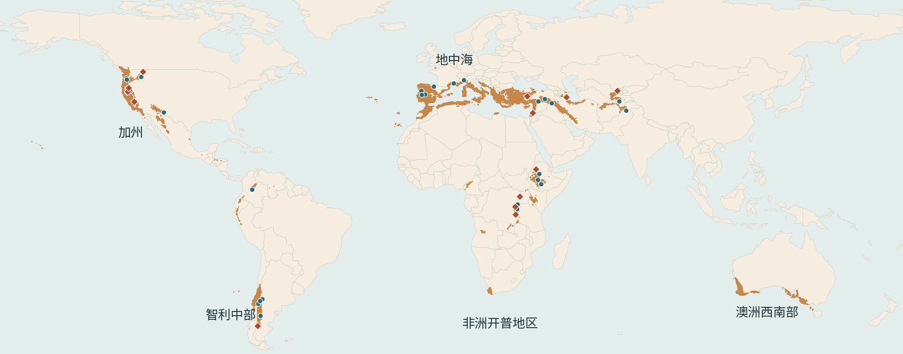
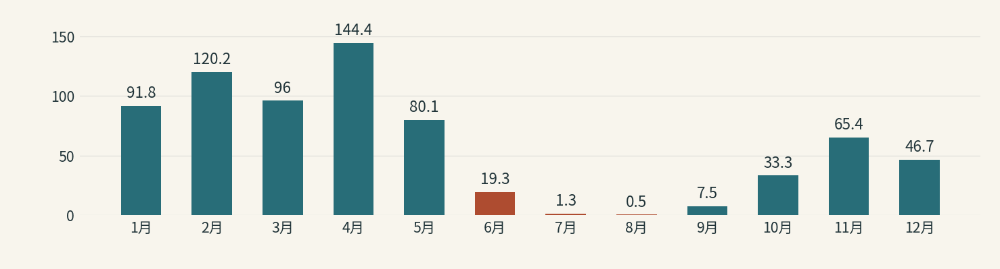
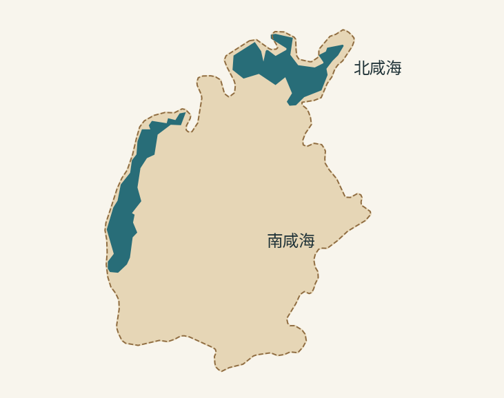

# 地中海气候：系咸水海噶一枝独秀，定系内陆水系噶元素乱流？

对于欧亚大陆以及全球范围内内陆河、湖、海订造噶微型地中海气候全统计特刊

[六页排版版（PDF）](atlas.pdf) · [773 条河湖记录（CSV）](waterbodies.csv)

意大利加尔达湖西岸，有一种房子专门畀柠檬过冬。夏天抬头，见到一排排石柱托住蓝天；到冬天，果农就用柱顶嘅横梁架起屋顶。旅行者望见一树黄果，觉得地中海跟咗上山。果农望住同一棵树，惦记嘅系几时要封棚。[〔柠檬园档案〕](https://www.visitgarda.com/en/Lemons-Lake-Garda-VisitGarda/)

**■　夏干温带陆地格网●　河段邻近点◆　湖、库或里海邻近点**

橙色画出全球 Csa、Csb、Csc 分布。每条筛中记录只标一个最近的合格内陆格点，部分点重叠。五处文字标示传统地中海型气候区的大致位置。底图与分析源自 Natural Earth、Beck 等。

从地中海盆地到加州、智利中部、南非开普同澳洲西南，夏季副热带高压令空气下沉，冷季风暴又有机会送雨上岸。呢个跨大陆嘅节奏，淡水河一样可以流经；至于岸边一阵风、一晚少结嘅霜，附近嗰片水自己就有份。[〔五区环流研究〕](https://ocp.ldeo.columbia.edu/res/div/ocp/pub/seager/Seager_etal_MedClimates_2ndrev.pdf)

果园同雨量计讲嘅可能系两件事。要问一片水有几大本事，不妨先去一个离海更远嘅地方。塔吉克斯坦首都杜尚别，两条河喺山前相遇，八月嘅常年雨量却只有半毫米。水明明喺脚下，点解唔落返嚟？

## 河在流，八月得半毫米雨

沿瓦尔佐布河逆流而上，水路通往希萨尔山嘅积雪同冰川；顺流经卡菲尔尼甘河（Kofarnihon），就进入阿姆河、咸海嘅内流流域。杜尚别呢段河身上有两份日历。一份记山上嘅雪几时化，一份记城里几时落雨。河水带得落山，山上落雪嗰日嘅天气就带唔落嚟。[〔流域资料〕](https://www.seep.tj/files/3/Information%20materials/Eng/SEEP-IEE%20for%20Dushanbe%20Subproject%20%28v_2022_11_09%29%20EN.pdf)

杜尚别站　｜　1991–2020 年各月平均降水量，毫米

北纬 38.58°、东经 68.73°，海拔 800 米。十二个月合计 706.5 毫米；六月至八月共 21.1 毫米，只占 3.0%。四月最多雨。[气象厅站表](https://www.data.jma.go.jp/tcc/tcc/products/climate/climatview/graph_mkhtml_nrm.php?e=6&k=0&m=9&n=38836&r=1&s=1&y=2026) · [常年值说明](https://www.data.jma.go.jp/tcc/tcc/products/climate/explanation/normal.html)

站址对应嘅气候格网属于热夏型 Csa。西风送来水汽，山脉迎风一面迫使气流抬升，中亚西南部许多地方嘅降水峰值落在春季。用「冬雨」两个字概括地中海型，一路讲到杜尚别，就要容得落这个四月。[〔中亚降水观测〕](https://acp.copernicus.org/articles/24/12203/2024/)

### 加尔达湖嘅风，认得条山路

当地人叫嗰阵午后南风做 *Ora*。研究者用十年记录比较北岸同深入山谷约 30 公里嘅气象站。最暖几个月，岸边约七成日子有呢阵风；岸站起风嗰啲日子，约八至九成连山里嗰支风向标都会转，平均迟三个半钟。呢个先系湖岸送出嚟、一路追踪得到嘅信号。至于成个夏季有几干，风向标仲欠一部雨量计。[〔双站风记录〕](https://iris.unitn.it/handle/11572/115666)

### 绕住里海行，雨也会换面

本刊筛中嘅一个里海西南岸格点在北纬 38.75°、东经 48.85°。沿南岸向厄尔布尔士山走，偏北湿气流亦可以带来强降水。将一粒 Csa 色点放大到成圈里海，最先畀你漏走嘅，正正系迎风山脚嗰场大雨。[〔南里海强降水〕](https://doi.org/10.1038/s41598-025-29026-x)

## 地图数到嘅四十五条记录

本刊翻查全球小比例尺地图内每一条可用记录。先找离通海海岸至少 50 公里嘅夏干温带陆地格点，再问距河线或湖岸 10 公里以内有冇一粒。45 条筛中记录包括 **32 条河段、9 条天然湖泊记录、3 条水库记录、1 条里海岸线**。同一条大河可以有几段，一条入选只代表局部相邻。

| 区域               | 全部记录 | 河段筛中 | 湖、库及里海筛中 | 合计筛中 |
|--------------------|----------|----------|------------------|----------|
| 欧亚（欧洲＋亚洲） | 329      | 13       | 4                | 17       |
| 非洲               | 83       | 6        | 4                | 10       |
| 北美洲             | 277      | 8        | 4                | 12       |
| 南美洲             | 56       | 5        | 1                | 6        |
| 大洋洲             | 28       | 0        | 0                | 0        |
| 南极洲             | 0        | —        | —                | —        |
| 全球               | 773      | 32       | 13               | 45       |

以同一批对象把半径收窄至 5 公里，全球余 37 条；放宽至 20 公里，有 52 条。主口径下，20 条只遇到 Csa，17 条只遇到 Csb，8 条两者皆有，0 条遇到 Csc。

### 澳洲点解交咗张白卷？

走到西澳斯旺—雅芳河流域，夏日少雨、冬日锋面送雨，完全系当地水文学要研究嘅事。偏偏本表用嘅世界河线无收录该河；大洋洲 28 条记录在设定距离内亦全部落空。再去南非西开普，伯格河流域一年有一半以上雨量落喺六月到八月。将北半球月份照抄落去，开普嘅冬天就会被写成夏天。[〔西澳〕](https://journals.ametsoc.org/view/journals/hydr/10/1/2008jhm1007_1.xml) [〔西开普〕](https://doi.org/10.1002/hyp.14819)

美洲两边最好连住读。加州萨克拉门托河贴近热夏型格点。智利中部迈坡河到少雨嘅夏天，山上储起嘅雪同冰仍会补给河流。站喺桥上睇见有水，抬头一样可以成个月等唔到一场像样嘅雨。[〔安第斯融雪〕](https://doi.org/10.1038/s41598-024-78014-0)

**最值得回头查嘅一粒点**　在埃塞俄比亚塔纳湖，岸边筛到 Csa，流域研究记录嘅主雨季却从六月中旬延至九月中旬。算法比较两个半年边个较暖，热带高地嘅雨季、热季同日历上嘅夏天可以错开。要判定该处岸边雨型，仍要核对该格点逐月温雨同岸站。[〔流域研究〕](https://pmc.ncbi.nlm.nih.gov/articles/PMC9360345/)

## 当一片海退开，岸上会点？

咸海。沙色为 Natural Earth 历史湖面，蓝色为其湖泊图层。两幅静态图形用作定位，精确日期请看右列卫星原景。

2000 年 8 月 25 日同 2014 年 8 月 19 日，NASA 嘅 Terra 卫星用同一种 MODIS 仪器望向咸海。后一次影像入面，南咸海东盆地已经干出湖底；地图上同一个地名，卫星眼下却换咗一种地表。

[打开 NASA 双时相原景，可拖动比较 ↗](https://science.nasa.gov/earth/earth-observatory/the-aral-sea-loses-its-eastern-lobe-84437/)

水退同上游引水灌溉有长期关系，年际来水亦会变。卫星照得到湿地转做干地；要量退水令岸边热咗几多，就要翻气温记录，再喺模式入面留住或拿走同一片水。咸海研究发现，缩湖造成夏季局地增暖嘅模拟结果，与近地面观测相符；大尺度气候变化同土地利用亦有份。北、南咸海两条记录都无筛中 Cs。湖可以明显改动温度，做到呢一步，已经分量十足。[〔退水研究〕](https://doi.org/10.1016/j.jaridenv.2014.06.008)

### 青海湖，两岸唔同票

一组大气—湖泊耦合模拟发现，有湖时，南部湖面及邻陆降水增加，北岸略减；五月、六月局地平均降水反而减少。山势会引导湖陆风，同一片水就可以改变边一岸、边个月先落雨。呢个系模式对照结果。[〔青海湖〕](https://doi.org/10.1029/2020JD033396)

### 盐分真系有戏份

犹他大盐湖嘅盐分压低饱和水汽压，同样水温下会削弱蒸发；盐亦有助湖面在冷季保持开敞。冷空气越过湖面，下风处可以出湖效应雪带。盐分改动嘅系热量、水汽同结冰条件，雨季仲要睇风暴几时到。[〔犹他大学〕](https://www.inscc.utah.edu/~u0028395/lake_diagnostics/)

**严格讲「内陆河」**，要顺水追到终点。45 条候选记录里，至少 8 条可明确放入内流流域。咸海流域有喷赤河、锡尔河同沙尔达拉水库；死海流域有约旦河、加利利海；另有图兹湖、里海、流入图尔卡纳湖嘅奥莫河。加利利海有水流出去，但成个流域嘅终点仍然系内陆。萨克拉门托河等外流河嘅内陆河段另有其地理意义。

## GPS 识路，湖面会回信

企喺堤上，普通 GPS 接收机靠卫星讯号算出你喺边。将合适嘅接收机固定喺岸边，天线仲可能同时收到直达讯号同水面反射讯号。两条路相差几远，会随水面升降而变。GNSS 干涉反射测量就利用呢点估水位。想由一个点走到成片湖，再搭上 Landsat 嘅光学影像同 SWOT 嘅雷达测高。[〔反射测水位〕](https://ihr.iho.int/articles/water-level-measurements-using-reflected-gnss-signals/)

<table>
<colgroup>
<col style="width: 50%" />
<col style="width: 50%" />
</colgroup>
<thead>
<tr class="header">
<th>想问嘅问题</th>
<th>可以直接打开嘅数据与读法</th>
</tr>
</thead>
<tbody>
<tr class="odd">
<td>岸站喺边？ 
有冇反射水位？</td>
<td><a href="https://www.ngs.noaa.gov/CORS/data.shtml">NOAA CORS</a> 按站点、日期下载 GNSS 观测（RINEX）同坐标；<a href="https://psmsl.org/data/gnssir/">PSMSL GNSS-IR</a> 可查已处理嘅水位。反射测量要有合适岸形、视野及讯号记录。</td>
</tr>
<tr class="even">
<td>湖岸退咗几多？</td>
<td><a href="https://earthexplorer.usgs.gov/">USGS EarthExplorer</a> 选 Landsat Collection 2 Level-2 地表反射率（30 米）。<a href="https://global-surface-water.appspot.com/download">JRC 全球地表水</a> 有基于 Landsat 嘅 1984–2024 水面出现频率；逐月全序列要接旧版至 2021 同新版 2022–2024，保留无观测标记。</td>
</tr>
<tr class="odd">
<td>湖面几高？ 
河面几阔？</td>
<td>美法 SWOT。<a href="https://podaac.jpl.nasa.gov/dataset/SWOT_L2_HR_LakeSP_D">LakeSP</a> 查湖面高程、面积；<a href="https://podaac.jpl.nasa.gov/dataset/SWOT_L2_HR_RiverSP_D">RiverSP</a> 查河段高程、宽度、坡度同推算流量。按过境日期同质量标记比较，科学轨道约 21 天重复。</td>
</tr>
<tr class="even">
<td>边个月落雨？</td>
<td><a href="https://gpm.nasa.gov/data/imerg">NASA GPM IMERG Final</a> 有半小时、日及月尺度降水估计，格距 0.1°。以<a href="https://www.data.jma.go.jp/tcc/tcc/products/climate/climatview/frame.php">气象站月常年值</a>对照。卫星地表温度同气象站近地气温系两种量，判 Cs 要用后者。</td>
</tr>
<tr class="odd">
<td>沿河最后去到边？</td>
<td><a href="https://www.hydrosheds.org/products/hydrobasins">HydroBASINS</a> 可追下游及辨认内流盆地；<a href="https://www.hydrosheds.org/products/hydrolakes">HydroLAKES</a> 约收 140 万个湖库，<a href="https://www.hydrosheds.org/products/hydrorivers">HydroRIVERS</a> 约收 850 万个河段。三者可用相连编号将咸海故事追返上游。</td>
</tr>
</tbody>
</table>

**试读一个像元**　打开[全球地表水地图](https://global-surface-water.appspot.com/map)，搜 Aral Sea，放大南咸海东盆地，在旧湖床点一下。先睇有水纪录，再查观测缺口；回到 NASA 嘅两张八月影像核对岸形。若要问退水有冇改动落雨，拣同海拔、同坡向嘅离岸站，比较退水前后同季节嘅温雨差，并控制大尺度环流。

地中海气候这个名，当初借咗一片海。去到内陆，真正要认嘅系一年之中雨几时来。至于一片水为身边嘅人做过乜，有时只消等到下昼：湖边起风，再过三个半钟，山谷嗰支风向标就会答你。

## 这一次，「全」数到边度？

**判气候。** 采用 Beck 等 1991–2020 年柯本–盖格分类。先排除干旱 B 类；最冷月均温高于 0°C 且低于 18°C，最暖月高于 10°C，才入温带 C 类。较暖半年最干月须同时少于 40 毫米、少于较冷半年最湿月的三分之一。Csa 最暖月 ≥22°C；其余按月均温高于 10°C 的月份数分 Csb（至少四个月）与 Csc（一至三个月）。两个半年为四月至九月、十月至翌年三月。经典西岸夏季多受副热带高压及下沉气流控制，冷季风暴路径可为其送雨；各地山脉、水汽来路仍有差别。[〔阈值表〕](https://pmc.ncbi.nlm.nih.gov/articles/PMC10593765/) [〔环流综述〕](https://ocp.ldeo.columbia.edu/res/div/ocp/pub/seager/Seager_etal_MedClimates_2ndrev.pdf)

**定分母。** Natural Earth 1∶5000 万全球 GeoJSON 收录 412 条湖库记录、462 条河线及湖中心线记录。河线剔除 103 条湖中心线、一条几何为空的卢瓦尔河重复记录；Colorado 与 San Juan 各拆开南、北美同名河，余 360 条河段记录。里海在海岸线图层，单独还原为 1 条内陆水体记录。合计 773。地中海等连通大洋的海保留为海岸。天然湖含原图注明的碱性湖，未凭湖名推断盐度。洲别按各线段采样点占多数的区域归并，欧亚合计欧洲和亚洲，含岛屿。

**量距离。** 采用 0.1° 版陆地分类，赤道附近每格约 11 公里。按格心剔除已入图的湖、库、里海水面；陆地格心距通海海岸 ≥50 公里才入选。沿岸线与河线以约 1 公里或更密间隔采样，比较球面最短距离。10 公里为本刊主口径，5、20 公里列作敏感性核对。50 公里系一个制图约定，海洋仍可影响更远内陆。固定岸线遇着退湖、库水位波动会失准。

**读逐条表。** CSV 内 1 表示该半径筛中，0 表示未筛中。*cell_lon_deg / cell_lat_deg* 是最近一个合格 Cs 格心的位置；*classes_10km* 收齐半径内所有 Cs 子类。*verified_closed_basin_example* 标出文中追至内流终点的 8 例；留空表示本栏未标注。格网邻近、水体改变局地天气、水体足以造出长期夏干气候，三者需要逐级增加证据。若要主张湖泊造出 Cs，还要证明去掉水体后，岸地长期温雨会跨出 Cs 阈值。现有资料给不到这种因果效应的全球总数。地图未收嘅溪流、小湖同果园尺度气候亦在分母之外。

**复核数据**　[Beck 等原始格网档案（CC BY 4.0）](https://doi.org/10.6084/m9.figshare.21789074) · [本次所用 0.1° 等值转存说明](https://github.com/Roti-Poulet/BeamNG.Earth-NT6/blob/main/CREDITS.md) · [独立转投影副本](https://github.com/dropbop/koppen)（45 个最近候选格点逐点同类）· [Natural Earth 全球矢量源](https://github.com/nvkelso/natural-earth-vector/tree/master/geojson)（ne_50m_lakes、ne_50m_rivers_lake_centerlines；50m coastline 及 110m 国家底图）。  
**内流水系核对**　[上阿姆河](https://www.feow.org/ecoregions/details/631) · [约旦河流域](https://www.feow.org/ecoregions/details/438) · [UNEP 跨境湖库](https://wesr.unep.org/media/docs/assessments/transboundary_lakes_and_reservoirs_status_and_future_trends.pdf) · [USGS Earthshots](https://eros.usgs.gov/earthshots)。图文基准日为 2026 年 11 月 27 日。
