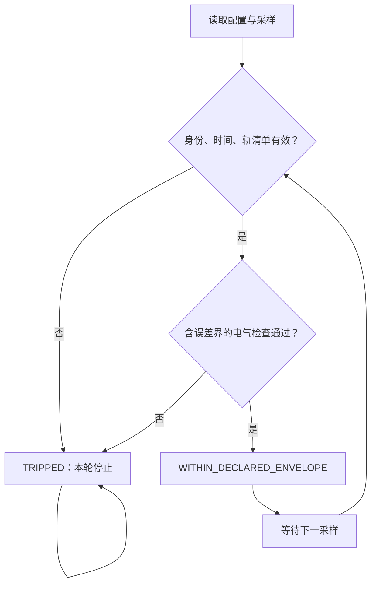

# 电压／电流专项 pre-BIOS：先把供电边界写清楚

创意：吴孟城（Windy Wu）；工程实现：ChatGPT。2026-11-08。

本模块承接 H1000 的内存固件设想，先实现一个**电压、电流专项的离线参考层**。
它读取显式供电配置和采样日志，计算功率并检查边界，供后续板级固件适配使用。
`pre-BIOS` 是本项目的原型名称，不表示它已运行在 BIOS 之前。
实现为标准库 Python；不读写寄存器、不刷固件、不发送 PMIC 命令，也不启用供电。

## 本次交付

| 组件 | 已实现 |
|---|---|
| `motionbricks/prebios_power.py` | 逐路电压、电流、功率、温度及测量误差检查；首个异常保持锁定；DC 功率和供电路径比较 |
| `docs/examples/prebios_power_synthetic.json` | 明确标识为模拟的 VIN、VDD、VDDQ、VPP 输入 |
| `tests/prebios_power/test_power.py` | 数学关系、越界与缺失传感器、时间连续性、身份变化、CLI 退出码测试 |
| CPU preflight | 在已有 Python 3.12／3.13、Ubuntu x86-64／ARM64 与 macOS ARM64 矩阵中加入测试与演示 |

这次没有把完整 H1000 耐久审查器搬入仓库：电气边界合格与数据正确性、持续高负载及寿命证据是不同问题。
本模块不积累千小时合格时长，也不把采样正常解释为内存已稳定。

## 一、明确单位、供电轨和测量位置

数值统一使用 V、A、Ω、W、°C、s；字段名包含单位，例如 `voltage_v`、`current_a`。
内存数据率单独使用 `rate_mts`，项目范围是 1–7200 MT/s。
DDR4／DDR5 分开记录，实际遥测必须匹配配置的代际、数据率和身份。
配置写了 7200 并不能证明任何 DDR4 或 DDR5 平台可以稳定运行；真实支持范围仍需板级验证。[1][2]

| 数据 | 必须表达的含义 |
|---|---|
| `platform_id` | 对应 CPU／主板硬件版本／DIMM 料号和安装布局的配置身份；目前只是调用方声明 |
| `profile_id`、`evidence_ref` | 本轮配置及证据引用；不是经过本程序认证的厂家许可 |
| 每路电压上下限 | 目标测量点的工作范围，不采用绝对最大额定值作为正常工作值 |
| 每路电流、功率上限 | 显式给出；不能只因电压正常就放行高电流 |
| 温度窗口 | 与实际传感器位置对应；停止温度为排他上界 |
| 电压、电流、温度误差 | 非负的误差界；使用误差界覆盖后的最坏值检查 |
| `path_resistance_ohm` | 对应已定义路径的等效电阻；未知填 `null`，不能假装为零 |
| 采样时间与启动标识 | 同一个单调时钟域；重启、重复采样、倒退、过期和长缺口都会使本轮审查停止 |

示例中所有数值均为**虚构的程序演示参数**，不构成 DIMM、CPU 或主板调压建议。
具体主板可能还有 CPU 内存控制器等供电轨；真实配置须将需要监测的轨全部列入。
程序拒绝缺失、多余或重复的轨，但无法知道调用方有没有把真实硬件清单写完整。

`voltage_v` 与 `current_a` 必须表示同一测量面上同步的 DC／准静态读数。
若是时间变化的波形，真实平均功率是平均 `v(t)i(t)`，不是平均电压乘平均电流；
导线平均发热需使用 RMS 电流。当前模型不从低频采样重建纹波、启动浪涌、快速尖峰或过流持续时间。

## 二、功率核算与保时捷 800V 的启发

保时捷对 Taycan 800V 架构的官方说明包括降低传输损耗和线缆负担。[3]
可以借鉴其供电架构思路，但不能直接迁移车辆的电压数值到内存接口。

### 轨上功率与走线损耗

```text
P_rail = V_rail × I_rail
P_wire = I² × R
P_rail_upper = (V + ΔV) × (I + ΔI)
```

所有负载轨使用相互不重叠的测量面，并标记 `accounting="load"`。
上游输入轨标记 `accounting="input"`，独立汇总；**不把输入功率和下游负载功率再加一次**。
不同电压的轨也不能通过直接相加电流来推算上游输入电流。
本版不把输入功率与输出功率之差自动解释为 PMIC 发热，因为它们可能覆盖不同边界或缺少其他负载。

### 把转换损耗显式放回模型

`compare_supply_paths` 的母线电压明确指**转换器输入端**；其上游另有等效导线电阻：

```text
P_converter_in = P_load / η
I_input = P_converter_in / V_converter_in
P_converter_loss = P_converter_in − P_load
P_wire = I_input² × R
V_source = V_converter_in + I_input × R
P_source = P_converter_in + P_wire
```

在负载、转换效率和路径电阻不变时，转换器输入电压翻倍使该路径电流减半，导线损耗降为四分之一。
这只是固定参数的 DC 模型：真实效率可能随电压与负载改变，还涉及开关损耗、PCB、封装和热设计。
它也不是“固定电源端电压”的非线性负载求解器；参考面的定义不能混用。
输出始终包含 `hardware_setting_recommended=false`。

内存芯片内部的动态功耗则近似随 `αCV²f` 变化，不能用“升高芯片电压会降低电流损耗”来推断总发热下降。[4]
本版为研究提供可检查的电气账目，没有测得节能率，也没有芯片温升或寿命模型。

## 三、审查状态与故障保持



正常状态仅表示“这一采样位于所声明的范围内”，不是可以启动、写固件或加压的授权。
任一路越界、非法／缺失数据、身份变更、重启或时间问题都会进入 `TRIPPED`；
后来的正常采样不能覆盖原故障。CLI 在首个异常处停止读取后续记录，并报告已经检查的条数。
创建新对象只是开始新一轮离线审查，不会清除硬件故障。

每份结果都固定保留：

```json
{
  "hardware_applied": false,
  "hardware_authorized": false,
  "memory_stability_validated": false,
  "lifetime_proven": false
}
```

`evidence_kind` 只允许 `synthetic` 或 `hardware_trace_unverified`。
后者也不代表程序验证过传感器或原始日志的真实性。

## 四、运行与验证

从仓库根目录执行，无需安装 GPU 运行依赖：

```bash
python -S -m motionbricks.prebios_power --demo
python -S -m motionbricks.prebios_power --trace docs/examples/prebios_power_synthetic.json
python -S -m unittest discover -s tests/prebios_power -v
```

退出码：`0` 为提交的采样全部通过声明范围；`1` 为本轮电气审查停止；`2` 为格式／配置错误。
没有 `--apply` 参数。未知输入字段或非法数字不能变成硬件写入路径。

当前测试包含误差界导致的提前拒绝、单路电压正常但电流或功率超限、总负载功率超限、
未知电阻不假报零损耗、上下游功率不重复计数，以及 NaN／Infinity／布尔冒充数字等输入。
本地 Python 3.12 和 3.13 的结果仅证明程序行为；跨平台 CI 状态以对应 PR 的实际检查为准。

## 五、下一阶段的板级接口

真实 BIOS／UEFI 适配仍需 CPU 型号、主板型号及硬件版本、BIOS 版本、DIMM 料号／数量／槽位，
对应工作范围和供电拓扑、可读传感器及误差、可用固件开发／签名／恢复入口。
Intel FSP 的 `FspMemoryInit()` 等初始化入口由具体平台集成，不能由普通离线脚本替代。[5]

后续应先建立只读遥测适配器和板级配置清单，再验证电压轨时序、过流硬件保护、
实际速率与独立数据校验。运行时供电保护必须由硬件及合适的实时控制承担，不能依赖 Python 采样。
H1000 的 1000 小时目标要另行测试：同时记录负载、数据错误、环境和性能保持情况；
电气日志正常本身不足以证明高负载、稳定性或寿命。

## 原始参考

本设计的模型与实现是研究推导；以下来源不为本项目提供认证。

1. [Kingston KF572C38RW-16 数据表](https://www.kingston.com/datasheets/KF572C38RW-16.pdf)：具体 DDR5-7200 产品配置与平台限制。
2. [Kingston DDR4／DDR5 对比](https://www.kingston.com/en/blog/pc-performance/ddr-memory-generation-differences)：代际、电压与电源管理差异。
3. [Porsche Taycan Glossary](https://newsroom.porsche.com/en_US/products/taycan/glossary-18550.html)：800V 架构与传输损耗。
4. [TI CMOS Power Consumption and Cpd Calculation](https://www.ti.com/lit/an/scaa035b/scaa035b.pdf)：CMOS 功耗组成。
5. [Intel FSP External Architecture Specification 2.3](https://cdrdv2-public.intel.com/644852/644852_2.3_Firmware-Support-Package-External-Architecture-Specification.pdf)：平台内存初始化接口。
