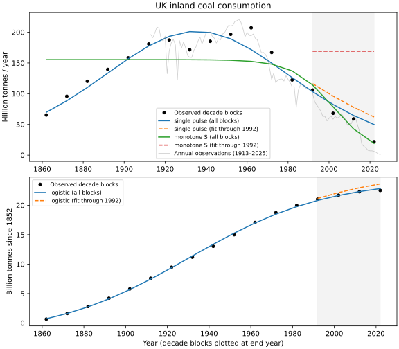

# How to Survive, Live and Tell One’s Own Story

吴孟城（Windy Wu）提出的 2026 GI Bill 教育倡议

## 给四所大学的公开提议

建议由哥伦比亚大学校长 Jennifer L. Mnookin 与明尼苏达大学、康涅狄格大学、威斯康星大学麦迪逊分校共同发起老兵写作试点。Mnookin 曾任 UW–Madison 校长，于 2026 年 7 月 1 日就任哥大校长。四校为倡议点名的拟议牵头方，参与及分工由各校自行决定。其他大学可按本地老兵社群的意愿、师资和经费，自行开班或与四校合作。[哥大校长办公室](https://president.columbia.edu/)

现行 GI Bill 可支持符合条件的获批教育项目。建议为本试点另拨教育经费，支付老兵的写作、备课、授课与编辑酬劳，保留学员已有的教育福利月数。第一本教材由愿意执笔的老兵合写，老兵作者共同主持选稿和修订。[VA 教育项目查询](https://www.va.gov/education/gi-bill-comparison-tool/)

## 三堂课，一本书

1. **Survive · 捱过嗰日。** 两位亲历者各写同一件小事，再交换手稿。用铅笔标出亲眼所见、事后听说和至今记不清的地方。两份记忆有出入，可以并排刊登。
2. **Live · 后来点过日子。** 写退伍回家后的一餐饭。家里人问「今晚食乜？」由这句话写起。作者也可以讲一次夜班、一段友谊，或者一个讲了二十年仍然好笑的笑话。
3. **Tell · 自己落最后一笔。** 年轻编剧带一页军事题材手稿来，老兵导师圈出一句，问「呢句你点知？」导师也读自己的稿，让学生反过来问。各人选一句重写，讲清楚自己为何坚持或改变写法。

作者保留著作权，可选实名、笔名、只给家人或完全私藏。作品收入合辑、录音公开、档案捐赠分别征得同意。愿保存个人史料的作者，可自行向美国国会图书馆 Veterans History Project 提交符合条件的材料。[项目参与说明](https://www.loc.gov/programs/veterans-history-project/how-to-participate/)

## 写作与 PTSD

临床书写暴露疗法（WET）由治疗师按程序引导。2023 年一项纳入 178 名 PTSD 退伍军人的随机试验中，WET 在减轻症状方面达到相对延长暴露疗法的非劣效标准。把结果推广到普通回忆录课堂，仍需单独验证。学员可以跳过任何创伤题材，也可自行选择联系专业服务。课程评价看学员能否按自己的意愿写完、修订和处置作品。[随机试验](https://pubmed.ncbi.nlm.nih.gov/37610727/)

## 同一餐饭，四种写法

丹尼尔·卡尼曼以 System 1 描述迅速、自发形成的印象，以 System 2 描述需要集中注意的推敲与核查。吴孟城为本写作课提出另一条轴，按说话对象命名：**System Introspective（“talking to myself”）** 与 **System Exospective（“talking to others”）**。前一条轴问这句话怎样形成，后一条轴问这句话讲给谁听。以下是课堂构想，四格里的台词均为虚构。[卡尼曼诺贝尔奖演讲](https://www.nobelprize.org/uploads/2018/06/kahnemann-lecture.pdf)

沿用回家吃饭的场景。有人问「今晚食乜？」试把同一刻写四次。

| 说话对象 | System 1 · 第一个反应 | System 2 · 想一想再讲 |
| --- | --- | --- |
| Introspective · 对自己讲 | 「又要我拣？」 | 「我记得嗰餐食面。至于系边个提议，我真系唔记得。」 |
| Exospective · 对别人讲 | 「是但啦，阿妈。」 | 「妈，你记唔记得嗰晚边个话食面？我想写低，又怕记错。」 |

写完圈出一句你只愿留给自己的话。想同人分享的，可以另写一句，请对方讲返佢听到嘅意思。由作者决定保留哪一稿。

## 治疗进步与预防责任

> 人体不是经济学的object，谢谢😏 ——吴孟城

杰文斯在《煤炭问题》中讨论过英国工业的经验：蒸汽机做同样的功耗煤更少，用得起蒸汽动力的行业却更多，总耗煤量仍可上升。[《煤炭问题》第七章](https://oll-resources.s3.us-east-2.amazonaws.com/oll3/store/titles/317/Jevons_0546_EBk_v6.0.pdf)

这个类比提醒负责政策的人守住一条线：即使 PTSD 治疗更快、更有效，决定他人承担何种风险的人，仍有责任减少可预防的创伤暴露。任何机构都不应以改善了救治为由接受更高的 PTSD 新发率。临床团队可以为更多人获得照护而记功；决定风险的人仍须就哪些伤害原可避免作出交代。

评估时应分别记录新近发病、首次确诊和接受治疗的人数。一个人今年第一次获得诊断，症状可能已持续多年。用新增诊断数考核预防工作，反而可能惩罚让老兵更容易求助的机构。

### 英国国内耗煤量的曲线形状

[英国能源安全与净零部原表](https://www.gov.uk/government/statistical-data-sets/historical-coal-data-coal-production-availability-and-consumption)的 Total Inland Consumption 列以百万吨计。1853–1912 只提供十年均值。为保持口径一致，长序列使用 1853–2022 年 17 个互不重叠的十年组；另用 1913–2025 逐年值复核。下图按各组末年标点。

| 1853–2022 年序列 | 模型 | 全段 R² | 仅用截至 1992 年的数据拟合，后三组 RMSE |
| --- | --- | ---: | ---: |
| 十年平均年耗煤量 | 单调 logistic | 0.563 | 121.18 百万吨/年 |
| 十年平均年耗煤量 | logistic 累计量的十年差分（单峰） | 0.920 | 30.36 百万吨/年 |
| 累计煤耗 | 以 1852 年末为零的 logistic | 0.9994 | 0.794 十亿吨 |
| 累计煤耗 | 直线基准 | — | 2.884 十亿吨 |

从 1913 年才开始看，数据已略过早期扩张。逐年单调下降 logistic 的 R² 为 0.915，单峰模型为 0.906；用截至 2005 年的数据预测 2006–2025 年，RMSE 分别为 18.75 和 22.08 百万吨/年。故窗口选择足以改变模型排名。累计量共享过去各期的观测，高 R² 不能独自验证长期上限。三组留出点是一次历史回测。这些耗煤数据不能单独识别效率变化的因果效果。

下载原表后，安装 numpy、scipy、matplotlib、xlrd，运行 `python uk_coal_fit.py Coal_since_1853.xls` 可重算结果和图。[复算脚本](coal-data/uk_coal_fit.py)

### 一条 S 线能回答哪条问题？

累计煤耗的 R² 达到 0.9994。同一批观测从 1853 年开始看，平均年耗煤量更接近单峰；截取 1913 年以后的逐年记录，下降 S 型却在留出年份略胜。读图时先看纵轴、起点，以及模型预测未参与拟合的年份时错了多少。物理上的功率上限也只约束能量累积的速度：持续以恒定功率接收阳光，累计能量仍随时间线性增长。

若有人画一条 PTSD 的 S 线，先请他给纵轴写全名字：截至当年累计确诊了多少人，还是当年每千人年有多少人新发病？前者可以在后者下降时继续上升。即使预测完全准确，「明年可能有多少人受伤」与「谁有权让他们承担这份风险」仍是两个独立问题。模型可以协助预留治疗人手；决定风险的人仍须说明哪些伤害可以避免，并听取承担后果者的意见。

## Invitation to participating universities

We propose that Columbia University President Jennifer L. Mnookin, the University of Minnesota, the University of Connecticut, and the University of Wisconsin–Madison convene the first workshops. Other universities are welcome to adapt the format locally. Pay veterans to write the book, teach from it, and decide which pages readers get to see. A veteran who takes a manuscript home to family has finished the course just as surely as one who publishes it.

Better PTSD treatment creates no allowance for preventable trauma. Those who make decisions about exposure remain accountable for prevention. An increase in first diagnoses may include people who have lived with symptoms for years.
