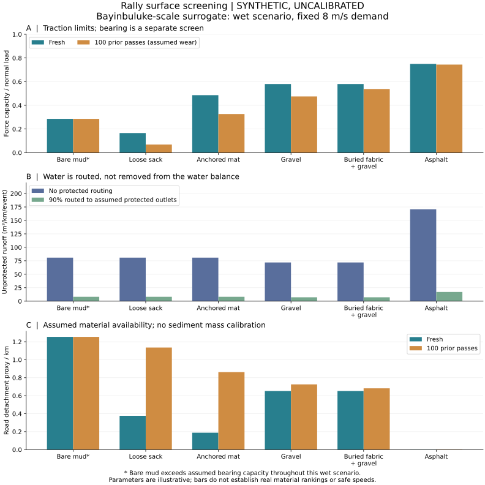

# 从修车厂布袋到拉力路面：巴音布鲁克合成赛道与派克峰案例

创意与研究方向：吴孟城（Windy Wu）；代码、资料整理与说明：AI 辅助。2026-11-08。

## 研究问题与交付

观察起点是在修车厂门前的泥路上铺旧布袋。研究问题是：轮胎接触织物后，抓地、承载、反复通过后的性能及雨水带走路面材料的潜势如何变化？这些效果能否在可更换路面模块中得到控制？

本次实现独立的标准库 CPU 参数模拟，位于 `motionbricks/rally_surface.py`，不依赖 GPU，不连接车辆执行器，也不调用 MotionBricks 的人体运动生成引擎。输入、216 组结果、CSV、图与测试均入仓。所有结果为 **SYNTHETIC_UNCALIBRATED（合成、未校准）**。软件测试检验公式实现与边界条件；材料实测、赛道实测和物理验证尚未完成。

## 先核实两个案例

**巴音布鲁克。** 环塔拉力赛官方网站说明，《飞驰人生》中的巴音布鲁克赛道是由多个景观组合成的虚构赛道，并转述电影设定的 109 km、1462 道弯。[1] 因而这里调用的是以该名称和规模建立的参数化替代路线，未取得或导入官方 GPS、DEM、路书、游戏地图或电影资产。不能将生成的弯道半径、坡度和宽度称为现实巴音布鲁克测量数据，也不能把这条路线作为现实保护区施工建议。

**派克峰。** 用户所说“铺水泥防止水土流失”，应校正为“沥青铺装与排水、坡面及泥沙治理”。PPIHC 官方历史把 1998 年有关碎石污染的诉讼列为背景，记录铺装于 2011 年赛事后完成，2012 年赛事首次为 100% 铺装；赛事组织者说明自己租用道路，并非铺装决策方。[2] 美国林务局发布的 2013 年监测报告（2014-05-02 提交）明确记载，道路用于治理的重新铺面是沥青，2011 年完成；后续还有排水沟喷射混凝土衬砌等工作。[3] 路面沥青和沟渠喷射混凝土不能混为一谈。

派克峰修复项目的实施机构 RMFI 指出，未受保护的道路排水曾在坡面形成冲沟，并将泥沙带入湿地与河流；项目同时开展冲沟稳定和湿地恢复。[4] 因此，本研究将“路面材料剥离”和“未受保护的径流暴露”分开报告。历史资料支持问题的提出，**没有提供本模拟的摩擦、磨损或径流参数校准**。不将历史前后圈速变化解释为铺装的单一因果效果。

## 可复现运行

在仓库根目录，Python 3.12 或以上：

```bash
python -S -m unittest discover -s tests/rally_surface -v
python -S -m motionbricks.rally_surface \
  --config docs/examples/rally_surface_synthetic.json \
  --output docs/results/rally_surface_synthetic.json
```

可选图表导出（仅绘图需要 Matplotlib，其依赖含 NumPy；本次使用 Matplotlib 3.10.8）：

```bash
python -m tools.rally_surface.render_report \
  docs/results/rally_surface_synthetic.json --output-dir docs/results
```

- [完整参数及来源](examples/rally_surface_synthetic.json)
- [完整结果 JSON](results/rally_surface_synthetic.json)
- [216 个场景 CSV](results/rally_surface_cases.csv)
- [对比图 SVG](results/rally_surface_comparison.svg)

结果 JSON 保留输入、计算模块 SHA-256 与生成的路段序列 SHA-256。几何哈希用浮点数序列计算；不同平台数学库末位差异可能改变该哈希，应结合容差比较数值。CSV 每行重复证据等级。模型不依赖网络、不使用随机采样；参数扫描区间不是概率分布或置信区间。

## 路线与对照设计

| 路线 | 借用的规模信息 | 本次人工几何 | 证据属性 |
|---|---|---|---|
| 巴音布鲁克替代路线 | 109 km、1462 道弯，来自电影设定的转述 | 宽 6 m；坡度 −8% 至 +8%；半径 20–160 m | 名称与规模源自虚构；全部几何合成 |
| 派克峰规模替代路线 | 官方赛事长度 12.42 mile ≈ 19.99 km、156 道弯 [2] | 宽 6 m；坡度 +4% 至 +10%；半径 25–180 m | 规模为真实赛事资料；全部几何合成 |

每个弯搭配一个等长直段；全路线一半长度为直段、一半为弯段。坡度按正弦变化，弯道半径按固定整数循环生成。路段长度沿路面计算，雨水接收面积采用其水平投影。此生成器不生成具有地理坐标的连续路线，未求曲线连接、超高、缓和曲线、山体位置或闭合约束。

六种路面交叉两种排水条件、三种天气、三种既往通过次数，共 `2 × 6 × 2 × 3 × 3 = 216` 个场景：

| 路面 | 直接接触轮胎的表面 | 对照目的 |
|---|---|---|
| `bare_mud` | 裸泥 | 基准 |
| `loose_sack` | 松铺织物 | 检查织物底部滑移和强度限制 |
| `anchored_mat` | 假设固定的织物垫 | 在相同地基上检验锚固、承载面积与衰减假设 |
| `gravel_control` | 碎石 | 隔离碎石本身的作用 |
| `buried_geotextile_gravel` | 碎石，织物埋在下方 | 与普通碎石具有完全相同的初始参数，仅假设退化速度较慢 |
| `asphalt` | 沥青 | 检验低材料暴露与高径流的取舍 |

普通碎石与埋置织物碎石的差异是**人为设置的退化假设**，不是模拟独立发现的加固效果。FHWA 资料支持土工织物隔离骨料与地基、维持结构的工程机制；相关施工规范要求设备不直接行驶在裸露的土工材料上。[5][6] 固定织物垫是单独的待验证概念，不能用埋置土工布的工程经验给它背书。

两种排水条件为 0% 和 90% 径流被导向假设有效的防护出口。90% 是场景输入，不是实测系统效率，也不是推荐设计值。所有表面使用同一土体和车辆输入。天气为干燥（饱和状态参数 0.05、降雨 0 mm）、湿润（0.8、30 mm）、饱和（1、60 mm）；雨量和含水状态独立指定，未计算入渗过程。既往车辆通过次数为 0、20、100。

## 受力模型和单位

质量 `m=1400 kg`、参考速度 `v=8 m/s`、纵向加速度 `a=0` 是示例输入。速度用于给每个路段施加相同的测试需求，不是安全速度建议。坡角 `θ=atan(grade)`，整车法向力 `N=mg cosθ`。

支持面积 `A` 是整车载荷在假设地基剪切面上的等效扩散面积，**不是轮胎接地面积**。土的饱和状态参数 `s∈[0,1]` 对黏聚力 `c`、摩擦角 `φ`、假设承载强度 `q` 及两端摩擦系数作线性插值。这里不显式求孔压；这些插值只是待测的有效强度替代输入。

容量取各环节中最小值：

```text
轮胎表面：F_tire = μ_tire × N
地基剪切：F_ground = c × A + N × tanφ
织物滑移：F_slide = μ_interface × N + F_anchor    （仅裸露织物）
织物强度：F_sheet                                （仅裸露织物）
F_capacity = min(全部适用的容量)
```

锚固项只提高织物界面的容量，不绕过共同地基剪切限制。模型将这些容量等效为各向同性的整车合力上限；真实锚固方向、局部受力和织物张拉场都未求解。埋置织物的作用只由假设的结构保持率体现，没有把它作为轮胎接触面。

需求为 `F_x=m(a+g sinθ+c_rr g cosθ)`、`F_y=m v²/R`（直段为零），合力 `sqrt(F_x²+F_y²)`。坡度有符号，下降路段可能需要制动。`capacity/N` 是这一模型的等效容量比，不能当成实验测得的轮胎摩擦系数。

承载另行筛查：`bearing_ratio=N/(Aq)`，超过 1 就标为超出假设承载能力。**即使剪切力需求未超限，承载超限也不能报告为可通行。** 尚不计算下陷深度、车辙、土体屈服后的力学或停车距离。

通过次数衰减采用 `r=exp(−k n)`：支持面积从初始值向预设残余面积靠近，锚固与织物强度乘 `r`，轮胎摩擦系数乘 `0.6+0.4r`，有效覆盖率为初始覆盖率乘 `r`。这些是明确可替换的经验形状，没有材料寿命证据。超限后程序仅报告需求超限，不继续积分滑移、破裂、速度或车辆轨迹；反复通过次数是独立参数扫描，不是车辆序列的动态耦合。

## 径流与侵蚀代理

每次假定降雨事件的降雨体积为 `P/1000 × L cosθ × W`（m³），径流体积为它乘输入径流系数 `C`。保护排水量与未保护排水量严格相加等于径流；剩余降雨归入“非径流”，不进一步分辨入渗、存储与蒸发。保护排水并不使水消失，坡下实际影响还需接收水体资料。

采用两个分开报告的**无量纲代理指标**：

```text
w = 1 + 5 × |grade|
路面剥离指标 = (L/1000 m) × (P/30 mm) × w × erodibility × (1−cover×r)
坡下暴露指标 = (未保护径流体积/100 m³) × w
```

`5`、`30 mm`、`100 m³` 及材料参数均是任意的示例标度，不能解释为率定系数。`w` 仅用道路纵坡作启发式权重，并未代表真实接收坡面的坡度。两指标不相加为“总环保分”，不转换成 kg、吨或吨/公顷/年，不冒充 RUSLE、WEPP 或流域水动力模型。没有雨时这些雨驱动指标为零，并不意味着轮胎扬尘或干态磨耗为零；后两者未建模。

同时报告总量与每公里指标，防止 109 km 与约 20 km 的路线长度差异被误当成材料效果。只有同一条路线、相同天气及载荷内的配对比较才隔离了本模型中的表面变量。

## 本次合成结果

下面均为巴音布鲁克替代路线的湿润场景，30 mm 降雨、无保护排水。数字来自入仓结果，非实测性能。

| 路面 | 新铺最小容量比 F/N | 100 次后最小 F/N | 新铺承载超限长度比例 | 新铺路面剥离指标/km | 未保护径流 m³/km/次 |
|---|---:|---:|---:|---:|---:|
| 裸泥 | 0.286 | 0.286 | 100% | 1.25465 | 80.87 |
| 松铺布袋 | 0.166 | 0.069 | 0% | 0.37639 | 80.87 |
| 固定织物垫 | 0.486 | 0.327 | 0% | 0.18820 | 80.87 |
| 普通碎石 | 0.580 | 0.475 | 0% | 0.65242 | 71.89 |
| 埋置织物加碎石 | 0.580 | 0.538 | 0% | 0.65242 | 71.89 |
| 沥青 | 0.750 | 0.744 | 0% | 0.00188 | 170.73 |



1. 给定本组界面参数，松铺布袋的最小容量比低于裸泥，说明“加一层布必定更抓地”在模型内也不成立。裸泥同时超出假设承载能力，其容量比不能用于宣称它可通行。
2. 固定垫的优势依赖假设的锚固、等效面积和强度；100 次后容量降低，路面覆盖保护也减弱。松铺布袋的合力需求超限长度比例从约 8.79% 增至 58.38%，这是给定磨损模型的结果，不是实测失效率。
3. 普通碎石和埋置织物加碎石新铺结果相同，后续差别来自预先声明的退化系数。需要循环加载试验检验这个假设。
4. 沥青的路面剥离指标低，但无保护排水时径流约为裸泥的 2.11 倍，这个倍数直接来自输入的径流系数 `0.95/0.45`。假设 90% 排水得到有效防护后，其未保护径流为约 17.07 m³/km/次。这个降低是场景设置的数学后果，不是历史治理效果的复现。

这些例子确定了需要测量的环节，不建立真实材料优劣排名。派克峰提供的比较价值，是提醒研究同时处理路面材料、排水出口和坡面生态，而不是把沥青、混凝土或织物指定为万能答案。

## 验证与下一步

20 项测试覆盖平路圆周运动解析需求、纵横合力、正负坡度、无黏聚土的 `tanφ` 极限、锚固不能绕过软土地基、零强度织物、承载与剪切分离、水量守恒、无雨对照、铺装增加未保护径流的反例、磨损响应、配对碎石对照、路线规模/虚构标记、路段细分不变性、长度加权、无效输入、确定性与 CLI 错误输出。

本次本地 Python 3.12.14 与 3.13 均通过；测试已接入现有 Ubuntu x86-64/ARM64、macOS ARM64 的 Python 3.12/3.13 CPU CI。远端状态以 PR 的实时检查为准，不将矩阵配置等同于检查通过。

校准次序：先确认布袋材质、污染和湿态状态；在同土质/密度/含水条件下测轮胎—织物与织物—土的纵横向力曲线、织物张拉和锚固拔出；用配对碎石结构测反复加载后的承载与车辙；再用降雨土槽同时量出水量、泥沙干重、材料流失及排水出口冲刷。留出独立土样、材料批次和载荷工况验证，记录不利结果。数据充分后再替换本文件中的经验衰减与侵蚀代理。

冰雪、冻融、高海拔动力变化、气动载荷、悬架、轮胎温度、左右轮差异、织物卷入/飞散、污染与微纤维释放、施工碳排、成本、长期维护及生态修复均未计算。原型结果不支持直接开展高速赛车试验或实际赛道铺设。

## 来源

检索日期：2026-11-08。资料用于历史与机制背景；所有数值参数的证据身份仍为人工假设。

1. 环塔拉力赛（2024-03-01），[《飞驰人生》里，比巴音布鲁克更凶险的赛道存在吗？](https://www.atr123.com/index.php?a=show&c=index&catid=229&id=620&m=content)——虚构性质及电影设定规模。
2. PPIHC，[Paving Pikes Peak – Competitors](https://ppihc.org/paving-pikes-peak-competitors/)——铺装历史、赛事年份比例和赛事规模；不是地形测量数据。
3. Troendle et al.，提交美国林务局，[Annual Progress Report for 2013](https://data.fs.usda.gov/emc/rig/pikespeak/PPH_Report_2013.pdf)，2014-05-02，Executive Summary，印刷页 1–3（PDF 第 3–5 页）——沥青于 2011 年完成及排水、修复和监测。
4. RMFI，[Pikes Peak Watershed Erosion Control and Restoration Project](https://www.rmfi.org/projects/pikes-peak-watershed-erosion-control-and-restoration-project)——实施方记录的冲沟、湿地和修复目标。
5. FHWA，[Geotechnical Aspects of Pavements, §7.6](https://www.fhwa.dot.gov/engineering/geotech/pubs/05037/07d.cfm)——土工材料与骨料、地基之间的隔离和稳定机制。
6. FHWA，[FP-24, §207.04](https://highways.dot.gov/sites/fhwa.dot.gov/files/fp-24_0.pdf)——隔离/稳定用途的土工材料铺设和覆盖施工要求；不构成裸露织物赛车路面的验证。
