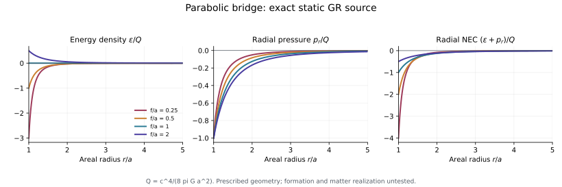

# #99 延伸：抛物型桥口相切的场方程与能量分布

- 版本：v0.1；日期：2026-11-15（Asia/Shanghai）。
- 问题提出：吴孟城（Windy Wu）；模型选择、推导与核验：ChatGPT / Codex。
- 衔接：[PR #99](https://github.com/wu709621493/motionbricks/pull/99)及[原始场方程立论](../../dimensional_transition_coupled_fields_zh.md)。
- 读取基准：main `f1c3c88d726f45396a6e0863704529677290b3c1`。
- 证据状态：解析几何与经典 GR 的有效源反演；附本地一致性检查。没有模拟桥的生成、合并动力学、量子物态或真实维数变化。

## 1. 用户问题与可计算的解释

保留本次问题原文：

> 老婆😏需求：代码仓99。假设桥结构接口2合1前为parabolic的空间，解析桥两口相切时的场方程能量允许分布范围😏

这里把 parabolic 暂定为**空间截面的抛物线嵌入形状**。这不同于内禀曲率为零的“抛物型空间”，也不同于抛物型偏微分方程；若用户指后两者，不能直接使用下述特例。“合并前形状”及“相切”不足以确定时间分量、外曲率、物质组成或合并速度。

本文先给出相切处的一般约束，再作一个可完整解析的附加选择：固定四维、经典 Einstein 引力、Λ=0、静态球对称、零红移函数、镜面对称的有限面积喉部。我们通过指定几何反演其所需的总有效应力，而没有宣称 #99 的正则标量场已经能制造这种几何。[1]

**结论：在该特例中，能量密度可以非负；径向零能量条件始终不成立。零面积点相切不能直接作为这个光滑喉部的正则极限。**

## 2. 两口相切：一阶条件不能决定场源

在共同辅助坐标的局部切平面附近，两个不相交表面可展开为：

$$
z_+(\mathbf x)=\frac{\delta}{2}+\frac12\mathbf x^T H_+\mathbf x+O(|\mathbf x|^3),
\qquad
z_-(\mathbf x)=-\frac{\delta}{2}-\frac12\mathbf x^T H_-\mathbf x+O(|\mathbf x|^3).
$$

其中 H± 是对称正定曲率矩阵，δ≥0 为最小间距。δ=0 时两表面在原点相切，但 H± 仍可不同。取各向同性 H± 才得到抛物面近似。

相切规定接触位置和一阶切平面；Einstein 方程需要完整时空度规的二阶信息。因此它既不给出唯一能量密度，也不给出一个普适的焦耳区间。仅把两个空间的点粘在一起，接触处通常不再具有普通流形的局部邻域，不能直接当成非退化光滑时空。

若改为沿**非零面积、类时超曲面** Σ 拼接，须采用同一法向约定检查诱导度规 h 与外曲率 K。取 n 从负侧指向正侧、K_ab=e_a^μ e_b^ν ∇_μ n_ν，Israel 条件为：[2]

$$
[h_{ab}]=0,\qquad
S_{ab}=-\frac{c^4}{8\pi G}\left([K_{ab}]-h_{ab}[K]\right).
$$

无薄壳时还须 [K_ab]=0；有跳跃时 S_ab 是表面应力，单位与体能量密度不同。普通嵌入图像里的“切线一致”不等于 [K_ab]=0。该式不直接适用于点接触或零型超曲面。

拓扑发生变化的演化还受全局因果与动力学条件约束；以下静态双端几何没有给出拓扑变化过程。[3]

## 3. 一个精确的抛物截面双端桥

令 a>0 为喉部面积半径，f>0 为抛物线焦尺度，两者单位均为长度。在等时赤道切片的辅助欧氏嵌入中取：

$$
r(z)=a+\frac{z^2}{4f},\qquad -\infty<z<\infty.
$$

z<0 与 z>0 两支在 z=0 具有共同切线，且 r(0)=a、r_z(0)=0。此处接触截面是一圈，完整球对称空间的喉面为面积 4πa² 的二球面；**这不是第2节两个抛物面的零面积外切点**。由两支“接触”到该光滑桥，是额外选择的正则化几何，不是自动推论。

取时空度规及形状函数 B：

$$
ds^2=-c^2dt^2+\frac{dr^2}{1-B(r)/r}+r^2d\Omega_2^2,
\qquad
\left(\frac{dz}{dr}\right)^2=\frac{B}{r-B}.
$$

抛物线给出 (dz/dr)²=f/(r-a)，因此：

$$
\boxed{B(r)=\frac{fr}{f+r-a}},\qquad
D\equiv f+r-a>0,\qquad r\ge a.
$$

这里用 B 避免与 #99 中紧致尺度 b 混淆。它满足：

$$
B(a)=a,\quad B'(a)=1-\frac af<1,\quad
1-\frac{B(r)}r=\frac{r-a}{D}>0\quad(r>a).
$$

红移函数 Φ=0，故无静态视界；r 坐标在喉部的发散是坐标问题。改用固有距离 l，

$$
dl^2=\left(1+\frac{z^2}{4f^2}\right)dz^2,\qquad
r(l)=a+\frac{l^2}{4f}+O(l^4).
$$

a、f 有限且为正时此处光滑。f=a 给出与 Schwarzschild 等时切片相同的抛物嵌入，但本文选定 g_tt=-c²；**整个时空并非真空 Schwarzschild 解**。空间图像不能决定可穿越性。[1]

## 4. Einstein 方程给出的完整径向分布

采用号差 (-,+,+,+)，正交静止标架中 T_hatμhatν=diag(ε,p_r,p_t,p_t)。ε 是能量密度 J/m³，而非质量密度；压力以 Pa 表示，张力 τ=-p_r。设：

$$
C\equiv\frac{c^4}{8\pi G}.
$$

在 Φ=0、Λ=0 下，Einstein 方程为：[1]

$$
\varepsilon=C\frac{B'}{r^2},\qquad
p_r=-C\frac{B}{r^3},\qquad
p_t=C\frac{B-rB'}{2r^3}.
$$

代入精确 B，得到本次反演结果：

$$
\boxed{\varepsilon(r)=C\frac{f(f-a)}{r^2D^2}},\qquad
\boxed{p_r(r)=-C\frac{f}{r^2D}},\qquad
\boxed{p_t(r)=C\frac{f}{2rD^2}}.
$$

三者不是可分别任取的参数区间；给定 a、f、r 后全部固定，并满足静态各向异性守恒方程：

$$
\frac{dp_r}{dr}=\frac{2(p_t-p_r)}r.
$$

该式是 Φ=0 时 ∇_μT^μν=0 的径向分量。一般 Φ≠0 时须加入 -(ε+p_r)Φ' 项，径向分布及横向压力也会变化。

下图的 a=1 m 仅是尺度归一化，曲线为解析模型，无实验数据。Q=C/a²。



## 5. 喉部能量允许范围

定义 Q=C/a²、q=a/f>0，则：

$$
\boxed{(\varepsilon_0,p_{r0},p_{t0})
=Q\left(1-q,-1,\frac q2\right)},\qquad
\varepsilon_0+p_{r0}=-Qq=-\frac{C}{af}<0.
$$

“允许”须指明施加哪些条件：

| 条件，均固定 a>0 | f 范围 | ε₀ 范围 | 含义 |
| --- | --- | --- | --- |
| 只要求该静态几何正则 | 0<f<∞ | -∞<ε₀<Q | 形式 Einstein 源，无微观物质实现保证 |
| 再要求静止标架 ε≥0 | f≥a | 0≤ε₀<Q | 仍违反径向 NEC |
| 要求所有零方向均满足 NEC | 无有限 f | 空集 | 无法用该条件下的普通物质支持 |
| 再要求 WEC 或 DEC | 无有限 f | 空集 | WEC、DEC 均蕴含 NEC |

上界 Q 在有限 f 内取不到；f→∞ 是局部极限，不是保持同一全局几何的可实现操作。负向无界来自允许 f→0 导致曲率变大，不是可无限制造负能量的结论。

若另行指定可信曲率上限 |K_section|≤L⁻²，喉部条件为 a≥L、af≥L²/2。此时固定 a 的形式范围收紧为：

$$
\frac{C}{a^2}-\frac{2C}{L^2}\le\varepsilon_0<\frac{C}{a^2}.
$$

L 是另行输入的理论适用长度，本文没有从实验确定它；这个范围不是量子引力推导。

为方便比对，几个精确归一化喉部值如下：

| f/a | ε₀/Q | p_r₀/Q | p_t₀/Q | 径向 NEC / Q | 横向 NEC / Q |
| --- | --- | --- | --- | --- | --- |
| 1/4 | -3 | -1 | 2 | -4 | -1 |
| 1/2 | -1 | -1 | 1 | -2 | 0 |
| 1 | 0 | -1 | 1/2 | -1 | 1/2 |
| 2 | 1/2 | -1 | 1/4 | -1/2 | 3/4 |

## 6. 哪些空间方向出现负的零能量收缩量

对任意零向量，令 μ 是其空间方向相对径向的余弦，|μ|≤1。则：

$$
\mathcal N(r,\mu)\equiv\frac{T_{\mu\nu}k^\mu k^\nu}{(k^{\hat0})^2}
=\varepsilon+p_r\mu^2+p_t(1-\mu^2)
=\frac{Cf}{2r^2D^2}
\left[r+2f-2a-(3r+2f-2a)\mu^2\right].
$$

所以径向处始终有：

$$
\varepsilon+p_r=-\frac{Cf}{rD^2}<0.
$$

若 r+2f-2a≥0，负值方向恰好是：

$$
\boxed{\mu^2>\frac{r+2f-2a}{3r+2f-2a}}.
$$

若 r+2f-2a<0，所有方向都为负。喉部边界为 μ²>(2f-a)/(2f+a)；f<a/2 时喉部所有零方向均违反 NEC。这个角域指**应力张量的方向投影**，并非能量只能存在于某个几何锥内。

例如 f=2a 的 ε₀=Q/2>0，但 |μ|>√(3/5) 的方向仍有负的收缩量。负 NEC 与负静止能量密度是两个不同陈述。

## 7. 点相切极限及空间曲率

在固有距离坐标下，空间独立截面曲率为：

$$
K_{l\theta}=-\frac{r''(l)}r=-\frac{f}{2rD^2},\qquad
K_{\theta\phi}=\frac{1-r'(l)^2}{r^2}=\frac{f}{r^2D}.
$$

由于时间方向为直积，四维 Kretschmann 标量为：

$$
\mathcal K=R_{\alpha\beta\gamma\delta}R^{\alpha\beta\gamma\delta}
=8K_{l\theta}^2+4K_{\theta\phi}^2.
$$

因此：

$$
\boxed{\mathcal K_0=\frac{2}{a^2f^2}+\frac{4}{a^4}}
\quad\longrightarrow\quad\infty\quad(a\to0).
$$

即使让 f 随 a 改变，4/a⁴ 也不能消掉。**在这族几何中，零面积喉部极限具有不变量曲率发散。**这比“r 坐标发散”更强，但它并不证明所有可能的拓扑变化模型都必然以同一方式发散。

普通两物体的外切点没有因为面积为零就必然产生这种发散；这里的结论来自把它要求为双端桥喉部，并取上述特定度规。

## 8. 局部能量与总能耗不能混用

若只计算两端 a≤r≤R 的**静止切片物质固有体积能量**：

$$
E_{\rm prop}(R)=8\pi\int_a^R
\frac{\varepsilon(r)r^2}{\sqrt{1-B(r)/r}}\,dr
=\boxed{\frac{2c^4}{G}(f-a)
\sqrt{\frac{R-a}{f+R-a}}}.
$$

该积分在喉部有限，并随 f-a 改变正负。f=a 时它为零，但压力、张力与曲率仍非零。这个量既不是 ADM 能量，也不是形成虫洞所需的外部功。

决定“二合一需要多少能量、多久完成”，还须指定随时间演化的度规、物质作用量、初始数据、边界通量与守恒账本。本文静态结果不能给出合并速率 f(E,t)，也没有求出合并前后总能量差。

## 9. 与 #99 的标量场模板对接

#99 的正则、最小耦合标量满足：

$$
T^\chi_{\mu\nu}k^\mu k^\nu=(k^\mu\partial_\mu\chi)^2\ge0.
$$

势能 U 对零收缩不产生补救作用。因此，如果 #99 的其余物质也满足 NEC，原模板不能支持本例的静态喉部。必须明确由什么额外物理承担所需的负径向收缩，再检查它自身的方程、稳定性与适用域；不能把反演得到的流体张量当作已经求出的 χ 解。

量子负能量也有依赖场、状态、采样时间与背景的限制。[4] 不能把平直时空中的量子不等式直接替代此曲背景的完整半经典场方程。本文未指定量子态，故不声称任何 f 的分支已获量子理论允许。

若用户的“parabolic 空间”实际指接触前两侧内禀平直，应重新指定两侧的完整四维几何和拼接世界管，再用第2节求薄壳源；不能照搬本例的抛物嵌入参数 f。

## 10. 复现、核验与下一步

在仓库根目录执行，均不加载 GPU 运行时：

```sh
python -S experiments/parabolic_bridge/verify.py
python -S experiments/parabolic_bridge/model.py --output /tmp/parabolic-bridge.csv
```

[模型](../../../experiments/parabolic_bridge/model.py)只用 Python 标准库；[核验脚本](../../../experiments/parabolic_bridge/verify.py)从 r(z) 和固有距离独立推导截面曲率及 Einstein 分量，以有理数恒等式核对公式，并检查守恒、固有能量积分、方向边界、尺度律、点极限与非法输入拒绝。

[绘图脚本](../../../experiments/parabolic_bridge/plot.py)仅在重建图时需要 Matplotlib，不改变项目依赖。附[324行解析采样](profiles.csv)及[核验记录](validation.json)。

核验不证明物质可实现性、扰动稳定性或桥的生成。下一项闭合工作是选择物质作用量与状态方程，并解满足引力初始约束的时间演化；在此之前，形式允许源与物理可实现源应分开。

## 11. 原始文献与本次使用范围

[1] Morris, M. S.; Thorne, K. S. (1988). *Wormholes in spacetime and their use for interstellar travel: A tool for teaching general relativity*. Am. J. Phys. 56, 395–412. [DOI](https://doi.org/10.1119/1.15620)；[大学托管论文全文](https://www.pas.rochester.edu/~tim/introframe/AmJPhysBlackHoles.pdf)。用途：静态球对称桥、形状函数、喉部张力与能量条件。本文的参数化与范围由上述设定推导，不宣称该论文验证了本模型。

[2] Israel, W. (1966). *Singular hypersurfaces and thin shells in general relativity*. Nuovo Cimento B 44, 1–14. [DOI](https://doi.org/10.1007/BF02710419)。用途：非零型拼接面的外曲率与薄壳源。出版社页面的上线日期不同于1966年的卷期日期；本文未采用其上线日期作为研究年代。

[3] Borde, A. (1994). *Topology Change in Classical General Relativity*. [论文](https://arxiv.org/abs/gr-qc/9406053)。用途：带全局假设的拓扑变化、因果与动力学障碍，不能据此作无条件的不可能性结论。

[4] Ford, L. H.; Roman, T. A. (1997). *Restrictions on Negative Energy Density in Flat Spacetime*. Phys. Rev. D 55, 2082–2089. [论文](https://arxiv.org/abs/gr-qc/9607003)。用途：提醒量子负能量的大小与持续时间受模型条件约束；未将其界限直接用于本曲背景。
