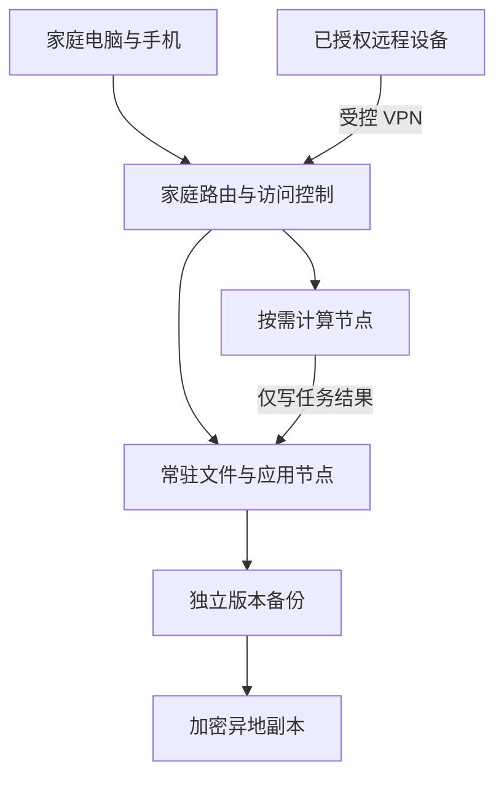

# 住宅私人服务器建设指南：私人服务器，它真香

> “私人服务器它真香。”——吴孟城
> 主题提出：吴孟城；整理：ChatGPT。2026-11-08。
> 状态：建设与验收设计，尚未采购、安装或完成住宅实测；属于本 fork 的独立工程笔记。

私人服务器值得建设的理由，是让文件、计算环境和学习过程掌握在自己手里：家里访问大文件方便，实验可以反复拆装，设备和软件也可以按需要组合。“真香”需要同时算进维护时间、噪声和恢复能力。

本文讨论住宅内自用、家庭共享和个人实验服务器。此前关于希拉里因“省电费、学 IT”搭服务器的说法是聊天中的幽默推测，不作为其真实动机的历史结论。私人服务器的工程价值可以独立讨论；处理机构或公务资料仍需遵循资料所属机构的授权和管理要求。

## 1. 先决定服务器为谁干什么

| 目标 | 本地建设的价值 | 需要接受的成本 |
| --- | --- | --- |
| 文档、照片、视频和项目归档 | 局域网访问，容量和目录自主安排 | 硬盘更新、备份与家庭账号管理 |
| Git、开发环境和个人知识库 | 可重复实验，学习系统与网络管理 | 升级、版本兼容和故障排查 |
| CPU 实验、模型文件与结果缓存 | 数据就近使用，计算任务可按需运行 | 内存、存储、散热与计算时长 |
| 有明确 GPU 需求的推理工作站 | 自己控制任务与运行时间 | 硬件兼容、功耗、驱动和散热 |
| 面向公众的持续在线服务 | 可以作为后续扩展 | 家宽上行、停电断网、维护值守；也应比较云主机或托管 |
| 邮件服务器学习 | 可在隔离测试环境研究收发机制 | 公网邮件还涉及域名认证、反垃圾信誉和运营商限制，不作为第一阶段任务 |

建设顺序建议：先做本地文件与备份，再增加 Git 或一个实验服务，最后才评估远程访问和公众服务。一次增加一个功能，确认旧功能仍能恢复。

## 2. 两类节点，分开安排运行时间

建议从“小型常驻服务节点 + 按需计算节点”开始。初期也可以只有一台设备，先按账号、目录和资源限额区分职责，需求增长后再分机。

| 部件 | 初始设计参考，不是最低配置或采购承诺 | 选型时核实 |
| --- | --- | --- |
| 常驻节点 | 安静的小主机或可维护的 NAS；16–32 GB 内存作为轻量多服务的起始规划 | 内存是否可升级、系统支持期、实测待机功率 |
| 系统与应用盘 | SSD；512 GB–1 TB 作为容量规划示例 | 系统、数据库、缓存与日志的增长速度 |
| 数据盘 | 按实际数据量、增长率和保留版本配置；为扩容留空间 | 接口、盘位、健康监控、备份盘容量 |
| 计算节点 | 复用兼容的台式机，任务完成后按计划停机 | CPU、内存、GPU 与目标软件分别兼容 |
| 网络 | 有线 1 GbE 起步；确认瓶颈后再考虑 2.5 GbE | 两端网卡、交换机、线材、磁盘均影响吞吐 |
| UPS | 按实际总负载及目标关机时间选型 | 同时看 W、VA、厂商续航曲线、通信驱动与电池维护 |
| 备份 | 独立备份介质及一份异地副本 | 恢复密钥、版本保留与能否实际恢复 |

不要把上述规划数字当成某个产品的保证。文件服务与轻量 Git 不要求独立 GPU；GPU 的选择必须由实际模型和运行环境决定。

建议拓扑：



图中 VPN 表示受控入口，不要求家庭路由器一定能运行 VPN 服务；也可由独立网关或服务器端客户端实现。备份节点需要独立凭据，计算任务不应取得删除所有备份的权限。

## 3. 住宅环境：功率、热量和声音一起看

设备放在干燥、通风、便于清洁和维护的位置，避开卧室床边、积水位置和被衣物遮挡的角落。机柜是否合适，取决于它能否把热空气排出；封闭柜门不等于隔音散热方案。固定设备和线缆，防止儿童、宠物拉扯。

实施时按设备说明书保留通风间距，使用与当地供电和负载匹配的插座、电源及 UPS。新增回路或固定布线交给合格电工核实；不要靠串接插线板扩展承载能力。

对典型室内计算设备，输入电能最终近似转化为室内热量。因此，持续 100 W 的设备也近似是持续 100 W 的热源；夏天可能增加空调负担。CPU 的 TDP 和电源铭牌瓦数都不能代替插座处实测功耗。

验收时记录：

- 空闲、备份、满负载三个状态的插座功率，以及是否包含 UPS 损耗和网络设备。
- 室温、磁盘温度、CPU/GPU 温度与厂商允许范围，尤其关注热天和连续任务。
- 卧室和相邻房间的夜间听感；若记录分贝，同时记录距离、背景声和仪器。
- UPS 通信是否正常，停电事件能否触发保存、停止任务和正常关机。

Network UPS Tools 的 `upsmon` 提供 UPS 监控与关机控制能力，[官方文档](https://networkupstools.org/docs/man/upsmon.html)可作为实施入口。具体 UPS 型号、驱动与关机链路仍须验证。续航目标应覆盖停止写入、应用退出和系统关机的实测时长，并留余量。恢复供电后，先检查存储与服务，再恢复计算任务。

## 4. 电费要算，不能预设住宅一定便宜

“住宅电费低”不是通用前提。美国 EIA 的 2025 年全国平均零售电价为住宅 17.23 美分/kWh、商业 13.37 美分/kWh；这组统计说明住宅不一定更低，并不能替代某个家庭的合同电价。[EIA 年度表 1.1](https://www.eia.gov/electricity/Annual/table.php?t=epa_01_01.html)

实际预算使用自己账单上的增量费率；有阶梯或分时价格时分段计算。下面采用**假设电价 ¥0.60/kWh、30 天/月、24 小时运行**，不是广州或其他地区的现行报价。

```text
月耗电量 kWh = 平均插座功率 W × 每日小时数 × 每月天数 / 1000
月电费       = 月耗电量 × 电价
```

| 持续平均功率（示例） | 30 天耗电量 | 示例月电费 |
| --- | ---: | ---: |
| 20 W | 14.4 kWh | ¥8.64 |
| 50 W | 36.0 kWh | ¥21.60 |
| 100 W | 72.0 kWh | ¥43.20 |
| 300 W | 216.0 kWh | ¥129.60 |

这些功率是演算输入，不是实测设备指标。若测量已在 UPS 输入侧进行，不要再重复添加 UPS 损耗；空调和未包含的交换机等耗电另计。

三年总拥有成本可按下式列账，所有项目使用同一货币：

```text
三年成本 = 初始硬件 + 36 ×（月电费 + 增量网络费 + 异地备份费）
         + 维护工时 × 自定时薪 + 维修/电池/硬盘预算 - 预计残值
```

例如仅为演算，取硬件 ¥3,000、100 W 连续负载、每月异地备份 ¥20、增量网络费 ¥0、维修预算 ¥600、残值 ¥0，则未计维护工时与额外制冷的三年成本为：

```text
3000 + 36 × (43.20 + 20) + 600 = ¥5,875.20
```

与云服务比较时，要对齐可用容量、版本保留、计算时长、外网流量、恢复速度和可用性。家中已有宽带并不意味着新增用途一定没有成本；自建服务器也没有自动获得机房级的供电和网络冗余。

## 5. 网络：先内网，再远程

第一阶段仅允许家中指定设备访问；不要为图省事把整台服务器设为路由器的公网 DMZ 主机。

| 通路 | 建议初始策略 | 验证方式 |
| --- | --- | --- |
| 家庭用户到文件/应用服务 | 单独账号、按目录授权 | 用户能访问自己的资料，无法读取他人的私有目录 |
| 访客或 IoT 到服务器 | 默认不通，按需要单独放行 | 从访客网络实际尝试访问 |
| 管理员到 SSH/管理面板 | 限管理网络或授权 VPN；独立管理员身份 | 普通用户与未授权远程设备不能进入 |
| 计算任务到数据目录 | 输入尽可能只读，输出写入独立目录 | 测试账号无法修改归档和备份 |
| 公网到服务器 | 初始不开放；IPv4/IPv6 均检查 | 从自己控制的外部网络检查可达性 |

优先使用仍受支持的系统和路由器，及时更新，关闭不用的服务和远程管理，使用独立强密码，并在支持的账号入口启用多因素认证。家居联网设备的基础维护原则可参考 [FTC 官方指南](https://consumer.ftc.gov/articles/securing-your-internet-connected-devices-home)。

需要外出访问时，先核实运营商是否使用 CGNAT、是否提供可入站公网地址、实际上传速度以及套餐条款。DDNS 只解决名称到地址的更新，不能自行解决 CGNAT 入站不可达。IPv6 也要有明确防火墙规则。

可评估受控 VPN 或组网服务。例如 Tailscale 官方说明，多数情况下不需要手动开放入站端口，复杂网络下可能使用中继；中继性能不能视为直连性能。[官方端口说明](https://tailscale.com/docs/reference/faq/firewall-ports) 使用此类服务时要核实设备授权、访问策略、账号恢复和对外部协调服务的依赖；不要把“接上 VPN”当作所有用户都应有管理员权限。

公开网站确有需要时，再单独设计 HTTPS、认证、反向代理与隔离应用；文件共享协议、数据库和管理面板不直接作为公众入口。本指南不提供通用的一键开放公网配置，因为具体网络和服务尚未确定。

## 6. 备份的验收标准是恢复成功

磁盘镜像或 RAID 可以应对某些硬盘故障，但不能替代独立备份；误删、被盗和整机损坏需要另外处理。同步也可能传播删除操作。

建议保留三份数据（含工作副本）、使用至少两类介质或独立存储系统，并有一份异地副本；至少一份采用离线或不可变方式，避免同一账号能删除所有版本。备份加密，密钥另行保存。CISA 的[联合通告](https://www.cisa.gov/sites/default/files/publications/AA20-302A_Ransomware%20_Activity_Targeting_the_Healthcare_and_Public_Health_Sector.pdf)强调离线加密备份和定期恢复测试；本节把这一原则用于家庭服务器设计。

一套可调整的初始保留方案：每日备份保留 14 份、每周保留 8 份、每月保留 12 份。实际容量取决于数据变化量与备份实现，不能直接按逻辑文件总量乘份数推断。数据库与 Git 服务还需要应用一致的备份方式，不能假设复制正在写入的文件就能恢复。

拟定个人文档目标：最多丢失 24 小时修改（RPO），在准备好替换设备后 4 小时内恢复核心文档服务（RTO）。这只是初始目标；采购等待时间另计，实测不达标就调整方案。

每月至少抽样恢复一次到空目录，核对内容或校验和；定期演练完整应用恢复，记录所需凭据、密钥、软件版本和步骤。恢复结果不得覆盖唯一原件。

## 7. 与 MotionBricks 的具体关系

这台服务器可以承载代码、文档、实验输入与结果，也可运行本仓库已有的 CPU 工具。它不会因为被称为服务器，就自动满足 GPU 推理条件。

- [CPU-safe preflight](preflight.md)：先检查环境，再决定安装哪些运行依赖。
- [CPU reference](cpu_reference.md)：按指南评估参考执行器，不把 CPU 运行等同于实时性能。
- [Platform safety](platform_safety.md)：计算任务沿用超时、输出限制和清理约束。
- [CPU memory/rendering lab](ddr4_1000_cpu_render_zh.md)：可以作为按需任务；逻辑内存分片不等于新增物理 DIMM。
- [Sleep mode](sleep_mode.md)：现有睡眠功能属于运动生成监督逻辑，不能当作主机休眠、硬盘停转或整机节电已经实现的证据。

建议把常驻存储和耗时实验分开调度：核心文件服务保留资源，计算任务限制 CPU、内存、磁盘输出和运行时长。对于来自公开 PR 的代码，使用隔离、可丢弃环境，不让实验进程继承家庭资料和备份凭据。本次只写建设设计，没有部署服务、修改 BIOS、开放端口或连接机器人。

## 8. 从开箱到可维护的四步

1. **盘点与选址。** 写明数据量、用户数、月增长量、工作负载、预算、维护负责人和可接受的中断时长；测量现有网络与设备空闲功率。
2. **内网试运行。** 安装受支持系统并更新，建立账号和访问规则，只上线一个服务，用复制的测试资料验证读写；保存配置与恢复步骤。
3. **备份和断电演练。** 在无唯一原件的测试环境验证应用备份、恢复和 UPS 关机流程，检查日志与文件完整性；确认后才迁入正式资料。
4. **观察后扩展。** 记录至少一周的功耗、温度、容量增长、备份和服务异常。确有需要再增加远程入口、带宽或计算设备，并复验受影响功能。

验收记录留空，待实际实施者填写：

| 项目 | 需要的证据 | 当前状态 |
| --- | --- | --- |
| 文件与账号权限 | 正向访问及拒绝访问记录 | 未执行 |
| 稳态功率、散热与夜间噪声 | 测量位置、环境、负载与结果 | 未执行 |
| 内外网边界 | IPv4/IPv6、访客网络及远程访问测试 | 未执行 |
| 备份恢复 | 恢复耗时、校验结果、应用可用性 | 未执行 |
| UPS 自动关机与复电 | 事件、应用退出、关机和恢复日志 | 未执行 |
| 一周稳定运行 | 任务失败、备份遗漏、容量与温度记录 | 未执行 |

**私人服务器的“真香”，是自己能使用、能理解、能恢复，也能决定什么时候让它休息。**
