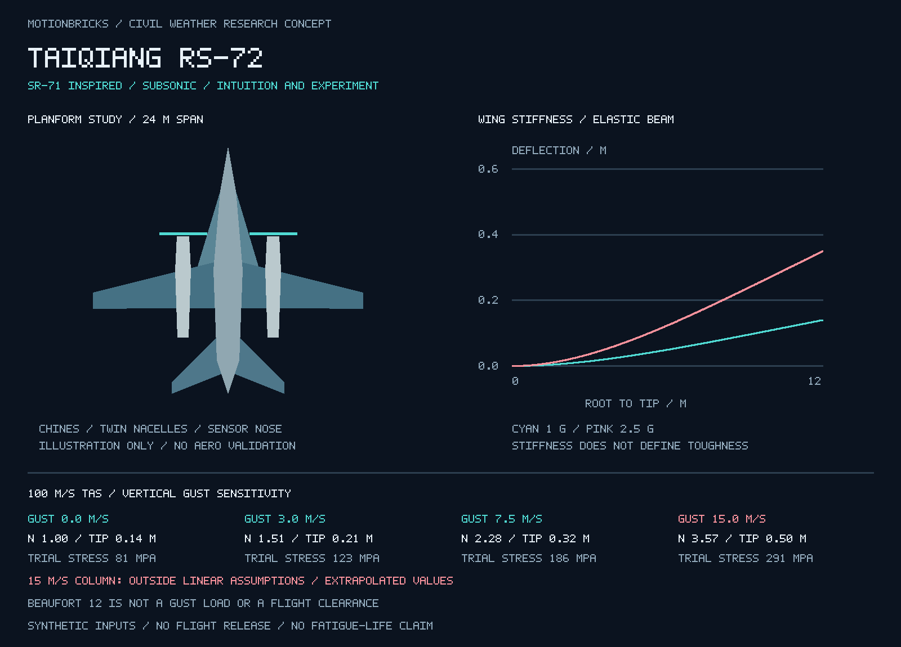

# 台强 RS-72：次音速民用气象侦察机概念与结构初筛

命名与设计倡议：吴孟城（Windy Wu）。研究整理、代码与示意图：AI 辅助。2026-11-08。

本项目延续 [风团—台风物理场](wheal_typhoon_biophysics_zh.md) 和 [PR #50](https://github.com/wu709621493/motionbricks/pull/50)，研究“以 SR-71 为外形灵感，面向 12 级风及以下环境的次音速民用气象侦察机”。当前成果是可复现的结构敏感性计算、概念平面图与技术路线；尚未完成实机设计、制造、风洞、结构试验或适航验证。**RS-72 是本项目命名，与任何厂商的 SR-72 项目没有隶属关系。**



## 1. 不忘本：直觉、手艺与实验

> “我们不能忘记人类的直觉，不能忘本。” —— 吴孟城

在人类拥有现代电子计算机产业之前，观察、想象、手工计算、工艺和实验已经推动了飞行。明朝万户飞天的传说，表达了用人造装置离开地面的愿望；莱特兄弟则在 1903 年留下了有记录的动力、可控飞行成果。[H1,H2] 二者在本项目中分别承担探索精神与实证工程的历史角色，不能合并写成“都已成功飞行”。NASA 的火箭史也明确把万户故事标为传说；这里不把未经证实的年代、身份或飞行结果当作工程事实。

莱特兄弟并非只靠直觉。他们对已有气动数据提出怀疑，制作风洞、测量翼型、调整设计。[H2,H3] “没有现代计算机产业”也不等于“没有数学与计算”。对 RS-72，直觉负责提出可检验的问题，手算负责数量级和单位，试验负责接触现实，计算负责扩展与追踪证据；当它们相互冲突时，保留原始测量并查找模型缺项，不用渲染的逼真程度裁决谁对谁错。

| 直觉或主张 | 转成可检验问题 | 本轮状态 |
| --- | --- | --- |
| “硬一点能不能扛风？” | 改变 EI 后挠度、应力和模态如何变化？ | 已实现静态挠度与应力分离；模态待做 |
| “韧一点能不能带伤回来？” | 裂纹、剩余承载与检测间隔能否成立？ | 已实现简化 K 敏感性；寿命与检查间隔待实测 |
| “流线形会不会更稳定？” | 扫掠、边条、重心与侧向导数怎样影响操纵？ | 只有概念图，尚无风洞 / CFD 证据 |
| “12 级以内应该能飞？” | 同一环境风级下，阵风、空速、含水量和飞行高度怎样组合？ | 已拆分变量；没有批准的入台风包线 |

保留设计者的草图、预期和反例，给未得到支持的直觉留下一条可追踪的实验记录。尊重先驱，也包括认真记录失败和不确定性。

## 2. SR-71 的启发与民用任务

NASA 记录的 SR-71 面向约 Mach 3.2、高空飞行，其钛合金结构与进气系统有特定高速热环境背景。[A1] RS-72 借鉴细长机身、边条、双短舱和可布置传感器的机鼻等视觉与布置思路；次音速目标需要重新选择翼型、展弦比、推进和操纵系统。不能由“像黑鸟”推导出低速湍流性能。

现实参照是 NOAA 的气象侦察任务分工：P-3 进入风暴进行观测，G-IV 在高空与风暴周边取得环境数据。[A2] 这说明任务、发动机及机体必须一起定义，并不证明新机可继承既有飞机的许可。

暂定双涡桨外形占位，研究平台目标为温压湿、三维风、降水结构、下投探空和机体载荷同步测量；发动机、进气分水、除冰和载荷能力尚未选型。翼盒可比较金属与复材方案，但本轮只用假想等效各向同性梁，不把碳纤维或钛合金名称直接当作抗台风结论。机上仪器需统一时钟，记录空速、惯导、迎角、应变和加速度，才能区分大气输入与机体响应。

## 3. “12级以内”的精确定义

本轮按**风力等级 ≤12，包含 12 级**理解。GB/T 28591—2012 表 1 中，12 级为标准气象观测场 10 m 风速 **32.7–36.9 m/s**。[A3] 热带气旋“台风”类别对应 12–13 级，“强台风”对应 14–15 级；风力等级、气旋类别和阵风强度不能混用。[A4]

前一份演示图的 45 m/s 是强台风量级背景，超出本机本轮提出的 ≤12 级环境范围，**不把它算成 RS-72 已经通过的工况**。低空 / 巡航高度的风廓线也不能由 10 m 风速直接替换。

飞机承受的气动输入来自相对气流：

\[
\mathbf V_{air}=\mathbf V_{ground}-\mathbf U_{wind},\qquad
q=\tfrac12\rho|\mathbf V_{air}|^2.
\]

恒定背景风改变地速与航迹；在保持相同真空速、密度和姿态的理想比较中，它不会仅因风级变大就增加 q。垂直 / 横向阵风、风切变、湍流谱、雷暴对流、雨滴与冰雹、结冰、雷击和含水量需要分别处理。因此本轮的 3、7.5、15 m/s **垂直阵风**是独立的参数扫描，既不等于“12 级风”，也不是从某级台风自动换算出来的。

## 4. 刚度、强度、韧性分别计算

| 性质 | 本轮指标 | 不能被它替代的指标 |
| --- | --- | --- |
| 弯曲刚度 | EI，翼尖挠度 δ | 强度、裂纹容限 |
| 强度 | 弹性试算 σ 与假设屈服 / 极限筛查值 | 疲劳寿命、材料韧性 |
| 断裂韧性 | K 与假设 Kmat 的比值 | 延性、全结构吸能能力 |
| 损伤容限 | 裂纹长度敏感性 / 形式上的临界裂纹 | 检查周期、服役寿命、失效安全验证 |

### 明确是假设的输入

| 输入 | 演示值 |
| --- | --- |
| 计算质量 / 翼展 / 机翼参考面积 | 12000 kg / 24 m / 70 m² |
| 概念图机身长度 | 22 m；不参与梁方程 |
| E / I / 外纤维距离 c | 70 GPa / 0.0013 m⁴ / 0.30 m |
| EI | 91 MN·m² |
| 屈服 / 极限应力筛查值 | 250 / 400 MPa |
| Kmat / a / Y | 30 MPa√m / 2 mm / 1.12 |
| 升力线斜率 / 密度 | 4.8 rad⁻¹ / 1.2 kg/m³ |
| 升力系数绝对值筛查 / 挠度筛查 | 1.8 / 半翼展的 5% |
| 真空速扫描 | 70 / 100 / 130 m/s，作为次音速情景；尚无认证速度 |

这些不是材料供应商允许值，也没有温度、腐蚀、连接、缺口、方向性或批次试样依据。I 是独立输入，并未由概念平面图推导；主翼示意面积为 70 m²，边条、平尾及机身不作为额外升力加到模型中。渲染图不是可加工 CAD。

### 梁与载荷方程

将单侧机翼简化为长 `l=b/2` 的固支等截面 Euler–Bernoulli 梁。两翼总升力 `nmg` 均布，单侧线载荷 `w=nmg/b`；忽略机翼自重、燃油和发动机惯性卸载，不能预设这种简化对所有失效模式都保守。

\[
M_{root}=wl^2/2,\quad \sigma=|M_{root}|c/I,\quad
\delta_{tip}=wl^4/(8EI).
\]

\[
\delta(x)=\frac{wx^2(6l^2-4lx+x^2)}{24EI}.
\]

梁方程来源见 [M1]。均布载荷、刚性翼根和小挠度线弹性都是模型假设，未计算扭转、屈曲、剪切变形、翼身连接或机身强度。增加 E 在同载荷下会减小 δ，但不会改变这个静定梁的根部弯矩与 σ；这正是“刚度不能代替韧性”的一个可运行反例。

### 阵风初筛

冻结姿态、准稳态小迎角线性近似：

\[
\Delta C_L=a_L U_g/V,\quad
\Delta n=\frac{\rho VSa_LU_g}{2mg},\quad n=1+\Delta n.
\]

`|Ug/V| > 0.1` 或试算 `|CL| > 1.8` 时，代码标记 `MODEL_OUTSIDE_ASSUMPTIONS`。这是本原型自定的适用性筛查，不是飞行限制或规范公式；不计算自由飞机俯仰响应、升力建立时滞或阵风缓和。超过屈服值后，σ、δ 和 K 仍保留为**线弹性外推报警值**，不当作实际变形预测。

### 裂纹敏感性

\[
K_I=Y\sigma\sqrt{\pi a},\qquad
a_{crit}=\frac1\pi\left(\frac{K_{mat}}{Y\sigma}\right)^2.
\]

这里 a 按边裂纹深度的占位参数处理，Y=1.12 是小边裂纹几何近似，尚无实际截面裂纹、厚度、塑性区或平面应变有效性验证。Kmat 不称为已测得的 KIC。模型只适合说明：同载荷下裂纹增大 4 倍，K 增大 2 倍；单独提高 E 不会提高这个 K 筛查的余量。形式上的 acrit 不可当作允许损伤尺寸；没有 Paris 参数、任务载荷谱与检测概率，因此不报疲劳循环寿命。[M2]

## 5. 本次计算结果

默认模型：1 g 时翼尖挠度 **0.1397 m**、根部弹性应力 **81.47 MPa**；2.5 g 仅作比较点，分别为 **0.3492 m / 203.68 MPa**。2.5 g 不是本项目确认的设计机动极限：若把 12000 kg 作为最大起飞质量代入 14 CFR 25.337 的质量相关表达式，得到约 2.76，而不是简单取下限 2.5；具体适航基础仍须确定。[R2]

固定真空速 100 m/s：

| 垂直阵风 m/s | n 试算 | 翼尖挠度 m | 根部应力 MPa | K 试算 MPa√m | 解释 |
| --- | ---: | ---: | ---: | ---: | --- |
| 0 | 1.000 | 0.140 | 81.5 | 7.23 | 在假设筛查值内 |
| +3 | 1.514 | 0.211 | 123.3 | 10.95 | 在假设筛查值内 |
| +7.5 | 2.285 | 0.319 | 186.1 | 16.53 | 在假设筛查值内 |
| +15 | 3.570 | 0.499 | 290.8 | 25.82 | 超出小迎角筛查，且超过假设屈服值；后三列为外推报警值 |

21 个空速×阵风组合中，13 个处于**本轮假设**范围，8 个触发模型适用性标志。这不是 13 次成功飞行，更不是“可穿越 12 级台风”的结论。报告同时保留全部应力、断裂和变形筛查标志，模型越界不会被绿色的单项指标遮掉。

## 6. 从原型走向可评价机体

14 CFR Part 25 作为运输类结构研究参照，而不是本项目已确定的适航归类：一般极限载荷系数 1.5 见 25.303；25.341 要求离散阵风和连续湍流的动态分析，考虑非定常气动与重要结构自由度；25.571 要求损伤容限和疲劳评价以及试验支持。[R1–R3] 本次只能读取 2025 年官方年度版，当前 eCFR 在线页面访问失败，因此不宣称核验了所有后续修订。

| 下一阶段 | 要补的实物 / 数据 | 判据 |
| --- | --- | --- |
| 气动与控制 | 风洞翼型 / 全机数据、质量重心、发动机和舵面模型 | 失速、操纵稳定性与阵风响应可核验 |
| 结构 | 翼盒、机身、尾翼、连接件的几何与材料试验 | 静力、屈曲、地面振动和有限元相互校准 |
| 动态风载 | 垂直与横向 1-cos 阵风、持续湍流、空间相干性 | 动态载荷、扭转、颤振与控制耦合覆盖工况 |
| 韧性与疲劳 | 缺口 / 裂纹试样、腐蚀环境、真实任务谱 | 剩余强度、裂纹增长、可检测损伤和检查间隔 |
| 台风环境 | 雨水摄入、结冰、雷击、传感器污染与冗余 | 推进和仪表在代表工况下的试验依据 |

这些是研究工作项；本轮无有人入台风试飞计划、无发动机采购、无制造图纸。先从台架与受控环境建立证据，才能决定是否及怎样扩展飞行任务。

## 7. 复现与证据

使用 [物理场文档](wheal_typhoon_biophysics_zh.md#4-执行与验证) 的独立 NumPy 环境，运行：

```bash
OPENBLAS_NUM_THREADS=1 python -m motionbricks.rs72 --out-dir /tmp/rs72-new-run
python -m unittest discover -s tests/weather_concepts -v
```

[完整计算 JSON](results/rs72/report.json)；代码：[rs72.py](../motionbricks/rs72.py)、[渲染器](../motionbricks/rs72_render.py)。输出 `CONCEPT_SCREENING_ONLY`、`flight_release: false`；试验图表使用 PR #50 的 CPU 变换与光栅化，未调用 GPU。测试覆盖载荷独立积分、参考系不变性、刚度与裂纹敏感性、正负阵风、模型越界和结果文件哈希。

## 来源

- H1：[NASA：火箭简史，万户部分明确标为 legend](https://www.grc.nasa.gov/www/k-12/rocket/TRCRocket/history_of_rockets.html)。
- H2：[美国国家公园管理局：莱特兄弟与首飞史](https://www.nps.gov/articles/wright-brothers.htm)。
- H3：[Smithsonian：1903 Wright Flyer 馆藏与风洞记录](https://www.si.edu/object/nasm_A19610048000)。
- A1：[NASA SR-71 Fact Sheet](https://www.nasa.gov/wp-content/uploads/2021/09/495839main_fs-030_sr-71.pdf)。
- A2：[NOAA：Hurricane Observation Instruments](https://www.aoml.noaa.gov/observational-instruments/)。
- A3：[GB/T 28591—2012 风力等级](https://www.cma.gov.cn/zfxxgk/gknr/flfgbz/bz/202209/P020220921551843068981.pdf)。
- A4：[GB/T 32935—2025 全球热带气旋等级](https://www.cma.gov.cn/zfxxgk/gknr/flfgbz/bz/202512/P020251225481860646746.pdf)。
- M1：[MIT Solid Mechanics：Deflections due to Bending](https://ocw.mit.edu/courses/1-050-solid-mechanics-fall-2004/f9a4d5764b9b0f51ffaacbdf69f7aed8_emech10_04.pdf)。
- M2：[Iowa State University：Fracture Mechanics 教学讲义](https://home.engineering.iastate.edu/~gkstarns/me325/LEFM.pdf)，含小边裂纹的 1.12 几何因子。用于公式语境，不作为任何航空材料的实测许用值。
- R1：[官方 CFR 2025：25.303 / 25.305](https://www.govinfo.gov/content/pkg/CFR-2025-title14-vol1/pdf/CFR-2025-title14-vol1-sec25-303.pdf)。
- R2：[官方 CFR 2025：25.337 / 25.341](https://www.govinfo.gov/content/pkg/CFR-2025-title14-vol1/pdf/CFR-2025-title14-vol1-sec25-341.pdf)。
- R3：[官方 CFR 2025：25.571](https://www.govinfo.gov/content/pkg/CFR-2025-title14-vol1/pdf/CFR-2025-title14-vol1-sec25-571.pdf)。
