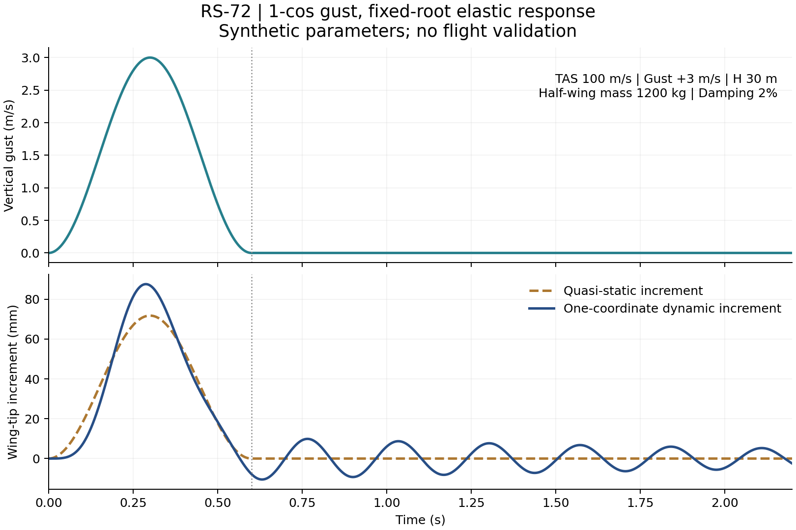

# 台强 RS-72：动态阵风验证设计与CPU实验

吴孟城（Windy Wu）设计倡议；AI 辅助复核与数值实验。2026-11-09（北京时间）。

**结论：8组旧工况均由小角度筛查触发，升力系数筛查0组，结构强度筛查2组。下一阶段采用1-cos阵风、固定翼根单自由度弹性响应与静态梁对照。** 本实验已经执行原型及数值检查；所有结构质量、阻尼和气动参数仍是假设。数值收敛与适航验证是不同的证据。

实现入口与后续模块见第8节。连续湍流、多模态与自由飞机响应尚未实现。

## 1. 复核基线与证据范围

- 当前读取的 main：`c4754016b9e615805b425594a7ec30aba768f6e0`。
- [PR #53](https://github.com/wu709621493/motionbricks/pull/53) 已合并；合并提交 `4468d9d933bf518d13d402902b50ab7258e00893`，时间为2026-11-08 10:09:42（北京时间）。
- [原始计算代码](https://github.com/wu709621493/motionbricks/blob/c4754016b9e615805b425594a7ec30aba768f6e0/motionbricks/rs72.py)、[原技术文档](https://github.com/wu709621493/motionbricks/blob/c4754016b9e615805b425594a7ec30aba768f6e0/docs/rs72_civil_weather_aircraft_zh.md)、[原21组报告](https://github.com/wu709621493/motionbricks/blob/c4754016b9e615805b425594a7ec30aba768f6e0/docs/results/rs72/report.json)。
- `tools/rs72_gust/audit_baseline.py`验证原21组报告的Git blob SHA，记录当前静态源码SHA，再运行原`gust_case`，并用另一套直接代数计算比对原报告。原报告保持原路径、未被修改。本次相关回归包含旧渲染测试；历史CI不作为新代码验证证据。
- 本次实际执行：Linux x86_64，Python 3.12.14 / NumPy 2.3.5及Python 3.13.5 / NumPy 2.2.4；绘图使用Matplotlib 3.10.8。求解不需要绘图库、GPU、PyTorch或TensorRT。跨平台CI由现有工作流执行，完成状态以对应PR提交的GitHub检查为准。

## 2. 8组越界工况的独立复核

以原模型的 `m=12000 kg, b=24 m, S=70 m², ρ=1.2 kg/m³, aL=4.8 rad⁻¹`，另写计算：

\[
C_L=\frac{2mg}{\rho V^2S}+a_L\frac{U}{V},\qquad
L=mg+\frac12\rho VSa_LU,
\]
\[
w=L/b,\quad M_0=w(12)^2/2,\quad
\sigma_{trial}=|M_0|c/I,\quad \delta=w(12)^4/(8EI).
\]

结果与21组原报告及原函数吻合（数值比较相对容差`1e-12`、绝对容差`1e-12`）。下面的应力都属于同一线性公式的试算值；表中8组均已超出小角度筛查。

| TAS m/s | 垂直阵风 m/s | \|U/V\| | CL试算 | 应力试算 MPa | 额外触发的筛查 |
| ---: | ---: | ---: | ---: | ---: | --- |
| 70 | −15 | 0.214286 | −0.456755 | 65.077 | 无 |
| 70 | −7.5 | 0.107143 | 0.057531 | 8.197 | 无 |
| 70 | +7.5 | 0.107143 | 1.086102 | 154.744 | 无 |
| 70 | +15 | 0.214286 | 1.600388 | 228.018 | 无 |
| 100 | −15 | 0.150000 | −0.439810 | 127.883 | 无 |
| 100 | +15 | 0.150000 | 1.000190 | 290.824 | 屈服；1.5倍载荷的极限应力筛查 |
| 130 | −15 | 0.115385 | −0.388053 | 190.689 | 无 |
| 130 | +15 | 0.115385 | 0.719639 | 353.631 | 屈服；1.5倍载荷极限；断裂；挠度 |

三类限制必须并列保存：

| 类别 | 原代码判据 | 21组的结果 | 解释 |
| --- | --- | --- | --- |
| 气动升力系数 | `abs(CL)>1.8` | 0组 | 假设阈值，没有正负失速极曲线；未超阈值不等于未失速 |
| 模型适用性 | `abs(U/V)>0.1` | 8组 | 项目自定小角度筛查；恰好0.1不触发 |
| 结构屈服 | `σtrial>250 MPa` | 2组 | 100/+15及130/+15；同时意味着线弹性材料假设失效 |
| 结构极限筛查 | `1.5σtrial>400 MPa` | 同上2组 | 与直接比较`σtrial>400`不同；不能称为已验证极限载荷能力 |
| 断裂筛查 | `Yσ√(πa)>30 MPa√m` | 130/+15这1组 | K≈31.395；LEFM有效性本来未验证，屈服后更不能作断裂预测 |
| 几何适用性 | `abs(δ)>0.05×12=0.6 m` | 130/+15这1组 | δ≈0.606224 m；归入小挠度模型筛查，不能单称“材料强度” |

原代码的`status`会被`MODEL_OUTSIDE_ASSUMPTIONS`覆盖，因此报告中的`SCREEN_EXCEEDED:0`**不表示没有结构报警**。需读取`exceeded_screens`和`model_flags`；新报告分别保留`aerodynamic_flags / strength_flags / model_flags / numerics_status`。超过屈服的应力、挠度与K仅保留为诊断外推值。

8组不是8次实际飞行失败；其余13组也不是已确认的安全飞行点。比如负载荷工况没有经过真实负升力、机动限制或结构稳定性核验。

给未知留两个位置：`U01`和`U02`，状态`UNSPECIFIED`，参数与结果均为`null`。它们是未定义的验证预留位，不是新增飞机座位，也不计入已算工况的分母。现状仍是**21组已计算＋2个未知预留位**。质量、阻尼、扭转等已识别的缺项另列，不占用这两个未知位置。

## 3. 方法来源及本轮取舍

FAA AC 25.341-1讨论离散阵风和连续湍流，并指出阵风结束后仍可能出现载荷峰值。[S1] 本实验借用离散阵风形状与扫描思路；没有选定适航基础。官方2025年版14 CFR 25.341列出1-cos形状、30–350 ft梯度范围及von Kármán谱。[S2] 完整飞机分析涉及非定常气动、刚体运动与重要结构自由度，当前模型尚不具备这些内容。

本轮选择：垂直、展向相干、均布增量载荷；固定机身/翼根；仅一个弯曲广义坐标。飞机不自由沉浮、不俯仰、不扭转；不包含控制律、气动反馈、气动阻尼或升力建立时滞。结构阻尼是外加假设。这个选择能隔离“相同准稳态载荷经过弹性动力系统后有什么变化”，不能回答完整飞机在阵风中的运动。

### 3.1 1-cos输入：明确H是到峰值的距离

\[
U(t)=\begin{cases}
\frac{U_p}{2}\left[1-\cos\left(\frac{\pi Vt}{H}\right)\right],&0\le t\le2H/V,\\
0,&\text{其他时间}.
\end{cases}
\]

峰值在`H/V`，总持续时间`Tg=2H/V`。`V`使用TAS；本实验的`Up`是实际垂直气流速度，正负号代表上/下阵风。`H=30 m,V=100 m/s`对应0.6 s事件。

这里的`Up=3 m/s`等数值是独立演示输入，固定幅度扫描H，不是规范设计阵风，也不由台风风级换算。若未来使用规范的EAS阵风幅度，需显式转换`Uactual=UEAS√(ρ0/ρ)`，并实现规范的高度、参考速度、缓和因子及H相关幅度等输入。不得把EAS直接与TAS相除，或静默引入没有任务依据的缓和系数。

### 3.2 由现有静态形状构造单坐标模型

定义半翼展`l=b/2=12 m`，`ξ=x/l`，采用与均布载荷静态挠曲线一致的Ritz形状：

\[
\phi(\xi)=\frac{6\xi^2-4\xi^3+\xi^4}{3},\qquad
y(x,t)=y_{1g}(x)+\phi(x/l)\eta(t).
\]

`φ(0)=φ′(0)=0`，`φ(1)=1`；`η`就是翼尖增量位移，单位m。这是选定的近似形状，不是已经实测的模态。以均匀半翼质量分布`μ=mhalf/l`、常数EI及结构阻尼ζ，虚功/能量投影给出：

\[
m_*=\int_0^l\mu\phi^2 dx=\frac{104}{405}m_{half},\quad
k_*=\int_0^l EI(\phi'')^2dx=\frac{16EI}{5l^3},
\]
\[
\omega_n=\sqrt{k_*/m_*},\quad c_*=2\zeta\sqrt{k_*m_*}.
\]

与原代码相同的准稳态升力给出增量线载荷及广义力：

\[
\Delta w(t)=\frac{\rho VSa_L}{2b}U(t),\quad
Q(t)=\int_0^l\phi\Delta w\,dx=\frac{2l}{5}\Delta w(t).
\]

运动方程与初值为：

\[
\boxed{m_*\ddot\eta+c_*\dot\eta+k_*\eta=Q(t)},
\qquad \eta(0)=\dot\eta(0)=0.
\]

初值围绕已有1g静态变形设置；不把1g载荷再突然加一次。12000 kg的整机质量用于原配平载荷，**不能直接当作机翼广义质量**。

该模型的静态极限精确复原原均布梁的翼尖位移：

\[
\eta_{qs}(t)=Q(t)/k_*=\frac{\Delta w(t)l^4}{8EI}.
\]

因此第一项对照就是`gust_case(V,U(t))['tip_deflection_m']−beam_case(1)['tip_deflection_m']`，应等于`ηqs(t)`。

### 3.3 载荷恢复与解释边界

\[
\delta_{tip}(t)=\delta_{1g}+\eta(t),\quad
M_{root}^{trial}(t)=M_{1g}+\frac{4EI}{l^2}\eta(t),\quad
\sigma^{trial}(t)=|M_{root}^{trial}(t)|c/I.
\]

这是由单形状曲率恢复的弹性试算弯矩和应力。动态时不能把瞬时总升力直接塞回`beam_case`来代替响应，因为结构惯性已参与平衡。也不能把这个曲率恢复值称为完整动态载荷恢复：一个Ritz形状只满足投影后的平衡，根部弯矩、剪力和局部应力还需多模态/梁单元收敛与独立惯性载荷积分核对。刚体加速度载荷因子没有在本实验中求解。

动态结果超过屈服或挠度筛查时，保留全部诊断时程及并列标记，并将材料/几何适用性标为越界；该时程不能继续作为物理预测。没有动态断裂、塑性或疲劳计算。原LEFM公式仅用于旧工况复核。

## 4. 假设输入与必须补齐的数据

| 输入/机制 | 本轮取值或处理 | 能否直接沿用现有代码 | 要获得实际预测还缺什么 |
| --- | --- | --- | --- |
| m、b、S、ρ、E、I、c | 原`Aircraft`默认值；EI=91 MN·m² | 可作为同一假设基线 | 实际构型、截面、环境与材料依据 |
| 1g载荷、均布梁形状 | 原`beam_case / wing_deflection` | 可直接计算 | 自重、燃油、发动机质量及翼身连接修正 |
| 升力斜率aL | 原4.8 rad⁻¹ | 可用于准稳态演示 | 速度/迎角/构型相关气动导数与正负升力极曲线 |
| 单侧机翼质量 | 新增1200 kg；扫描600/1200/2400 kg | 原代码没有 | 实际质量沿展向分布、发动机/燃油集中质量、转动惯量 |
| 结构阻尼ζ | 新增0.02；扫描0.01/0.02/0.05 | 原代码没有 | 地面振动/自由衰减试验及阻尼随幅值变化 |
| 刚体沉浮、俯仰、扭转 | 本轮冻结/省略 | 不能由梁代码推导 | 重心、Iyy、升力/力矩导数、尾翼、弹性轴、GJ、耦合模态 |
| 非定常气动与气动阻尼 | 本轮省略 | 原aL不足以定义 | 经验证的频域导数/气动状态空间模型、阵风穿透与时滞 |
| 强度、断裂、疲劳 | 沿用假设阈值仅筛查；不算寿命 | 原函数可诊断 | 适用材料允许值、接头/屈曲、裂纹几何、疲劳谱、试验 |
| 连续湍流强度与尺度 | 下一节为拟定接口 | 原代码没有 | 高度/航线/风暴区域的三维风、PSD、相干性与非平稳性记录 |

演示参数导出：`m*=308.148148 kg`、`k*=168518.518519 N/m`、`fn≈3.721895 Hz`。这些数值由假设质量与EI推得，没有实测频率。

敏感性扫描中改变半翼质量时，整机配平质量仍固定12000 kg；这是把内部质量分配变化隔离出来的数学试验，不代表已经完成可实现的飞机质量账本。

## 5. 数值方案、异常拒绝与已完成结果

采用float64和经典四阶RK4，阶段时刻直接计算解析阵风函数。初始步长上限：

\[
\Delta t_0\le\min(T_n/100,T_g/200).
\]

阵风段步数取偶数，并在`0,H/V,2H/V`落点。尾段延长：

\[
T_{tail}=\max\{10T_n,\;5/(\zeta\omega_n)\}.
\]

再将两个区段各自步数乘2和4，保证粗细网格嵌套；这比只规定RK4“稳定步长”更有意义。这里只以位移响应验证时间离散，未来增加加速度/剪力指标时要为它们重新规定收敛标准。

| 检查 | 验收标准 | 本次状态 |
| --- | --- | --- |
| 三档时间步长 | 两对相邻网格的增量峰值及对齐时程L∞误差分别≤0.5% | 默认及25条敏感性记录均满足 |
| 峰值时刻 | 相邻网格差≤2个较粗时间步；多个相近峰需另行记录 | 本次满足 |
| 尾段 | 最终状态推得的自由振动包络/全过程增量峰值<1% | 本次满足；默认约0.0821% |
| 零输入与正负输入 | 零阵风无增量；在线性假设内正负增量互为相反数 | 已测 |
| 独立解析/积分校验 | Duhamel积分绝对误差≤1e−8 m；自由衰减与解析解一致；无阻尼能量漂移<1e−8相对量 | 已测 |
| 静态极限 | 原梁静态增量一致；慢阵风全时程归一化差<0.5% | 已测，慢阵风为数值极限测试 |
| 原21组核验 | 原函数、独立代数、报告三方一致；8/0/2分类正确 | 已测 |

归一化分母为精细网格增量位移峰值，下限`1e−9 m`，避免用1g总量稀释误差；零阵风放大系数记为`null`。两次细化都达到标准才标`CONVERGED`。这是本项目预设的数值验收阈值，不是法规或物理误差界。

异常输入在分配大数组前拒绝：非数值、布尔值、NaN/Inf；TAS、H、机翼质量、EI等非正；原`Aircraft`内部不一致；阻尼不在原型支持的`0<ζ≤0.2`；气动端点筛查越界；超过200000积分步。一般积分内核另检查时间网格、初值和每次外力/状态的有限性。公开演示接口不接受无阻尼病例，零阻尼仅用于有限时长的积分器能量测试。

气动检查同时检查配平与阵风峰值两个端点，覆盖整个1-cos区间。原8组越界病例必须在新动态演示中拒绝；它们仍保留于独立静态诊断报告。不对CL或阵风静默截断，不把更换为`atan(U/V)`视为已解决失速或非定常问题。

输出路径已存在则拒绝覆盖，非法JSON浮点不允许写出；CLI失败返回非零，数值未收敛返回2。`CONVERGED`与结构/气动标记及`UNVALIDATED_ASSUMED_PARAMETERS`并列，`airworthiness_demonstrated=false`及`flight_release=false`始终保留。

### 本次实际数值结果

默认演示：`V=100 m/s, Up=+3 m/s, H=30 m, mhalf=1200 kg, ζ=0.02`。

| 指标 | 本次值 |
| --- | ---: |
| 静态翼尖增量峰值 | 0.071778462 m |
| 动态翼尖增量峰值 | 0.087582593 m |
| 增量峰值比（动态/静态） | 1.220179 |
| 动态增量峰值时刻 | 0.287946 s |
| 总翼尖最大绝对位移 | 0.227246531 m |
| 单形状恢复的最大试算应力 | 132.560477 MPa |
| 最细时间网格步数 | 16812 |
| 最细最大时间步 | 0.000671679 s |
| 最细两网格峰值相对差 | 4.37×10⁻⁹ |
| 最细两网格时程相对差 | 1.89×10⁻⁸ |



图显示前2.2 s，实际积分到约11.29 s。阵风在0.6 s结束后，结构仍自由振动；没有把阵风结束当作响应结束。

此外已运行25条敏感性记录（包含一个与默认输入相同的记录）：100 m/s、+3 m/s下16个H点，以及固定H=30 m的3种质量×3种阻尼。全部通过时间离散判据。16点粗H网格上的最大放大约1.6395，位于H=15.6464 m；**H网格尚未加密，不能把它称为真实最危险梯度**。实际记录见`docs/results/rs72_dynamic/sensitivity.json`。没有执行完整三空速、双符号包线，也没有得到湍流统计极值。

## 6. 下一阶段完整扫描与连续湍流设计

### 6.1 离散阵风扫描

拟定首轮网格：V=70/100/130 m/s，Up=±3 m/s，H在9.144–106.68 m取16点。其后对每个输出量的局部峰值附近细化H，并用31/61点嵌套网格作整体检查。将“连续两次H网格细化的峰值变化<1%”作为本项目扫描验收标准；边界为最大值时记录边界，不能声称已经包住峰值。质量与阻尼再做独立敏感性分析。

先用±3保持原小角度筛查内；±7.5仅在通过气动检查的空速上作扩展。±15在本阶段三种速度下全部拒绝，不能依靠时间域积分把越界变成通过。H对位移、弯矩、加速度最不利的位置可能不同，分别追踪。时间收敛、H扫描收敛和模态截断收敛必须分开记录。

### 6.2 连续湍流：拟设计，尚未执行

采用一维冻结湍流，先使用von Kármán垂直速度谱形状；`L=762 m`与演示`σu=1 m/s`仅作方法输入，不是台风实测参数。以角空间频率κ（rad/m）、角时间频率ω（rad/s）及**单边PSD**定义：

\[
\Phi(\kappa)=\frac{L}{\pi}
\frac{1+\frac83(1.339L\kappa)^2}{[1+(1.339L\kappa)^2]^{11/6}},
\quad
S_U(\omega)=\frac{\sigma_u^2}{V}\Phi(\omega/V).
\]

谱形状来自[S2]；上述时间转换与下述合成/校验是本实验的实现约定。`∫₀∞SU(ω)dω≈σu²`，1.339舍入导致的微小归一化差应单独记录。不得混用Hz与rad/s、单边与双边谱，或把频率映射中的TAS换成地速。

对离散频率构造：

\[
U(t)=\sum_j\sqrt{S_U(\omega_j)\Delta\omega}
\left[A_j\cos(\omega_jt)+B_j\sin(\omega_jt)\right],
\quad A_j,B_j\sim N(0,1).
\]

独立高斯系数、固定并记录种子/随机算法/NumPy版本；FFT实现需明确DC、Nyquist与归一化处理。这是有限频带、周期样本，不能称为真实无限湍流。至少20个种子，首选每条有效记录≥`100L/V`，另留不计入统计的启动段`max(10L/V,5/(ζωn))`。延长记录、扩大频带与减小dt都要有独立收敛证据。

验收目标：输入样本集合均方值与带宽积分差≤5%；扩大频带后输入/输出预测RMS变化<1%；输出集合RMS与下式频域预测差≤5%，同时报告种子间不确定区间。时程出现气动/结构越界要保留并标注，不裁剪、不悄悄换种子。样本最大值随时长变化，不能代替规范限载或无限时域极值。

对本阶段线性固定翼根系统，令`B=Q/U`，独立频域对照为：

\[
G_\eta(i\omega)=\frac{B}{k_*-m_*\omega^2+i c_*\omega},\quad
\sigma_\eta^2=\int_0^\infty|G_\eta(i\omega)|^2S_U(\omega)d\omega.
\]

Dryden可作为后续有理滤波器算法对照，但需要独立说明目标谱差异，不能贴成von Kármán。两者都不能自动代表台风中的强对流、非平稳风切变、横向相关阵风或雨冰载荷。

## 7. 从数值自检走向物理校准

本次完成的是方程和软件实现的核验。下一阶段首先应获得或建立：质量分布及几何模型；静载荷—挠度/应变测量；至少第一弯曲及扭转频率/模态形状；自由衰减或模态试验阻尼；翼身连接边界；真实气动导数和非定常响应。

建议逐级对照：当前单Ritz形状→多个弯曲/扭转模态→自由飞机沉浮/俯仰耦合→非定常气动。每次加入新自由度，都单独检查峰值、相位、载荷恢复和参数可辨识性。先用已知梁/台架做载荷、位移、应变与加速度同步测量，再讨论飞机级参数，不预先指定一个“吻合百分比”作为物理通过；应由测量误差与用途确定容差。

U01/U02继续保持未定义，直至实际发现新的输入类别或失配原因。真实的质量、阻尼、气动、材料数据缺口不能用这两个空位来“兜底”。

## 8. 实现模块、后续文件与验收标准

| 文件 | 内容 | 当前验收/后续门槛 |
| --- | --- | --- |
| `motionbricks/rs72_gust.py` | 1-cos、Ritz、RK4、异常拒绝、并列标记与CLI | 21项新增测试通过；原静态接口不变 |
| `tests/weather_concepts/test_rs72_gust.py` | 静态复核、边界、Duhamel、能量、收敛、CLI拒绝与文件写入检查 | 使用独立数学对照，检查CSV校验和及失败输出 |
| `tools/rs72_gust/audit_baseline.py` | 原21组报告核验与独立计算 | 21组一致，8/0/2类别与重叠正确 |
| `tools/rs72_gust/sweep.py` | 有界25条敏感性记录 | 时间收敛已检查；完整空速/符号/H加密扫描待做 |
| `tools/rs72_gust/plot.py` | 从报告和CSV绘图，先核对校验和 | 原始时程可追溯，假设与未验证标记可见 |
| `docs/results/rs72_dynamic/` | 审计、默认报告、敏感性、图、验证记录 | 记录输入、环境、源码哈希和实际命令；完整CSV由CLI生成并由CI保存 |
| `.github/workflows/preflight.yml` | 在已有weather测试与工件步骤中加入静态审计、动态CLI | Ubuntu x86_64/ARM64及macOS ARM64，Python 3.12/3.13；结果以实际对应提交为准 |
| `motionbricks/rs72_turbulence.py`（拟新增） | von Kármán样本与频域RMS对照 | 实现第6节PSD单位、频带、时长与统计验收后启用 |
| `tests/weather_concepts/test_rs72_turbulence.py`（拟新增） | PSD积分、滤波响应、重复性与统计误差 | 不以单条曲线外观作为通过 |

本次相关本地回归：每个Python版本均运行weather_concepts 42项（原21项＋新21项）、memory_lab 25项、preflight 31项。完整仓库的其他子项目测试交由现有CI，不把本地98项称为全仓验证。实际记录见`docs/results/rs72_dynamic/validation.json`及测试日志。

## 9. 可复现命令

从仓库根目录运行。建议隔离环境；仅安装本实验的CPU依赖，不安装项目GPU推理依赖：

```bash
python3.12 -m venv .venv-rs72
.venv-rs72/bin/python -m pip install -r tools/rs72_gust/requirements.txt
export OPENBLAS_NUM_THREADS=1
export OMP_NUM_THREADS=1
.venv-rs72/bin/python -m tools.rs72_gust.audit_baseline > rs72-static-audit-new.json
.venv-rs72/bin/python -m unittest discover -s tests/weather_concepts -v
.venv-rs72/bin/python -m unittest discover -s tests/memory_lab -v
.venv-rs72/bin/python -m unittest discover -s tests/preflight -v
.venv-rs72/bin/python -m motionbricks.rs72_gust --tas 100 --gust 3 --gradient 30 --half-mass 1200 --damping 0.02 --out-dir /tmp/rs72-dynamic-new
.venv-rs72/bin/python -m tools.rs72_gust.sweep --out-dir /tmp/rs72-sensitivity-new
```

输出目录必须不存在。默认实验输出`report.json`与完整`history.csv`；报告含CSV及源码SHA256、Aircraft假设、求解器阈值与模型缺项。只在时程文件成功写出后写报告；写出异常时记录`failure.json`。JSON禁止NaN/Inf，数值未收敛返回2，非法输入/IO失败返回1。报告和时程不覆盖已有目录。

所有报告的`airworthiness_demonstrated=false`和`flight_release=false`保持不变。即使时间收敛，结构或模型报警仍并列存在。

负例：

```bash
.venv-rs72/bin/python -m motionbricks.rs72_gust --tas 70 --gust 7.5 --out-dir /tmp/rs72-refused-new
```

预期退出码1，理由为线性气动假设越界，不创建输出目录。该工况仍保留在独立静态诊断报告中。

可选绘图：

```bash
.venv-rs72/bin/python -m pip install -r tools/rs72_gust/requirements-plot.txt
.venv-rs72/bin/python -m tools.rs72_gust.plot --report-dir /tmp/rs72-dynamic-new --out /tmp/rs72-dynamic-new.png
```

绘图前核对CSV校验和，拒绝覆盖已有图；仅重画时程，不产生新物理结果。仓库保留小型报告和图，完整CSV在上述CLI结果及对应CI工件内。默认输出的最大16812步以及25条敏感性记录均可直接重现。

## 10. 参考资料

- [S1] FAA，**AC 25.341-1: Dynamic Gust Loads**（2014-12-12），§6.2、§6.3及飞机建模/验证章节。[官方PDF](https://www.faa.gov/documentLibrary/media/Advisory_Circular/AC_25_341-1.pdf)；[官方状态页](https://www.faa.gov/airports/resources/advisory_circulars/index.cfm/go/document.information/documentNumber/25.341-1)。本次读取状态页显示Active。作为工程方法来源，不作为本机已满足该文件的声明。
- [S2] 美国政府出版局，**14 CFR 25.341，2025年版**，离散阵风与连续湍流公式。[官方PDF](https://www.govinfo.gov/content/pkg/CFR-2025-title14-vol1/pdf/CFR-2025-title14-vol1-sec25-341.pdf)。本次eCFR实时入口受访问限制，故明确引用可读取的2025官方版本，不声称完成2026法规逐条核查。
- [S3] 固定提交的MotionBricks原型、报告及原文档，链接见第1节；原型的EI、强度与气动数值均标为假设。

**当前可接受的结论：原静态结果已独立复核，最简时间域方程与数值实现已有可复现自检。实际机翼、整机气动弹性与12级风环境的安全飞行能力仍未验证。**
