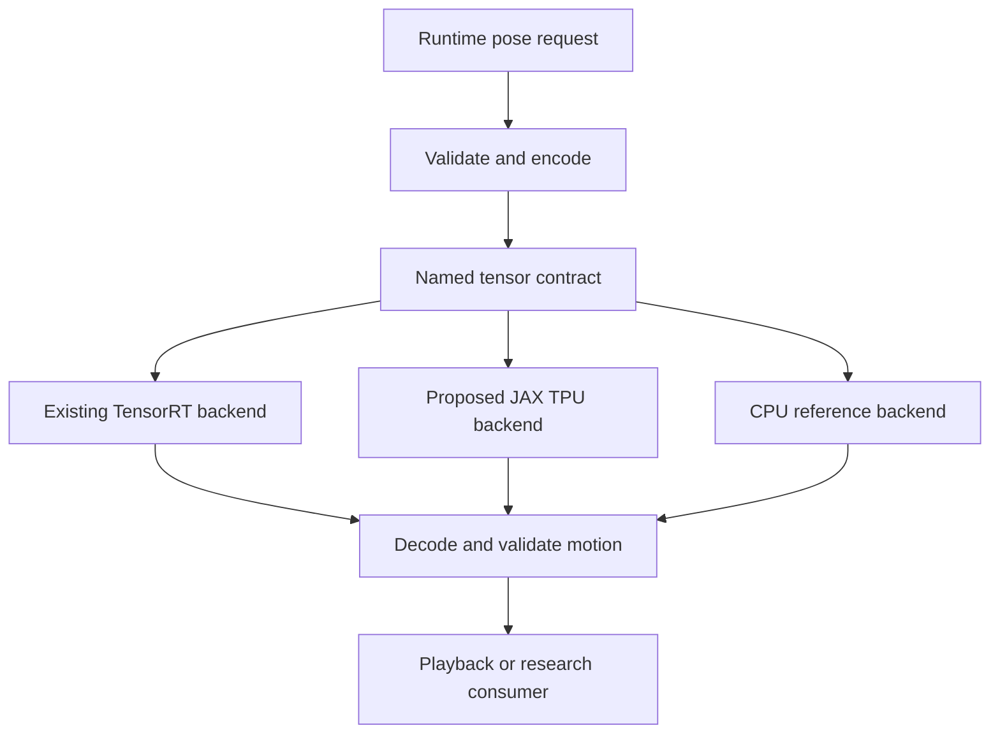

# TPU backend integration protocol

Status: proposed architecture, version 0.1, 2026-11-01.
Requested by Mengcheng Wu (Windy Wu); engineering draft prepared with AI assistance.

TPU means Tensor Processing Unit, initially targeting Google Cloud TPU through
JAX/XLA. This document defines admission requirements for a future backend. It
adds no TPU implementation, converted weights, hardware support claim, or cloud
resource. Edge TPU and other vendors' similarly named accelerators are out of scope.

## 1. Baseline and decision

Reviewed fork base: `ef100d9bf1c0b9504d98ed9abe91ac6413111e73`, including merged
CPU-preflight PR #1. Relevant existing interfaces:

- [ONNX inference](onnx_inference.md): batched graph inputs/outputs and CPU ONNX
  Runtime reference example. The bundled interactive engines require CUDA;
  the documentation separately permits direct graph execution through other runtimes.
- [InferenceEngine](../motionbricks/inference/engine.py): TensorRT plans, persistent
  Warp CUDA buffers, CUDA streams and graph capture.
- [MotionBricksEngine](../motionbricks/model/engine.py): inherits that engine and
  performs encoding, decoding, alignment and endpoint correction on Warp buffers.
- [Exporter](../tools/onnx/README.md): original model code, SafeTensors checkpoints,
  normalization statistics, and checksum checks.
- [CPU preflight](preflight.md): environment/pose validation, not model inference.

**Decision:** introduce a backend-neutral graph boundary and a separate motion
adapter in a future implementation. Start with G1, batch size 1, then SOMA. Prefer
an explicit source-model port into JAX using verified checkpoint weights; evaluate
an ONNX conversion route only after an operator-coverage audit. Neither path is
currently verified. JAX's TPU support does not imply MotionBricks operator support.
StableHLO is an interchange layer, not proof that arbitrary ONNX graphs convert.

## 2. Proposed architecture



The CPU reference is proposed harness code around the documented ONNX Runtime
path, not an implemented backend in this PR. The initial TPU path must be usable
without an NVIDIA GPU. Encoding/decoding can initially run on CPU with explicit
copies; any Warp CPU operation used must be tested there. An implementation that
retains CUDA preprocessing must identify itself as a **hybrid GPU–TPU path** and
cannot claim TPU-only support. Existing demos remain on TensorRT until their
buffer, scheduling and lifecycle assumptions are refactored and tested.

| Proposed component | Responsibility | Required boundary |
| --- | --- | --- |
| Pose adapter | Units, joint order, masks, world/model transforms | No hidden CUDA imports in TPU-only path |
| Graph backend | Compile/load and execute named tensors | No robot control or pose interpretation |
| Output adapter | Decode, trim, correct, restore world placement | Shared semantic tests across backends |
| Capability report | Versions, actual device, supported shapes/precision | Distinguish detection, compilation and inference |
| Host application | Playback, request deadlines, state/history | Reject stale outputs; own safety and control policy |

Proposed graph API (names are design requirements, not available Python symbols):

- `capabilities()` returns actual backend/device identity, supported rig/precision,
  fixed batch buckets, software versions and evidence level.
- `compile(model_artifact, contract, options)` validates hashes and builds/loads a
  device-specific executable; unsupported operations fail with a structured report.
- `run(named_host_arrays)` validates shapes/dtypes, explicitly transfers inputs,
  waits for completion, and returns host arrays owned by that request. Start with
  synchronous semantics; do not simulate Warp streams or CUDA pointers.
- `close()` releases owned resources; repeated close is safe. Calls after close
  fail. A compile/inference error must never silently switch to CPU or TensorRT.

Partition logical requests from accelerator buffers. Preserve request ID, model
hash, rig, coordinate convention, transform, precision policy and deadline in host
metadata. A backend cannot change models, rig, or precision within one compiled
session. Concurrent requests require isolated buffers or serialized execution.

## 3. Tensor and pose contract

The checked-in JSON manifests remain authoritative for names, non-batch dimensions
and dtypes: [SOMA](../motionbricks/assets/onnx/soma/soma_n1.json) and
[G1](../motionbricks/assets/onnx/unitree_g1/unitree_g1_n1.json). They describe N=1;
only the leading batch dimension is generalized for the graph interface.

| Property | Required semantics |
| --- | --- |
| Runtime context / target | Exactly 4 context frames; 1–4 target frames |
| Graph target capacity | Always 4; reproduce existing packing and masks for fewer targets |
| Batch | Same positive N for every input; initial fixed buckets N=1, later 8 and 16 |
| Floating interfaces | FP32, including mixed-precision implementations |
| Masks | INT32, only 0 or 1; preserve each mask's meaning |
| Allowed lengths | INT32 `[N,11]`, counts 6–16; at least one enabled per request |
| Output capacity | 64 raw frames; per-request valid length is `4 * pred_num_tokens` |
| Runtime valid length | Trim 3 frames at each end: `4 * pred_num_tokens - 6`, or 18–58 |
| Coordinates | SOMA local XYZ+XYZW, Y-up model space; G1 root XYZ+XYZW plus 29 radians, Z-up/+X-forward |
| Contacts | G1 separate raw output; SOMA embedded in motion features; runtime clipping follows existing decode |

SOMA's runtime transforms are not its `[N,8,267]` ONNX feature input. G1 runtime
poses are not its source CSV's centimeters/degrees. Preserve alignment, masks,
normalization, root restoration, quaternion sign equivalence and endpoint
correction. Compare raw graph outputs **before correction** as well as decoded
outputs; correction must not conceal a faulty model port. Ignore unused padded
output frames when calculating numerical errors.

The initial precision policy is FP32 interface and an explicitly recorded compute
policy. Do not infer arithmetic precision from array dtype alone: record JAX/XLA
matmul settings and actual lowering where available. BF16 is a separate experiment,
not a rename of the bundled mixed-FP16 model. It requires its own quality gate.

## 4. Conversion and dependency admission

Before implementing a converter, inventory operators, shapes, loops/conditionals,
indexing/gather, codebook selection, reductions, normalization and any custom calls
from the actual hydrated graph/source. Record each operator as supported, rewritten
with parity tests, or blocking. Port checkpoint layout, normalization arrays and
selection/tie-breaking behavior explicitly. Never replace an unsupported operation
with an approximation without declaring a new model variant and validating it.

Store source commit, checkpoint SHA-256, ONNX SHA-256, manifest hash, port/converter
commit, compile options and converted artifact hash. Retain the repository's model
and sample-data notices; do not assume code licensing also covers weights or clips.

Use an isolated optional TPU environment. Future packaging must split the current
unconditional TensorRT dependencies so installing a TPU backend does not install
CUDA components. Do not run the root `uv sync` as a claimed TPU-only installation.
Pin an actually tested Python/JAX/jaxlib/libtpu combination and record the TPU type,
topology, host OS and runtime image; no version compatibility is asserted here.

Keep TPU compilation caches separate from `.trt-cache`. Cache keys include artifact
and manifest hashes, framework/runtime/compiler versions, accelerator type,
precision policy, fixed shape bucket and sharding configuration. Reject stale or
untrusted cache artifacts. Multi-host execution is deferred until single-host
correctness and request independence pass.

## 5. Validation gates and skip policy

These gates are a future implementation contract. The only executable checks
supplied today are the existing CPU-preflight/example-source tests in section 7.

| Gate | Evidence required to advance | Missing hardware/dependency behavior |
| --- | --- | --- |
| G0: offline contract | Pose/config validation; synthetic fixtures; adapter shape/mask/error tests | Runs on CPU; no TPU import |
| G1: CPU reference | Hydrated real weights; direct ONNX reference outputs; deterministic fixture hashes | Report BLOCKED if dependencies/assets absent |
| G2: port parity | Port on CPU vs reference, raw and decoded; operators audited | Never report TPU execution |
| G3: TPU execution | Explicit TPU device, compilation, synchronized real inference, numerical parity | Local opt-in may SKIP with reasons; required TPU CI must FAIL |
| G4: chained motion | Per-rig continuity/contact checks, long rollouts and batch isolation | Requires G3; record unrun cases |
| G5: performance | Warm and cold timings, memory, throughput and host overhead | No speedup claim from CPU or compile-only results |

Proposed future opt-in flag: `MOTIONBRICKS_TPU_TESTS=1`. It is **not wired up** by
this documentation PR. Without opt-in, GPU-free tests run and TPU tests should skip
before importing optional libraries. With local opt-in but no TPU, report a skip
reason; a required TPU CI job instead fails its prerequisite step. Once a TPU is
present and prerequisites pass, compile failures, unsupported operators, invalid
outputs and parity failures are test failures, not skips. CPU fallback must not
satisfy a TPU-required test. A detected TPU is only `DEVICE_DETECTED` evidence.

Initial proposed numerical acceptance thresholds, to be reviewed before collecting
results (not existing measured guarantees):

- On a fixed deterministic FP32 corpus, valid raw floating outputs must satisfy
  `abs(candidate-reference) <= 1e-4 + 1e-4*abs(reference)`. Report max/percentile
  errors by tensor; no single aggregate score may hide a failing tensor.
- Masks and predicted token counts match exactly; token counts belong to the
  request's allowed set. Instrument discrete code selection where accessible.
  Near-tie divergence blocks strict equivalence until investigated; do not simply
  relax tolerance after observing a failure. If sampling is introduced, establish
  a separate seeded/statistical protocol before claiming equivalence.
- Decoded root translation differs by at most 1 mm, quaternion angular distance
  by at most 0.1 degree (q and -q equivalent), and G1 hinge angles by at most
  0.1 degree on the same corpus. Contacts remain finite and in [0,1] after decode.
- Test both rigs, target counts 1–4, token counts 6 and 16 and mixed allowed sets,
  translations/rotations, stationary and moving requests, and malformed inputs.
  Require at least 100 fixed valid requests per rig for initial admission.
- For N=8/16, compare each request with its N=1 result and permute batch order;
  prove no cross-request state leakage. For each rig run at least 10 sequences
  of 100 chained generations; record drift, discontinuities, foot sliding and
  failures. Define scenario-specific quality limits before evaluating G4.

BF16 has no accepted tolerance yet and cannot pass by inheriting the FP32 label.
Numerical parity does not establish physical feasibility or contact-force accuracy.

## 6. Performance and deployment decision

Measure first compile, cache load, first inference and steady-state inference
separately. Warm each fixed bucket, then collect at least 1,000 synchronized
requests and report p50/p95/p99, throughput, peak memory and failures. JAX dispatch
is asynchronous: wait for device completion before stopping each timer [2]. Report
both device-only execution and end-to-end encoding, transfers, decoding, correction,
and queueing. For remote service prototypes include network delay and timeouts.
Do not compare TPU end-to-end results to the README's TensorRT plan-only timings.

Record reproducible hardware and software details, input corpus/hash, batch policy,
precision and timing method. No TPU speed advantage, real-time deadline or cost
advantage is assumed. Decide whether TPU is useful for offline batched experiments
before proposing an interactive backend. Cloud inference is not a low-level robot
servo loop. Late or mismatched responses are rejected; the host controller retains
its independently validated fallback behavior. Generated motion alone does not
certify balance, collision avoidance, actuator limits or safe physical interaction.

## 7. Reproduction and evidence for this documentation PR

On the fork after PR #1 (no project installation required):

```sh
python tools/preflight.py --model unitree_g1 --json
python -m unittest discover -s tests/preflight -v
python -m unittest discover -s tests/examples -v
```

These commands check the existing CPU-safe path. The current preflight's strict
mode evaluates **CUDA/TensorRT prerequisites**, not TPU readiness. There is no
`--backend tpu` option and no TPU inference command in this PR.

Local review on 2026-11-01: inspected the manifests, ONNX documentation, exporter,
and inheritance/buffer coupling of both engine layers. CPU unit tests: 16 passed.
Example source test: passed; two GPU generation tests: skipped by default. Checked
new relative documentation links and whitespace. No JAX/TPU install, device probe,
conversion, TPU compilation, inference or benchmark was performed. G1–G5 are
unvalidated; G0 adapter tests await implementation. No remote CI result is claimed.

Perception Theory boundary: this protocol addresses the motion-generation
component. Human-comparable force control, force sensation, temperature sensing
and thermal regulation each require independent instrumentation and experiments.
Neither environment readiness nor successful motion generation establishes them.

## 8. Reference sources

Official documentation consulted 2026-11-01; capabilities can change, so record
exact versions when implementation starts.

1. [JAX installation: Google Cloud TPU](https://docs.jax.dev/en/latest/installation.html#pip-installation-google-cloud-tpu).
   Establishes a TPU installation route, not compatibility of this model.
2. [JAX benchmarking](https://docs.jax.dev/en/latest/benchmarking.html).
   Compile/warm-up and synchronization requirements for meaningful measurements.
3. [OpenXLA StableHLO](https://openxla.org/stablehlo).
   Framework/compiler interchange concept; no ONNX conversion guarantee inferred.
