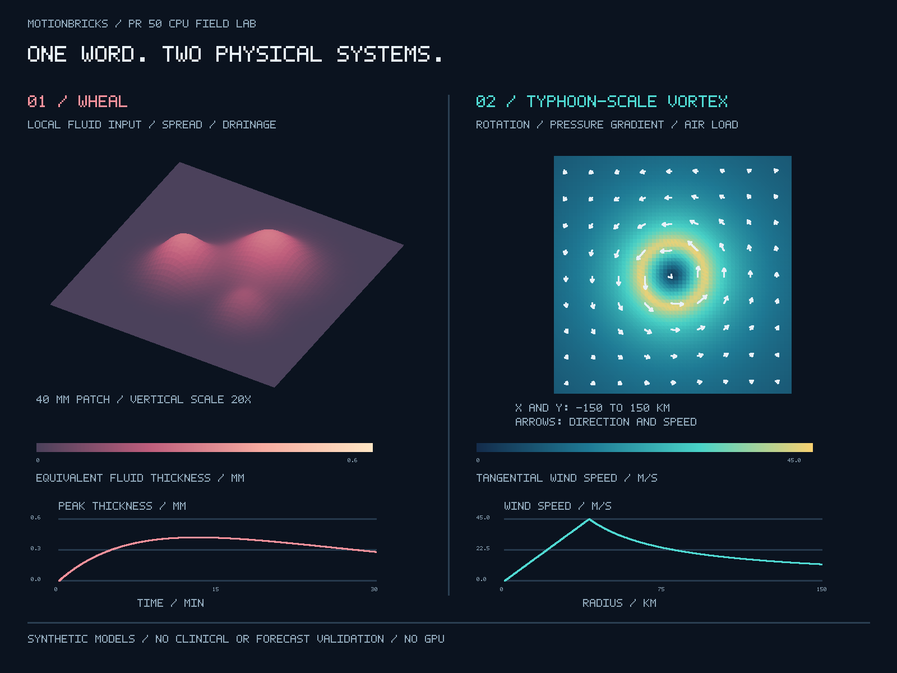

# “风团”与“台风”：同字、不同介质与机制

创意：吴孟城（Windy Wu）；研究整理与代码：AI 辅助。2026-11-08。

承接 [PR #50](https://github.com/wu709621493/motionbricks/pull/50)，本次真实调用它的 `CpuBlockRuntime`、逐顶点独立标量校验、CPU 三角形光栅化和 Z-buffer，生成下图。后续民用气象侦察机方案见 [台强 RS-72](rs72_civil_weather_aircraft_zh.md)。



## 1. 先把三个“风”分清

“风团”（wheal）也是现代皮肤科的皮损形态术语，不是中医专属词。其要点是局部浅表水肿造成的隆起；荨麻疹常出现风团，但有风团不自动等于某一病因或某一个诊断。[1,2]

中医讨论荨麻疹时常用“瘾疹”，并用“风”等概念组织传统病机与辨证。[3] 这种解释语言不等于可以用风速计测得的空气流动。这里尊重其术语背景，不把“风邪”未经验证地映射为组胺浓度、气压或某个 SI 物理量。

| 对照项 | 风团 / wheal | 台风 / typhoon |
| --- | --- | --- |
| 对象 | 皮肤局部隆起这一形态 | 热带气旋这一大气系统 |
| 主要介质 | 组织、微血管、间质液 | 湿空气及其与海洋的热量、水分交换 |
| 机制线索 | 肥大细胞等释放介质，血管通透性变化，液体进入间质 | 气压梯度、旋转、对流与水汽相变等共同作用 |
| 本原型空间范围 | 40 mm × 40 mm 的假想皮肤区域 | 300 km × 300 km 的假想水平风场 |
| 本原型输出 | 等效液体厚度 mm、体积 mm³ | 风速 m/s、静压 Pa、动压 Pa |
| 可共同使用的数学 | 场、网格、守恒检查、时间或空间尺度分析 | 场、网格、守恒检查、时间或空间尺度分析 |
| 不能据此推出 | 皮肤内有“微型台风”，或能靠测风诊断 | 一张涡旋图已完成真实台风预报 |

“阵列级强台风”在这里解释为**用二维数值数组表示强台风量级的风场**，不是新增气象等级，也不是风扇阵列已制造出台风。按中国西北太平洋及南海分级，强台风的底层中心附近最大平均风速为 41.5–50.9 m/s；相应标准指定 10 m 与 2 min 平均。[4] 本图设定 45 m/s，只借用数值量级；模型没有真实观测高度和平均时段，报告中的正式气象分类保持 `null`。

## 2. 生物物理初模：液体输入、扩散与引流

人体组胺相关研究支持风团、红晕与微血管反应之间的联系；例如 Falcone 等的 18 人实验观察到刺激后的风团—红晕时间变化，Bisgaard 等用示踪剂研究通透性和间质运输。[5,6] 这些实验不是下列参数的拟合数据；本原型也没有从相关性直接建立完整病因模型。

令 `h(x,y,t)` 为单位皮肤面积上的**额外液体体积所对应的等效厚度**，量纲 mm。它不是临床测得的表皮高度，也不是组胺浓度。演示方程由本项目自行设定：

\[
\partial_t h=D_h\nabla^2h+S_0(x,y)e^{-t/\tau_s}-h/\tau_d.
\]

第一项粗略表示横向分散，第二项表示随时间减弱的局部液体输入，第三项表示简化引流。可将其理解为输运—清除的低阶代理模型；它不求解血管壁通量、糖萼、胶体渗透压、组织弹性和淋巴管网络。渲染将 h 作为表面隆起的示意代理，并将垂直比例放大 20 倍。不能据此估计真实患者皮损高度。

| 参数 | 演示值 | 性质 |
| --- | --- | --- |
| 网格 | 64 × 64，dx = 0.625 mm | 单元中心有限差分 |
| D_h | 0.002 mm²/s | 假设的有效扩散系数，不是实测组胺扩散率 |
| 输入幅值 | 0.0015 mm/s × 三个加权高斯斑点 | 合成输入，不是诊疗阈值 |
| τ_s / τ_d | 600 / 1800 s | 假设的输入衰减 / 引流时间 |
| dt / 模拟时长 | 5 / 1800 s | 360 步，初始 h = 0 |
| 边界 | 四边零法向通量 | 不模拟液体离开计算区域 |

显式更新要求 `dt × (4D_h/dx² + 1/τ_d) ≤ 1`，否则拒绝。全局核验为：

\[
\sum h\,\Delta x^2=\int (\text{输入量}-\text{引流量})\,dt.
\]

默认运行在 30 min 得到峰值等效厚度约 **0.2801 mm**、等效体积 **61.5694 mm³**，体积平衡残差约 `8.53e-14 mm³`。这些是模型计算值，不是患者数据。图中时间曲线先升后降；该形状由假设方程产生，尚无临床验证。

## 3. 空气动力学初模：旋转、气压梯度与动压

用北半球逆时针 Rankine 涡作为稳态、轴对称示意：

\[
v_\theta(r)=\begin{cases}V_m r/R_m,&r\le R_m\\V_mR_m/r,&R_m<r\le R_o.\end{cases}
\]

设 `V_m=45 m/s`、`R_m=40 km`、`R_o=300 km`、`ρ=1.2 kg/m³`、`f=5×10⁻⁵ s⁻¹`、外边界气压 `101000 Pa`。由梯度风平衡积分得到静压：

\[
\frac1\rho\frac{dp}{dr}=\frac{v_\theta^2}{r}+fv_\theta.
\]

这是低阶径向力平衡，不是完整 Navier–Stokes 或热带气旋模式。[7] 外半径必须有限，否则该外区速度形式与科里奥利项导致压力积分对无穷远边界不收敛。模型在 r = 0 显式保持速度为零；R_m 的折角也不被解释为真实眼墙结构。

动压单独计算为 `q = ρv²/2`。[8] 默认解析峰值为 **1215 Pa**；中心静压约 **98320 Pa**。**动压不是中心气压降，不能把这两个数互相替代。** 本模型不含边界层摩擦、海面通量、凝结加热、降雨、垂直速度、地形、路径或非轴对称结构；箭头是速度矢量，不是云纹理。

## 4. 执行与验证

```bash
# 使用独立环境；不安装仓库根目录的 CUDA / TensorRT 依赖。
python -m venv .venv-weather
. .venv-weather/bin/activate
python -m pip install -r tools/memory_lab/requirements.txt
OPENBLAS_NUM_THREADS=1 python -m motionbricks.wheal_typhoon \
  --out-dir /tmp/wheal-typhoon-new-run
OPENBLAS_NUM_THREADS=1 python -m motionbricks.rs72 \
  --out-dir /tmp/rs72-new-run
python -m unittest discover -s tests/weather_concepts -v
```

输出目录必须不存在；程序不会覆盖以前的证据。实际默认证据：[JSON](results/wheal_typhoon/report.json)。渲染含 **8192 个逐个验证的顶点、15876 个三角形、2048 次 CPU block launch**。图片由代码计算，不是生成式插画。

这次复用的是 PR #50 的**变换与光栅器**，没有重新运行其 1000 分片内存压力实验或受监督内存 worker，没有物理 DIMM、GPU 或全缓存占用结论。方程推进是 NumPy CPU 数组计算。`PASSED` 只表示本次数值和渲染核验成功。

新增 21 项测试同时覆盖本模型与 RS-72，包括零输入、零通量守恒、连续余弦解的网格收敛、全局体积 ODE 时间步收敛、涡心与峰值、径向力平衡、速度方向、梁载荷积分、刚度与韧性独立变化、阵风正负号及不可覆盖输出。Python 3.12.14 / NumPy 2.3.5 与 Python 3.13.5 / NumPy 2.2.4 均通过；跨平台结果另看 PR CI。

## 资料与证据角色

1. [2026 国际荨麻疹指南](https://pubmed.ncbi.nlm.nih.gov/41649409/)：疾病定义与肥大细胞相关机制；不是数值参数来源。
2. [中华医学会：来去匆匆的神秘风团](https://www.cma.org.cn/art/2024/7/2/art_4584_57381.html)：中文术语与诊断边界。
3. [龙港街道社区卫生服务中心：中医辨证介绍](https://www.yantai.gov.cn/art/2024/4/17/art_95621_3189098.html)：仅用于中医术语语境，不作为本模型疗效证据。
4. [GB/T 32935—2025 全球热带气旋等级](https://www.cma.gov.cn/zfxxgk/gknr/flfgbz/bz/202512/P020251225481860646746.pdf)：表 1 及 10 m、2 min 口径。
5. [Falcone et al., 2017, DOI 10.1159/000477416](https://pubmed.ncbi.nlm.nih.gov/28746926/)：人体组胺刺激研究。
6. [Bisgaard et al., 1985, DOI 10.1111/1523-1747.ep12265527](https://pubmed.ncbi.nlm.nih.gov/3889168/)：人体通透性与间质运输研究。
7. [Chavas, Reed & Knaff, 2017](https://repository.library.noaa.gov/view/noaa/27611)：梯度风平衡与风压关系；本项目的 Rankine 参数为自行设定。
8. [NASA Glenn：Dynamic Pressure](https://www1.grc.nasa.gov/beginners-guide-to-aeronautics/dynamic-pressure/)：动压定义。
