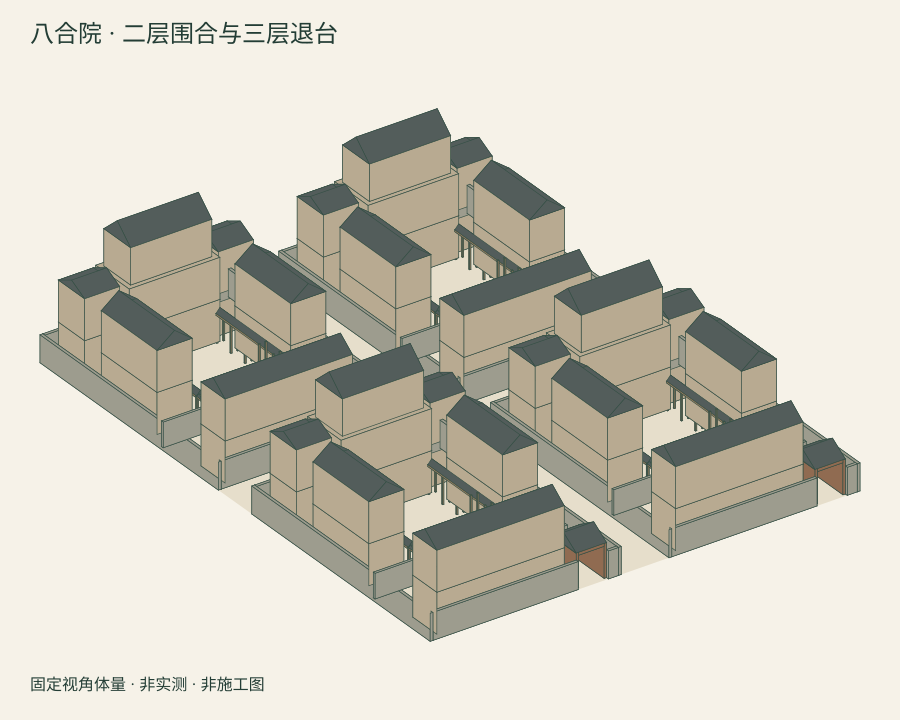

# 八合院：当代二三层体量概念

构想：吴孟城（Windy Wu）；AI 辅助实现。2026-11-10，概念号 MB-BJ-BHY-C2026-001，版本 0.1.0。

这里将用户提出的“八合院”具体定义为**四个两进模块、共八个露天院落**，不是历史建筑分类术语。原 PR #42 的20构件、4史料和约1900年的源数据保持原样。新方案在54 × 70 m的假想场地重组空间，不能解释为给某座现存古宅直接加层。



## 最简单的看法

直接看上图，再点 [一层与八个院落](output/plan.svg)、[二层](output/floor2.svg)、[三层退台](output/floor3.svg) 或 [去屋顶体量](output/massing-no-roofs.svg)。这些是静态图片，不需要拖动或设置。

下载整个 `output` 目录后打开 [图册入口](output/index.html)，即可看图、查构件和下载模型。要旋转再选 [交互实验版](output/interactive.html)；它的实际浏览器验收仍未完成。

## 构件开发

| 分类 | 记录数 | 本版内容 |
|---|---:|---|
| 一层衍生构件 | 80 | 4 × 原20种构件；保留 source_element 映射，楼房高度改为当代设定 |
| 二层体量 | 24 | 每模块正房、东西厢房、倒座及两耳房，共6处 |
| 三层退台体量 | 4 | 每模块正房上方一处；四边退0.6 m |
| 竖向交通预留空间 | 8 | 每模块两处，只有包络位置，尚无可通行楼梯 |
| 合计 | **116** | 108条实体构件记录 + 8条空间预留；不等于116个独立网格 |

一层与二层的层高均假设为3.6 m，三层体量高3.2 m，正房屋脊最高11.9 m。两排两列模块间各留6 m间距；**6 m并非消防、疏散或规划合规结论**。八个院落是明确登记的露天矩形空缺，不按楼层重复计数。

二三层体量只在下层建筑投影内布置。此几何约束没有验算柱、梁、楼板、基础、抗震或实际荷载。坡顶移至最上层；三层正房采用退台。现版本有四个独立模块的院内门廊；跨模块入口与步行连通路线尚未设计，不能把模块间空地当作已验证的出入口。

竖向交通预留在静态楼层图中用虚线表示；可选交互版还能选中查看粉色虚线包络。它们不进入OBJ或场景实体，避免把“空间预留”伪装成已建楼梯。所有房屋仍是封闭体量，没有室内可行走空间。

## 文件与复现

- 编辑 `design.json`，运行标准库生成器 `build.py`。
- `output/model.json` 保存116条记录、8个院落、网格、原始数据SHA-256和出处映射。
- `output/index.html` 默认静态图册；无JavaScript、无内嵌模型JSON，只加载一张总览图片，其他视图点链接打开。
- `output/inventory.html` 静态列出116条记录。
- `output/interactive.html` 可选交互实验版，保留旋转、楼层显示和屋顶切换。
- `output/plan.svg`、`floor2.svg`、`floor3.svg` 提供三层体量投影；`massing.svg` 和 `massing-no-roofs.svg` 提供两种固定视角。
- `concept.obj`、`concept.scene.json` 提供体量与场景包络。
- `output/manifest.json` 校验11份生成物，不包含清单自身、代码或说明。

在包含PR #42的仓库根目录运行：

```sh
python3.12 -S experiments/bahayuan/build.py
python3.12 -S experiments/bahayuan/build.py --check
python3.12 -S -m unittest discover -s tests/bahayuan -v
python3.13 -S experiments/bahayuan/build.py --check
python3.13 -S -m unittest discover -s tests/bahayuan -v
```

测试覆盖116条唯一记录、8个院落、来源保留、上下层几何包络、最高屋脊、院落被遮挡的拒绝、模块重叠与非法坐标的拒绝、退台过量的拒绝、未验证属性保护、竖向预留不混入实体、确定性及SHA-256。**上下层包络测试不是结构试验。**

## 下一阶段的设计决策

1. 细化一处样板模块的柱网、梁板、基础与材料，再讨论荷载路径及抗震；当前没有给出施工用截面。
2. 把竖向预留细化为实际楼梯、平台、门洞和无障碍方案；结合人数与用途审查疏散，不能仅用两个包络证明合规。
3. 设计模块间入口与连续通行路线，再做几何碰撞和运行时加载测试。
4. 以选定城市、地块与使用性质核对高度、退界、保护、日照、消防和设施要求；尚未选定真实地址。
5. 细化门窗、栏杆、排水、厨卫与机电构件，且每一类单独登记，不用重复复制冒充细节复原。

## 验证边界

本次完成CPU几何、标准库测试、SHA-256、静态图册链接和无脚本检查；三层图中的构件数分别为80/24/4，去屋顶图只去除屋顶面。**可选交互版尚未实际运行**；原档案的浏览器验收脚本不适用于此116条记录页面。图册的真实设备排版、可选交互版的楼层切换/键盘操作，以及MotionBricks GPU加载、人物运动和碰撞均未验收。

本次按用户要求随图册版一起整理PR，原历史档案与当代概念分别存放。代码Apache-2.0；原创文字、数据和几何CC-BY-4.0，外部史料权利独立保留。
