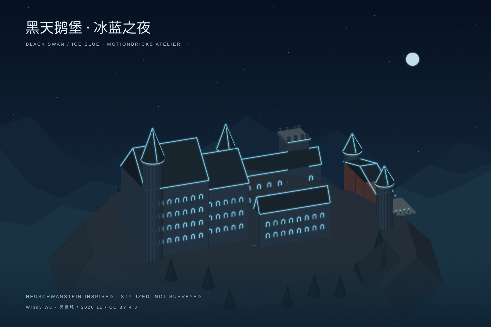

# 黑天鹅堡 · 冰蓝之夜

按吴孟城（Windy Wu）的目标，先搭一座德国城堡，再叠加冰蓝发光灯饰。
本版以 **Neuschwanstein / 新天鹅堡** 为创作原型，将“黑天鹅堡”保留为项目主题名；
默认黑曜石配色，也提供月白石墙。不是另一座真实建筑的认定或实测复原。



## 打开与继续搭建

- 下载目录后，直接打开 [output/index.html](output/index.html)：完整离线交互，无 CDN、无 GPU 运行时依赖。
- [静态夜景 SVG](output/preview.svg)：可在 GitHub 或普通图片查看器中浏览。
- [glTF 2.0](output/castle.gltf)：完整网格、法线、材质、冰蓝自发光；buffer 内嵌，单文件可导入三维软件。
- [OBJ](output/castle.obj) 与 [MTL](output/castle.mtl)：须放在同一目录；MTL 的 `Ke` 支持因软件而异。
- [模型数据](output/model.json) 与 [SHA-256 清单](output/manifest.json)：可追加构件、检查导出是否一致。
- [MotionBricks 体量预览](output/castle.envelopes.scene.json)：原编辑器的兼容入口。

交互控件包括月夜/白昼、独立灯饰开关、亮度、墙面配色、环绕视角、俯仰与复位。
鼠标拖动或方向键可以旋转，手机可以使用原生滑块。预览静止时不持续渲染。
下载文件是构建时的固定版本，网页控件不会改写导出的 glTF。

## 本版构成

582 个独立网格构件：双宫殿、圆形尖塔、方塔、红褐门楼、骑士楼与侧翼、
高低两级院落、入口路径、山脊和简化松树。门楼通道与院落没有被封闭体块填满。
冰蓝灯饰沿屋檐、屋脊、山墙、尖塔轮廓、窗拱和路径布置，独立于建筑材质。

Python 构建器复用 `tools/siheyuan/build.py` 的箱体、坡屋顶和场景序列化函数，
只用标准库，不修改旧建筑模块。网页采用 Canvas 软件深度缓冲：薄灯带在自身墙面前，
其余建筑可遮住灯带；发光后叠加视觉光晕。静态 SVG 使用遮罩处理灯饰遮挡。

glTF 按材质合并网格以减少文件体积；独立构件身份保留于模型 JSON 与 OBJ。
glTF 将本地 Z-up 转换为 Y-up，色彩从 sRGB 转成线性值；自发光使用
`emissiveFactor` 和可选 `KHR_materials_emissive_strength`，强度设为 4。
软件未支持该扩展时仍保留核心自发光色；光晕取决于目标软件的后处理设置。

现有 MotionBricks 场景格式只支持彩色立方体，本版没有改造运行时渲染器。
`castle.envelopes.scene.json` 因而仅导出非灯饰网格的包围盒；它会简化圆塔、尖顶和地形，
不包含发光或可通行室内。完整外观请使用 glTF 或网页。

## 重建与验证

```bash
python -S experiments/black_swan_castle/build.py
python -S experiments/black_swan_castle/build.py --check
python -S -m unittest discover -s tests/black_swan_castle -v
```

构建结果字节确定，不写时间戳。六项测试覆盖闭合网格与外向面、有限数值、院落/门洞留空、
灯饰分组、glTF buffer/索引/法线/坐标与发光材质、生成文件散列和输入约束。

离线浏览器复核脚本另测灯开关、实际画面变化、亮度、配色、旋转、拖动、复位、
下载、320/390/768/1440 px 布局及零外部请求：

```bash
npm install --prefix /tmp/castle-review playwright@1.62.1
/tmp/castle-review/node_modules/.bin/playwright install chromium
NODE_PATH=/tmp/castle-review/node_modules node experiments/black_swan_castle/browser_review.cjs
```

本地 Python 3.12.14：六项测试与重建核对通过；静态 SVG 经 Inkscape 转为 PNG 并人工查看。
本地 Chromium 因环境禁止其进程单例 socket 而无法启动，额外 headless shell 下载亦未完成，
**本地浏览器交互复核尚未运行**。随附脚本与独立 CI job 运行该检查，CI 结果以 PR 为准。
真实手机、GPU 渲染、原编辑器实际导入和 glTF 第三方软件导入均未实测。

## 原型依据与创作边界

| 来源 | 支持范围 | 本模型自行设定 |
| --- | --- | --- |
| [巴伐利亚宫殿管理局：建造史及建筑群平面](https://www.neuschwanstein.de/englisch/palace/history.htm) | 宫殿、门楼、方塔、骑士楼、上下院落等建筑群元素 | 尺寸、位置、比例、窗数、地形和简化几何 |
| [巴伐利亚宫殿管理局：内部与现代技术](https://www.neuschwanstein.de/englisch/palace/interior.htm) | 天鹅主题及浪漫主义背景 | 黑曜石配色、冰蓝灯饰及光晕 |

没有复制官方照片或图纸为资产；几何由参数程序生成。
本地米制尺度为艺术设定，无地理定位、建筑实测、照度/电气计算、结构或文保施工评估。
灯饰是数字场景的创作方案。

本次读取的 main 基准：`d715dc1f08bd881796526beffad5a3931e26a0ed`。
代码 Apache-2.0；原创几何及渲染 CC BY 4.0，署名 Windy Wu / 吴孟城，AI 辅助建模。
